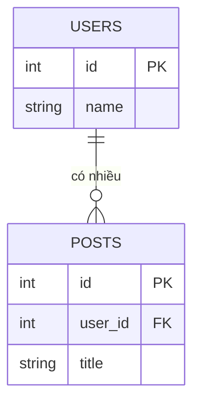
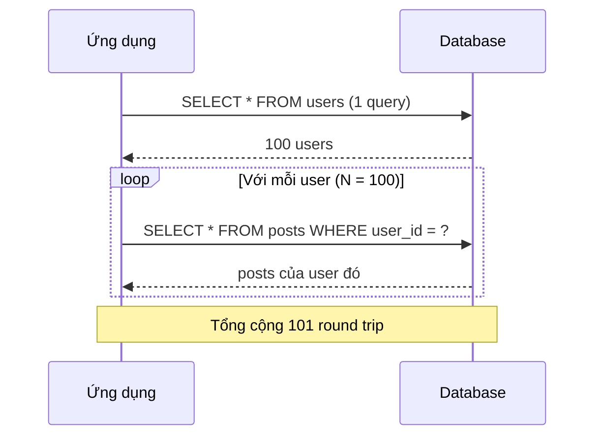
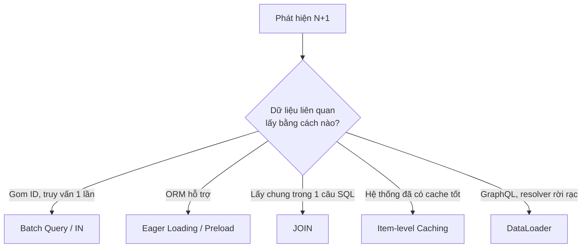
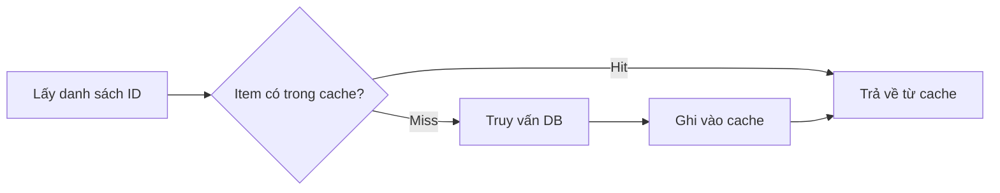

# N+1 Query Problem: có thật sự là "kẻ thù" của hiệu năng?

> **Đối tượng:** sinh viên / lập trình viên mới học Backend.
> **Mục tiêu:** hiểu N+1 là gì, vì sao nó làm chậm hệ thống, các cách khắc phục và khi nào nên chọn cách nào.

## Mục lục

1. [Mở đầu](#1-mở-đầu)
2. [Kiến thức nền cần biết](#2-kiến-thức-nền-cần-biết)
3. [N+1 Query là gì?](#3-n1-query-là-gì)
4. [Ví dụ minh họa](#4-ví-dụ-minh-họa)
5. [Vì sao N+1 gây chậm?](#5-vì-sao-n1-gây-chậm)
6. [Cách phát hiện N+1](#6-cách-phát-hiện-n1)
7. [Các cách khắc phục](#7-các-cách-khắc-phục)
8. [So sánh và cách chọn giải pháp](#8-so-sánh-và-cách-chọn-giải-pháp)
9. [Kết luận: tối ưu là sự cân bằng](#9-kết-luận-tối-ưu-là-sự-cân-bằng)
10. [Trích dẫn](#10-trích-dẫn)
11. [Mở rộng](#mở-rộng)

---

## 1. Mở đầu

Nhiều bạn dev luôn tìm cách tránh N+1 query. Vậy N+1 có thật sự là kẻ thù của hệ thống không? Hãy cùng phân tích.

![]

Câu chuyện thường diễn ra như sau: ta viết code chưa khéo, khiến ứng dụng sinh ra rất nhiều truy vấn vào cơ sở dữ liệu (CSDL) và làm giảm hiệu năng. Khi review, đồng nghiệp thường bình luận ngay: *"fix N+1"*. Nếu lỗi này lọt qua, vài tháng sau hệ thống chậm, người điều tra ra nguyên nhân sẽ thốt lên câu kinh điển: *"Ai viết đoạn code này vậy?"* 😅

## 2. Kiến thức nền cần biết

Trước khi vào chủ đề chính, hãy làm rõ vài thuật ngữ sẽ gặp trong bài:

| Thuật ngữ | Giải thích ngắn |
|---|---|
| **Quan hệ one-to-many** | Một bản ghi ở bảng này liên kết với nhiều bản ghi ở bảng khác. Ví dụ: một `user` có nhiều `post`. |
| **Khóa ngoại (foreign key)** | Cột trong bảng "nhiều" trỏ về bảng "một". Ví dụ: `posts.user_id` trỏ về `users.id`. |
| **ORM (Object-Relational Mapping)** | Thư viện cho phép thao tác CSDL bằng đối tượng trong code thay vì tự viết SQL. Ví dụ: GORM (Go), Hibernate (Java). |
| **Round trip** | Một lượt gửi truy vấn từ ứng dụng đến CSDL và nhận kết quả về. |
| **Latency (độ trễ)** | Thời gian chờ để nhận được phản hồi. |
| **Lazy loading** | Dữ liệu liên quan chỉ được truy vấn khi code thực sự truy cập đến nó. |
| **Eager loading** | Dữ liệu liên quan được tải sẵn cùng lúc với dữ liệu chính. |
| **Connection pool** | Tập hợp các kết nối CSDL được tạo sẵn để dùng lại; số lượng kết nối là hữu hạn. |

Mô hình dữ liệu dùng xuyên suốt bài viết: **một `user` có nhiều `post`** (quan hệ one-to-many).



## 3. N+1 Query là gì?

**N+1 Query Problem** là vấn đề hiệu năng xảy ra khi ứng dụng:

1. Thực hiện **1 truy vấn** để lấy danh sách bản ghi, sau đó
2. Thực hiện thêm **N truy vấn riêng lẻ**, mỗi truy vấn cho một bản ghi, để lấy dữ liệu liên quan.

Tên gọi "N+1" đến từ tổng số truy vấn: 1 truy vấn đầu + N truy vấn tiếp theo.

Vấn đề thường xuất hiện khi làm việc với quan hệ giữa các bảng, đặc biệt khi backend dùng ORM. Tuy nhiên N+1 **không chỉ có ở ORM**: viết SQL thủ công nhưng đặt truy vấn bên trong vòng lặp cũng tạo ra N+1. Với ORM dùng lazy loading, nguyên nhân thường là ứng dụng không chỉ rõ kế hoạch tải dữ liệu, nên mỗi lần truy cập quan hệ lại phát sinh một truy vấn mới [7].

## 4. Ví dụ minh họa

### 4.1. Ví dụ bằng mã giả

Giả sử cần lấy tất cả user kèm các post của từng user (cú pháp chỉ mang tính minh họa):

```
User.all.each do |user|
  user.posts
end
```

Các câu SQL sinh ra (với 3 user):

```sql
SELECT "users".* FROM "users"

SELECT "posts".* FROM "posts" WHERE "posts"."user_id" = 1
SELECT "posts".* FROM "posts" WHERE "posts"."user_id" = 2
SELECT "posts".* FROM "posts" WHERE "posts"."user_id" = 3
```

Đếm số truy vấn (không cần lôi máy tính CASIO FX-500 MS ra 😄): **4 truy vấn**.

- **1** truy vấn lấy tất cả user → đây là phần "1" trong "N+1".
- **3** truy vấn lấy post của 3 user → đây là phần "N" trong "N+1".

Với 1000 user, ta phải chạy **1001** truy vấn.

### 4.2. Ví dụ bằng SQL thuần

Backend cần một API trả danh sách user kèm các bài viết. Bước 1, lấy danh sách user:

```sql
SELECT id, name
FROM users;
```

Giả sử có 100 user. Bước 2, lấy bài viết của từng người:

```sql
SELECT id, title FROM posts WHERE user_id = 1;
SELECT id, title FROM posts WHERE user_id = 2;
-- ... tiếp tục đến user cuối cùng
```

Kết quả: 1 truy vấn lấy user + 100 truy vấn lấy bài viết = **101 truy vấn**.



### 4.3. Ví dụ bằng Go + GORM

Giả sử các model được khai báo như sau:

```go
type User struct {
    ID    uint
    Name  string
    Posts []Post `gorm:"foreignKey:UserID"`
}

type Post struct {
    ID     uint
    UserID uint
    Title  string
}
```

**Cách dễ phát sinh N+1** (truy vấn nằm trong vòng lặp):

```go
var users []User

if err := db.Find(&users).Error; err != nil {
    return err
}

for i := range users {
    if err := db.
        Where("user_id = ?", users[i].ID).
        Find(&users[i].Posts).Error; err != nil {
        return err
    }
}
```

Truy vấn đầu tiên lấy danh sách user. Sau đó mỗi user phát sinh thêm một truy vấn để lấy posts.

## 5. Vì sao N+1 gây chậm?

Nguyên nhân chính: ứng dụng giao tiếp với database **quá nhiều lần** cho **một yêu cầu logic**.

Ngay cả khi mỗi truy vấn chỉ mất vài mili-giây, hàng trăm truy vấn chạy tuần tự vẫn làm tổng thời gian tăng đáng kể. Ngoài thời gian database thực thi SQL, ứng dụng còn trả chi phí cho network round trip, xử lý kết quả và quản lý tài nguyên truy vấn.

Tóm tắt hậu quả:

- **Latency tăng vọt:** tổng thời gian = số truy vấn × thời gian mỗi lần.
- **Overhead mạng:** 101 round trip giữa App Server và Database Server (với N = 100).
- **Tải lên database:** database phải tiếp nhận và xử lý nhiều câu lệnh hơn.
- **Áp lực lên connection pool:** khi nhiều request cùng xảy ra, lượng truy vấn phát sinh làm tăng áp lực lên connection pool và database server.
- **Khả năng mở rộng (scalability) giảm:** dữ liệu càng lớn, N càng lớn, hệ thống càng chậm.

## 6. Cách phát hiện N+1

Không thể sửa thứ mình không nhìn thấy. Một số cách phổ biến:

- **Bật log SQL** và đếm số câu lệnh sinh ra cho mỗi request. Nếu thấy một câu lệnh giống hệt nhau, chỉ khác tham số, lặp lại hàng chục lần, đó là dấu hiệu rõ ràng của N+1.
- **Hibernate (Java):** bật SQL logging và Hibernate Statistics để theo dõi số truy vấn [7].
- **GORM (Go):** có thể dùng chế độ debug/logger của GORM để in các câu SQL ra console. *(Ghi chú: phần này chưa được trích nguồn trong bản viết lại; hãy đối chiếu với tài liệu GORM Logger khi áp dụng.)*

## 7. Các cách khắc phục

Ý tưởng chung: **giảm số lần gọi database** nhưng vẫn lấy đủ dữ liệu.



### 7.1. Batch Query với `IN (...)`

**Batch Query** là lấy dữ liệu liên quan cho **nhiều bản ghi trong một truy vấn** thay vì từng bản ghi một. Đây là ý tưởng cốt lõi mà eager loading thường dùng, nhưng bạn cũng có thể tự triển khai nếu dùng SQL thuần hoặc không muốn phụ thuộc vào tính năng của ORM.

Thay vì:

```sql
SELECT * FROM posts WHERE user_id = 1;
SELECT * FROM posts WHERE user_id = 2;
SELECT * FROM posts WHERE user_id = 3;
```

hãy gom các user ID rồi truy vấn một lần:

```sql
SELECT * FROM users;
SELECT * FROM posts WHERE user_id IN (1, 2, 3);
```

Chỉ còn **2 truy vấn**: một để load toàn bộ user, một để load các post tương ứng. Sau đó ứng dụng gom post theo `user_id` trong bộ nhớ và gắn vào từng user.

Ví dụ tự triển khai bằng Go:

```go
var users []User
if err := db.Find(&users).Error; err != nil {
    return err
}

// 1. Gom ID
ids := make([]uint, 0, len(users))
for _, u := range users {
    ids = append(ids, u.ID)
}

// 2. Một truy vấn duy nhất cho tất cả posts (tránh IN rỗng)
var posts []Post
if len(ids) > 0 {
    if err := db.Where("user_id IN ?", ids).Find(&posts).Error; err != nil {
        return err
    }
}

// 3. Gom theo user_id rồi gắn lại
postsByUser := make(map[uint][]Post, len(users))
for _, p := range posts {
    postsByUser[p.UserID] = append(postsByUser[p.UserID], p)
}
for i := range users {
    users[i].Posts = postsByUser[users[i].ID] // user không có post → slice rỗng/nil
}
```

**Cần chú ý:**

- **Không có bài viết:** user không có post vẫn phải được xử lý (ví dụ nhận slice rỗng).
- **Tập ID rỗng:** nên bỏ qua truy vấn, tránh sinh ra `IN ()` không hợp lệ.
- **Giới hạn số tham số:** mỗi driver/database có giới hạn riêng. Ví dụ, giao thức PostgreSQL dùng chỉ số tham số 16-bit nên một truy vấn tối đa 65535 tham số [8]. Với danh sách rất lớn, hãy chia ID thành từng batch nhỏ. Kích thước batch nên chọn theo kích thước dữ liệu, giới hạn của driver và hiệu năng thực tế (đo đạc, không đoán).

### 7.2. Eager Loading (Preloading)

**Eager Loading** là tải dữ liệu liên quan một cách chủ động ngay khi truy vấn dữ liệu chính, thay vì đợi đến lúc cần mới truy vấn riêng cho từng bản ghi. Đây là cách phổ biến nhất để xử lý N+1, vì ORM tự làm giúp bạn bước batch query ở mục 7.1.

Trong GORM, dùng `Preload` [1][2]:

```go
var users []User

if err := db.Preload("Posts").Find(&users).Error; err != nil {
    return err
}
```

GORM thường thực hiện **hai truy vấn**:

```sql
SELECT * FROM users;

SELECT * FROM posts
WHERE user_id IN (1, 2, 3, 4, ...);
```

Sau đó GORM ánh xạ kết quả về đúng quan hệ của từng user. Nếu cần tải posts cho 100 user, số truy vấn cơ bản giảm từ **101 xuống còn 2** (không tính các truy vấn khác mà ứng dụng có thể thực hiện).

GORM cũng hỗ trợ `Preload` kèm điều kiện và preload lồng nhau (nested), ví dụ `db.Preload("Orders", "state = ?", "paid")` hay `db.Preload("Orders.OrderItems.Product")` [1].

### 7.3. Sử dụng JOIN

**JOIN** cho phép lấy dữ liệu của nhiều bảng trong **một** câu truy vấn, giảm N+1 truy vấn xuống còn 1:

```sql
SELECT u.id, u.name, p.id AS post_id, p.title
FROM users u
LEFT JOIN posts p ON p.user_id = u.id;
```

> Dùng `LEFT JOIN` để user chưa có bài viết vẫn xuất hiện trong kết quả.

**Trong từng framework:**

- **GORM:** tài liệu nêu rằng quan hệ *has one* có thể eager loading bằng `Preload` hoặc `Joins`, còn quan hệ *has many* được hướng dẫn dùng `Preload` [2][3].
- **Hibernate/JPA (Java):** dùng `JOIN FETCH` để lấy toàn bộ dữ liệu cần thiết trong cùng một câu query; cũng có thể dùng native query thay cho HQL (ngôn ngữ truy vấn của Hibernate) [7].

**Hệ lụy cần biết:**

- **Trùng lặp dữ liệu:** với quan hệ one-to-many, dữ liệu của bản ghi "một" bị lặp lại trên mỗi dòng kết quả. Ví dụ, một bài viết có 100 bình luận thì dữ liệu bài viết lặp lại 100 lần, tốn bộ nhớ và I/O hơn cho App Server.
- **Cartesian product khi JOIN nhiều collection:** nếu JOIN đồng thời nhiều quan hệ "nhiều" (ví dụ một bài viết vừa có comments vừa có tags), số dòng kết quả nhân lên theo M × N [4][6]. Hibernate thậm chí ném `MultipleBagFetchException` khi bạn cố `JOIN FETCH` đồng thời nhiều collection kiểu `List` (bag) [4][11]. Cách an toàn là tải **mỗi lần một collection** (nhiều truy vấn nhỏ) [4].
- **Phân trang (pagination) dễ sai:** `JOIN FETCH` có thể trả về dòng cha trùng lặp và gây lệch phân trang [7].
- **Khó cache:** tập kết quả lớn và thay đổi thường xuyên nên khó cache toàn bộ.

### 7.4. Item-level Caching (một chiến lược khác)

Khi hệ thống đã có lớp cache mạnh (Redis, Memcached, hoặc in-memory cache phân tán), N+1 có thể **không còn là vấn đề**, mà trở thành một chiến lược truy cập dữ liệu hợp lý: **1 truy vấn (danh sách) + N lượt tra cache**.

**Cách hoạt động:**

1. **Truy vấn (1):** lấy danh sách ID cơ bản, ví dụ `SELECT id FROM posts WHERE ...`. Truy vấn này nhanh, nhẹ và có thể cache toàn bộ trang.
2. **Truy vấn (N):** với mỗi item, thay vì gọi DB, gọi cache, ví dụ `cache.Get(authorID)`.
   - **Cache hit** (trường hợp phổ biến): nhanh hơn nhiều so với đi tới DB, vì không phải truy vấn database.
   - **Cache miss** (lần đầu): chỉ item đó phải gọi DB, sau đó được đưa vào cache cho các lần sau.

> **Ghi chú:** bản gốc nêu độ trễ cache ở mức micro-giây (< 1ms). Con số này đúng với in-memory cache trong cùng tiến trình; với Redis/Memcached vẫn có một network round trip (tới cache server), nên độ trễ thực tế phụ thuộc hạ tầng và cần đo đạc.



**Ưu điểm:** phù hợp với dữ liệu ít thay đổi.

**Nhược điểm:**

- Dữ liệu trong cache phải được cập nhật/vô hiệu hóa (invalidate) liên tục khi dữ liệu gốc thay đổi.
- Nếu cập nhật trễ, người dùng có thể đọc phải dữ liệu cũ.
- Không phù hợp với dữ liệu biến động nhanh như bình luận (comment), đánh giá (rating)...

→ Lựa chọn này cũng tùy từng bài toán.

### 7.5. DataLoader (thường dùng với GraphQL)

Trong GraphQL, mỗi field có một resolver chạy độc lập và không có cơ chế tự gom nhóm, nên N+1 rất dễ xảy ra ở các field lồng nhau [9]. **DataLoader** là thư viện giải quyết vấn đề này bằng **batching** (gom nhiều yêu cầu trong cùng một lượt xử lý thành một truy vấn) và **caching** (trong phạm vi một request) [9][10].

Lưu ý quan trọng: tạo DataLoader **riêng cho mỗi request**, để tránh lộ dữ liệu giữa các người dùng [9][10].

## 8. So sánh và cách chọn giải pháp

| Giải pháp | Số truy vấn (ví dụ 100 user) | Ưu điểm | Hạn chế |
|---|---|---|---|
| Batch Query `IN` | 2 | Đơn giản, kiểm soát được, không phụ thuộc ORM | Tự gom dữ liệu; cần chia batch nếu danh sách rất lớn |
| Eager Loading (`Preload`) | 2 | Ngắn gọn, ORM lo phần gom dữ liệu | Phụ thuộc tính năng ORM |
| JOIN | 1 | Một lần round trip | Trùng lặp dữ liệu, Cartesian product, khó phân trang/cache |
| Item-level Caching | 1 + N lượt tra cache | Rất nhanh nếu cache hit | Phải xử lý invalidation; dữ liệu có thể cũ |
| DataLoader | 2 (gom theo lượt xử lý) | Hợp với GraphQL resolver | Cần cấu hình đúng phạm vi theo request |

**Gợi ý thực hành:**

- Đánh index cho cột khóa ngoại dùng để JOIN/lọc (ví dụ `posts.user_id`); ORM không thể bù đắp việc thiếu index [7].
- Luôn **đo** trước và sau khi tối ưu thay vì đoán.

## 9. Kết luận: tối ưu là sự cân bằng

Trong thiết kế hệ thống hiện đại, database thường là nút thắt cổ chai đắt đỏ nhất. Tuy nhiên không có chiến lược nào luôn đúng: khi cần JOIN, ta vẫn dùng; khi cần N+1 (ví dụ kết hợp cache), ta vẫn dùng. Tìm phương án tối ưu cho từng bài toán chính là mục tiêu của người làm dev chúng ta. 🙂

---

## 10. Trích dẫn

1. GORM Docs, *Preloading (Eager Loading)*: https://gorm.io/docs/preload.html
2. GORM Docs, *Has Many*: https://gorm.io/docs/has_many.html
3. GORM Docs, *Has One*: https://gorm.io/fr_FR/docs/has_one.html
4. Vlad Mihalcea, *The best way to fix the Hibernate MultipleBagFetchException*: https://vladmihalcea.com/hibernate-multiplebagfetchexception/
5. Vlad Mihalcea, *Spring Data JPA MultipleBagFetchException*: https://vladmihalcea.com/spring-data-jpa-multiplebagfetchexception
6. jOOQ Blog, *No More MultipleBagFetchException Thanks to Multiset Nested Collections*: https://blog.jooq.org/no-more-multiplebagfetchexception-thanks-to-multiset-nested-collections/
7. TO THE NEW, *Hibernate N+1 Query Problem: Causes, Solutions and Production Best Practices*: https://www.tothenew.com/blog/hibernate-n1-query-problem-causes-solutions-and-production-best-practices/
8. PostgreSQL (commit *Adjust batch size in postgres_fdw to not use too many parameters*, nêu giới hạn 65535 tham số): https://github.com/postgres/postgres/commit/cb92703384e2bb3fa0a690e5dbb95ad333c2b44c
9. GraphQL.js Docs, *Solving the N+1 Problem with DataLoader*: https://www.graphql-js.org/docs/n1-dataloader/
10. OneUptime, *GraphQL DataLoader N Plus 1*: https://oneuptime.com/blog/post/2026-02-02-graphql-dataloader-n-plus-1/view
11. Baeldung, *A Guide to MultipleBagFetchException in Hibernate*: https://www.baeldung.com/java-hibernate-multiplebagfetchexception

---

### Mở rộng

- **Lazy loading vs Eager loading** trong ORM và cách chọn chiến lược tải mặc định.
- **Batch fetching / `batch_size`** của Hibernate (tải theo lô thay vì từng bản ghi).
- **`@EntityGraph` và `MULTISET`** để lấy nhiều collection mà không sinh Cartesian product [5][6].
- **Pagination đúng cách** khi có quan hệ one-to-many (keyset pagination, phân trang hai bước: lấy ID cha rồi mới tải quan hệ).
- **Index và `EXPLAIN`/`EXPLAIN ANALYZE`** để đọc kế hoạch thực thi truy vấn.
- **Connection pooling** và ảnh hưởng của số lượng truy vấn tới pool.
- **Cache invalidation, cache-aside, write-through**; lấy nhiều key trong một lần (ví dụ multi-get) để tránh "N lượt tra cache" tuần tự.
- **DataLoader trong Go** (ví dụ các thư viện dataloader cho gqlgen/GraphQL; nên kiểm tra tài liệu của thư viện trước khi dùng).
- **Công cụ giám sát/APM** và tracing để phát hiện N+1 trên môi trường thật.
