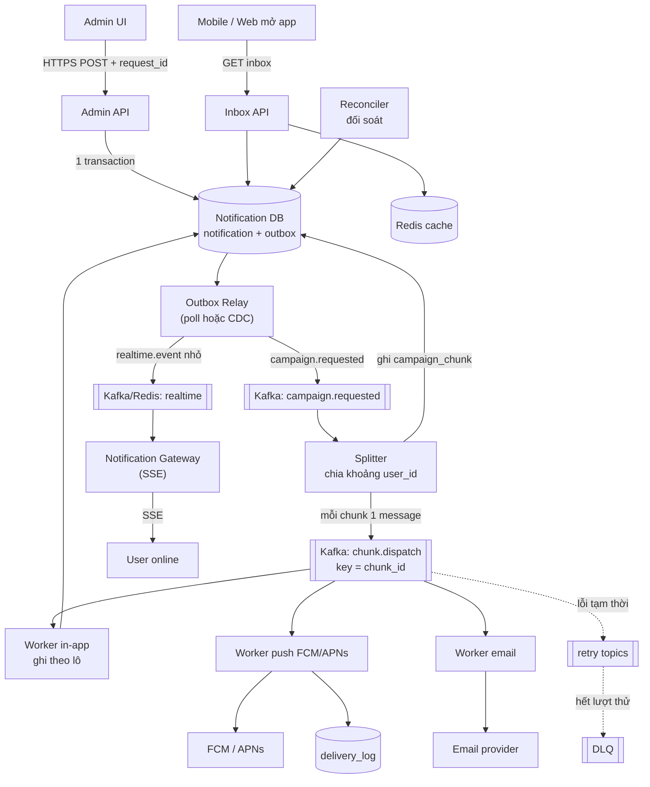

# Thiết kế hệ thống gửi thông báo (Notification) cho hàng triệu người dùng

## Mục lục

1. [Giới thiệu bài toán và mục tiêu](#1-giới-thiệu-bài-toán-và-mục-tiêu)
2. [Đánh giá ý tưởng ban đầu](#2-đánh-giá-ý-tưởng-ban-đầu)
3. [Kiến trúc đề xuất](#3-kiến-trúc-đề-xuất)
4. [Các bước triển khai chi tiết](#4-các-bước-triển-khai-chi-tiết)
5. [Cách đảm bảo không thiếu, không thừa](#5-cách-đảm-bảo-không-thiếu-không-thừa)
6. [Cách đảm bảo hệ thống ổn định](#6-cách-đảm-bảo-hệ-thống-ổn-định)
7. [Bảng đánh đổi (Trade-off)](#7-bảng-đánh-đổi-trade-off)
8. [Các lỗi thường gặp của người mới](#8-các-lỗi-thường-gặp-của-người-mới)
9. [Ví dụ code: consumer idempotent theo lô](#9-ví-dụ-code-consumer-idempotent-theo-lô)
10. [Từ điển thuật ngữ](#10-từ-điển-thuật-ngữ)
11. [Câu hỏi tự kiểm tra](#11-câu-hỏi-tự-kiểm-tra)
12. [Nguồn tham khảo và phần chưa kiểm chứng](#12-nguồn-tham-khảo-và-phần-chưa-kiểm-chứng)

---

## 1. Giới thiệu bài toán và mục tiêu

### 1.1. Bài toán

Hãy tưởng tượng một **bưu điện** phải gửi 10 triệu bức thư báo "Flash Sale 0 giờ" trong vài phút. Nếu bạn bảo một nhân viên viết từng địa chỉ rồi chạy đi bỏ thư, bưu điện sập. Bài toán thực chất là: **làm sao chia việc thật khéo để không ai bị sót, không ai nhận hai thư, và các quầy khác (đặt hàng, thanh toán) vẫn phục vụ bình thường.**

### 1.2. Bốn ràng buộc bắt buộc

| # | Ràng buộc | Nghĩa là gì trong kỹ thuật |
|---|---|---|
| 1 | Không gửi thiếu | Mọi user thuộc đối tượng nhận đều có thông báo (hoặc có bằng chứng lý do không nhận được, ví dụ token hết hạn) |
| 2 | Không gửi thừa | Không trùng (duplicate), không gửi cho user ngoài đối tượng, tôn trọng opt-out |
| 3 | Ổn định | DB, Kafka không quá tải; đặt hàng/thanh toán không bị chậm lây |
| 4 | Đánh đổi tối thiểu | Mỗi đánh đổi được nêu rõ và có lý do chấp nhận (mục 7) |

### 1.3. Giả định và ước lượng quy mô

Các con số dưới đây là **giả định để tính toán**. Hãy thay bằng số thật của hệ thống bạn rồi tính lại.

| Đại lượng | Giá trị giả định | Cách tính / lý do |
|---|---|---|
| Số user đối tượng (U) | **10.000.000** (trường hợp xấu nhất) | Đề bài nêu 1–10 triệu; thiết kế cho mức cao nhất |
| Hạn chót hiển thị in-app | **5 phút = 300 giây** | Đề bài: "vài phút" |
| Tốc độ ghi trung bình nếu ghi từng user | 10.000.000 / 300 ≈ **33.000 dòng/giây** | Chưa tính đỉnh; cần dự phòng ×2 ≈ **~70.000 dòng/giây** |
| Dung lượng 1 dòng thông báo/user | ~100 byte dữ liệu + chỉ mục + WAL ≈ **~250–300 byte** | Ước lượng thô, cần benchmark |
| Dung lượng 1 chiến dịch (nếu ghi từng user) | 10M × ~300 B ≈ **~3 GB** | 5 chiến dịch/ngày ≈ 15 GB/ngày chỉ cho thông báo |
| User bật push và có token hợp lệ | **60%** → ~6.000.000 | Giả định; cần số liệu thật |
| User đang online lúc phát hành (kết nối SSE) | **10%** → ~1.000.000 | Giả định cho giờ cao điểm sự kiện |
| Số kết nối SSE mỗi node | **~50.000** | Giả định bảo thủ cho server dùng I/O không chặn → cần ~20 node |
| Số user mở app trong 2 phút đầu sau push | 10–20% của 6M ≈ 0,6–1,2 triệu → **~5.000–10.000 request/giây vào API inbox** | Gọi là "thundering herd" (đàn trâu đổ xô), rất hay bị quên |

### 1.4. Nhận xét về giả định (có chỗ chưa hợp lý)

**Giả định "10 triệu user nhận push trong vài phút" chưa thực tế nếu chưa xin tăng hạn mức FCM.** Theo tài liệu FCM, hạn mức mặc định là **600.000 tin nhắn/phút/project**; vượt quá sẽ nhận HTTP 429 cho đến khi hạn mức nạp lại ở phút sau; nếu cần hạn mức cao hơn cho một sự kiện, cần yêu cầu trước ít nhất 15 ngày [1].

- Mặc định: 6.000.000 push / 600.000 mỗi phút = **10 phút** (chỉ khi dùng gần hết hạn mức, và hạn mức còn dùng cho các chức năng khác).
- Muốn 6 triệu push trong 3 phút → cần ~2.000.000 tin/phút → phải xin tăng hạn mức từ trước.

**Giả định thay thế đề xuất:**

- **In-app:** trong **5 phút** (làm được nhờ thiết kế ở mục 3).
- **Push/Email:** trong **10–20 phút**, hoặc 5 phút nếu đã xin tăng hạn mức trước sự kiện.

### 1.5. Quyết định dành cho bạn

Có 3 quyết định mà mình **đề xuất** nhưng **bạn là người chọn**, vì chúng phụ thuộc vào yêu cầu nghiệp vụ mà mình chưa biết. Mỗi mục đều nêu cái giá của phương án còn lại.

| Quyết định | Mình đề xuất | Phương án khác và cái giá |
|---|---|---|
| **Q1. Mô hình fan-out cho in-app** | **Hybrid** (broadcast đọc theo luật; danh sách chọn lọc ghi theo user) | *Ghi cho mọi user:* đơn giản về khái niệm, nhưng ghi ~3 GB và ~33k–70k dòng/giây mỗi chiến dịch. *Chỉ đọc theo luật:* nhẹ nhất, nhưng không dùng được khi đối tượng là danh sách tùy ý khó biểu diễn bằng luật |
| **Q2. User đăng ký mới trong lúc đang gửi** | **Đóng băng đối tượng tại thời điểm T0** (chỉ user có `id ≤ cutoff`) | *Cho user mới cũng thấy:* thân thiện hơn nhưng đối soát "đủ/thừa" phức tạp hơn |
| **Q3. Push cho broadcast toàn bộ** | **Gửi theo từng token** qua chunk | *FCM topic:* ít việc hơn cho bạn, nhưng khó chứng minh "mỗi user nhận đúng một lần" và khó đối soát từng user |

---

## 2. Đánh giá ý tưởng ban đầu

Ý tưởng của bạn gồm 3 bước. Dưới đây là đánh giá từng bước theo 3 cột: **đúng, sai, còn thiếu**.

### 2.1. Bước 1: "Admin gửi thông báo, hệ thống dùng SSE"

| | Nhận xét |
|---|---|
| **Đúng** | SSE là công nghệ tốt cho việc *đẩy sự kiện xuống client đang online* |
| **Sai** | **Nhầm hướng.** Admin gửi lệnh *lên* server, đó là một request thông thường (HTTPS `POST`), không phải SSE. SSE là kênh **một chiều từ server xuống client** |
| **Thiếu** | Xác thực/phân quyền Admin; khóa chống bấm đúp (`request_id`); xác nhận trước khi gửi (gửi nhầm 10 triệu người là sự cố nghiêm trọng); trạng thái chiến dịch (nháp → duyệt → đang gửi → xong) |

### 2.2. Câu hỏi riêng: "SSE nên đặt ở đâu?"

**Vì sao SSE không dùng cho Admin?** Hãy ví von **loa phát thanh**: loa chỉ phát từ đài xuống dân (một chiều). Admin muốn *ra lệnh cho đài* thì phải đi qua cửa đài (HTTP `POST`), không thể hét vào cái loa.

**Đặt SSE ở đâu?** Ở **tầng cuối của kiến trúc**, tại **Notification Gateway** (cụm server giữ kết nối với app/web của người dùng cuối):

- Người dùng đăng nhập → mở `GET /v1/notifications/stream` (SSE).
- Gateway nhận sự kiện từ Kafka/Redis rồi đẩy xuống các kết nối đang mở.
- SSE chỉ là **kênh "báo có tin mới" cho người đang online**, **không phải nơi lưu trữ**. Nguồn sự thật luôn là DB; nếu SSE rớt, user vẫn thấy thông báo khi lấy inbox (mục 4, bước 8).

**SSE hay WebSocket?** Thông báo chỉ cần một chiều → SSE đủ dùng và có sẵn cơ chế tự kết nối lại và `Last-Event-ID`. WebSocket phù hợp khi cần hai chiều (chat). Trên mobile, kênh chính vẫn là push (FCM/APNs) vì app có thể không chạy nền.

### 2.3. Bước 2: "Đẩy sự kiện vào Kafka, không quan tâm client online hay không"

| | Nhận xét |
|---|---|
| **Đúng** | Kafka tách người gửi khỏi người xử lý (decoupling); "không quan tâm online" là đúng, vì tin phải được lưu để user offline đọc sau |
| **Sai/Rủi ro** | Nếu hiểu là "1 sự kiện cho mỗi user" → 10 triệu message, quá thừa. Nếu **dùng `notification_id` làm key** → mọi message cùng một key đi vào **một partition duy nhất** (hot partition), các consumer còn lại ngồi chơi |
| **Thiếu** | (1) Lỗi *dual write*: ghi DB xong mà đẩy Kafka lỗi (hoặc ngược lại) → cần **Transactional Outbox**. (2) Thiết kế key/partition. (3) Retry và DLQ |

### 2.4. Bước 3: "Consumer ghi hàng triệu bản ghi vào DB, chia lô"

| | Nhận xét |
|---|---|
| **Đúng** | Chia lô (batch) là đúng hướng: một câu `INSERT` nhiều dòng giảm hàng nghìn lần số round trip |
| **Sai/Rủi ro** | Ghi 10 triệu dòng vào cùng DB với đặt hàng/thanh toán dễ làm chậm các chức năng đó (mục 2.5) |
| **Thiếu** | Khóa duy nhất để chống trùng khi consumer retry; checkpoint để chạy tiếp khi sập giữa chừng; điều tiết tốc độ ghi; đối soát |

### 2.5. Bảng rủi ro cần xử lý

| Rủi ro | Vì sao xảy ra | Hậu quả | Cách giải quyết (xem mục) |
|---|---|---|---|
| **Write amplification** (khuếch đại ghi) | Mỗi dòng ghi ra nhiều nơi: bảng + mỗi chỉ mục + WAL (nhật ký ghi) + bản sao replica | 10M dòng thành hàng chục triệu thao tác ghi; replica lag; DB chậm | Hybrid (3.1); chỉ 1 chỉ mục (3.5); cô lập DB (6) |
| **Hot partition** | Key giống nhau → cùng partition | Một consumer quá tải, phần còn lại rảnh | Key theo `chunk_id` (3.4) |
| **Consumer retry gây trùng** | Xử lý xong nhưng sập trước khi commit offset → Kafka giao lại | Gửi trùng | Idempotency nhiều tầng (5) |
| **User đăng ký mới khi đang gửi** | Danh sách user thay đổi theo thời gian | Thiếu hoặc thừa tùy thời điểm đọc | Đóng băng đối tượng tại T0 (bước 3) |
| **User offline** | Không có kết nối SSE | Mất tin nếu chỉ dựa vào realtime | Lưu DB; đồng bộ khi mở app (bước 8) |
| **Message khổng lồ** | Nhét 10 triệu ID vào một message | Vượt giới hạn kích thước message của Kafka (mặc định khoảng 1 MB) | Chỉ gửi "mô tả công việc" (khoảng ID) |
| **Poison message** | Message luôn gây lỗi | Chặn cả partition nếu retry tại chỗ | Retry topic + DLQ (bước 6) |
| **Admin bấm hai lần** | Mạng chậm, bấm lại | Hai chiến dịch giống nhau | `request_id` duy nhất (bước 1) |
| **Thundering herd** | Triệu người mở app cùng lúc sau push | API inbox quá tải | Cache (bước 8) |
| **User opt-out/bị khóa** | Trạng thái thay đổi giữa lúc tạo chiến dịch và lúc gửi | Gửi thừa | Kiểm tra điều kiện *lúc gửi* (bước 5) |

---

## 3. Kiến trúc đề xuất

### 3.1. So sánh các hướng fan-out

**Fan-out** nghĩa là "tỏa ra": từ 1 thông báo của Admin, tạo ra thứ gì cho 10 triệu người. Ví von **nhà hàng**:

- **Fan-out on write** (ghi lúc gửi): bếp *chép sẵn* 10 triệu tờ thực đơn và đặt lên từng bàn. Khách ngồi vào là có ngay, nhưng bếp phải chép rất nhiều.
- **Fan-out on read** (ghi một bản, đọc lúc xem): bếp dán **1 tờ thực đơn lên bảng**; khi khách vào thì tự nhìn bảng, và chỉ ghi chú riêng "khách này đã xem đến đâu".
- **Hybrid:** dán bảng cho món chung, đặt thực đơn riêng cho khách VIP.

| Tiêu chí | A. Ghi cho từng user | B. Lưu 1 bản + đọc theo luật | C. Hybrid (đề xuất) |
|---|---|---|---|
| Số dòng ghi cho 10M user | ~10.000.000 | ~1 (+ trạng thái đọc rải rác về sau) | 1 cho broadcast; per-user chỉ cho danh sách chọn lọc |
| Tải DB lúc gửi | Rất cao (~33–70k dòng/s) | Gần như bằng 0 | Thấp |
| Dung lượng/chiến dịch | ~3 GB | Vài KB | Thấp đến vừa |
| Rủi ro "gửi thiếu" | Có (consumer lỗi, DLQ) → phải đối soát | **Không** (hiển thị là hàm của luật, không có bước gửi để lỗi) | Thấp |
| Đối tượng là danh sách tùy ý (vd user đã thêm giỏ hàng) | Làm được | Khó (không biểu diễn được bằng luật gọn) | Làm được (dùng nhánh ghi cho nhóm này) |
| Đọc inbox | Đơn giản (truy vấn theo user) | Phải gộp broadcast + cá nhân | Phải gộp (có cache) |
| Độ phức tạp | Thấp | Trung bình | Trung bình-cao |

### 3.2. Lựa chọn và lý do

**Chọn C (Hybrid):**

1. **In-app, đối tượng "tất cả user" hoặc nhóm lớn biểu diễn được bằng luật** → *fan-out on read*: lưu **1 bản ghi** `notification` kèm luật (`audience_type='ALL'`, `audience_cutoff_user_id`).
   - **Vì sao:** việc nặng nhất (ghi 10 triệu dòng) biến mất. "Không thiếu" đạt được *theo cấu trúc*: ai thỏa luật thì thấy, không có bước nào để lỗi.
2. **In-app, đối tượng là danh sách chọn lọc** (ví dụ ≤ ~100.000 user, ngưỡng này là giả định để bạn đo lại) → *fan-out on write* theo lô, đúng ý tưởng ban đầu của bạn.
3. **Push/Email** → *luôn theo từng user* qua chunk, vì mỗi thiết bị cần token riêng và nhà cung cấp (FCM, email) mới là nơi gửi thật.

> **Nếu bạn chọn A (ghi cho mọi user):** vẫn dùng toàn bộ kiến trúc dưới đây; chỉ cần cho nhánh ghi in-app chạy với mọi chiến dịch, đồng thời chuẩn bị DB ghi riêng và tăng số consumer lên theo mục 3.4.

### 3.3. Sơ đồ tổng thể



### 3.4. Thiết kế Kafka

**Nguyên tắc vàng: Kafka chuyển "mô tả công việc", không chuyển 10 triệu bản tin.**

Với U = 10M và mỗi chunk = 5.000 user → **2.000 message**. Đó chỉ là vài nghìn message nhỏ, Kafka xử lý nhẹ nhàng. Thay vì gánh dữ liệu, Kafka đóng vai "bảng phân công".

| Hạng mục | Thiết kế | Vì sao |
|---|---|---|
| Topic | `notification.campaign.requested` (ít message), `notification.chunk.dispatch` (chunk công việc), `...retry.1m/.5m/.30m`, `...dlq` | Tách luồng thấp tải và cao tải; retry không chặn luồng chính |
| Mỗi channel | Topic/consumer group riêng: `inapp`, `push`, `email` | Email chậm không kéo push chậm theo (cô lập sự cố) |
| **Partition key** | **`chunk_id`** (hoặc để producer round-robin) | Phân bố đều. **Không** dùng `notification_id` vì cùng key đi cùng partition (hot partition). Chiến dịch này không cần thứ tự giữa các user nên không cần gom key |
| Số partition | **24** cho `chunk.dispatch` | Xem phép tính bên dưới |
| Consumer group | 1 group cho mỗi channel; số consumer ≤ số partition | Mỗi partition chỉ được một consumer trong cùng group đọc → consumer thừa sẽ ngồi chơi |
| Retention | `chunk.dispatch`: 7 ngày; DLQ: 14 ngày | Đủ thời gian phát hiện sự cố cuối tuần và phát lại |
| Cấu hình độ bền | Replication factor 3, `min.insync.replicas=2`, producer `acks=all`, `enable.idempotence=true` | Mất một broker vẫn không mất message |

**Phép tính số partition (có giả định):**

- Cần ~**33.000 dòng/giây** trung bình, dự phòng ×2 → ~**70.000 dòng/giây** (nhánh ghi in-app của danh sách chọn lọc/Option A).
- Giả định mỗi worker ghi **5.000–10.000 dòng/giây** (bảo thủ, cần benchmark).
- Số worker cần = 70.000 / 5.000 = **14**.
- **24 partition** ≥ 14 worker, còn dư địa tăng, và 24 chia hết cho nhiều con số (2, 3, 4, 6, 8, 12) nên dễ chia đều.
- **Vì sao không đặt 1000 partition cho "chắc ăn"?** Quá nhiều partition tốn tài nguyên broker và làm chậm việc bầu lại leader khi sự cố. Ngược lại số partition rất khó giảm về sau, nên 24–48 là điểm bắt đầu hợp lý.

**Chọn kích thước chunk:**

| Mức | Giá trị | Vì sao |
|---|---|---|
| Chunk (message Kafka) | **5.000 user** → 2.000 chunk/10M | Nhỏ đủ để lỗi chỉ phải làm lại 5.000 user (không phải 10 triệu); đủ lớn để số message vài nghìn |
| Lô ghi DB (trong chunk) | **1.000 dòng/câu INSERT** | Một round trip cho 1.000 dòng (nhanh hơn ghi từng dòng khoảng 1.000 lần về số round trip). Nếu lô quá lớn, transaction dài, khóa lâu, replica lag. Khoảng 500–5.000 thường hợp lý; **hãy benchmark** |
| Lô gọi FCM | Theo giới hạn của API/SDK (kiểm tra tài liệu hiện hành) | Mỗi API có giới hạn riêng |

### 3.5. Mô hình dữ liệu

```sql
-- Một chiến dịch thông báo
CREATE TABLE notification (
  id                 BIGINT PRIMARY KEY,          -- ID tăng theo thời gian (Snowflake/ULID)
  request_id         UUID NOT NULL UNIQUE,         -- chống bấm đúp / retry của Admin
  title              TEXT NOT NULL,
  body               TEXT NOT NULL,
  audience_type      TEXT NOT NULL,                -- 'ALL' | 'LIST' | ...
  audience_cutoff_user_id BIGINT NOT NULL,         -- đóng băng đối tượng: user có id <= cutoff
  status             TEXT NOT NULL,                -- DRAFT | APPROVED | SENDING | DONE | CANCELED
  created_by         BIGINT NOT NULL,
  created_at         TIMESTAMPTZ NOT NULL DEFAULT now(),
  expire_at          TIMESTAMPTZ
);

-- Outbox: sự kiện chờ đẩy sang Kafka
CREATE TABLE outbox (
  id           BIGSERIAL PRIMARY KEY,
  aggregate_id BIGINT NOT NULL,
  event_type   TEXT NOT NULL,
  payload      JSONB NOT NULL,
  created_at   TIMESTAMPTZ NOT NULL DEFAULT now(),
  published_at TIMESTAMPTZ
);

-- Một "đoạn công việc": khoảng user_id [from_user_id, to_user_id)
CREATE TABLE campaign_chunk (
  campaign_id      BIGINT NOT NULL,
  chunk_id         INT NOT NULL,
  channel          TEXT NOT NULL,                  -- 'INAPP' | 'PUSH' | 'EMAIL'
  from_user_id     BIGINT NOT NULL,                -- bao gồm
  to_user_id       BIGINT NOT NULL,                -- không bao gồm
  status           TEXT NOT NULL,                  -- PENDING | PROCESSING | DONE | FAILED_RETRY | DEAD
  attempts         INT NOT NULL DEFAULT 0,
  cursor_user_id   BIGINT,                         -- checkpoint: đã xử lý đến đâu
  eligible_count   INT NOT NULL DEFAULT 0,         -- số user đủ điều kiện đã gặp
  inserted_count   INT NOT NULL DEFAULT 0,         -- số dòng thực sự ghi mới
  skipped_dup      INT NOT NULL DEFAULT 0,         -- số dòng trùng bị bỏ qua
  owner            TEXT,
  lease_until      TIMESTAMPTZ,
  PRIMARY KEY (campaign_id, chunk_id, channel)
);

-- Thông báo theo từng user (chỉ cho nhánh "ghi", không dành cho broadcast)
CREATE TABLE user_notification (
  user_id         BIGINT NOT NULL,
  notification_id BIGINT NOT NULL,
  created_at      TIMESTAMPTZ NOT NULL DEFAULT now(),
  read_at         TIMESTAMPTZ,
  PRIMARY KEY (user_id, notification_id)           -- vừa là khóa chống trùng, vừa phục vụ inbox
);

-- Mốc "đã đọc đến đâu" cho broadcast (không cần 1 dòng/thông báo)
CREATE TABLE user_inbox_state (
  user_id                   BIGINT PRIMARY KEY,
  broadcast_read_watermark  BIGINT NOT NULL DEFAULT 0
);
```

**Vì sao khóa chính là `(user_id, notification_id)` mà không tạo thêm chỉ mục?**

- Một cái khóa này *cùng lúc* làm hai việc: (1) chống trùng (ghép cặp duy nhất), (2) phục vụ truy vấn inbox "tin của user X, mới nhất trước" (vì `notification_id` tăng theo thời gian).
- Mỗi chỉ mục thêm vào là mỗi lần ghi thêm một nơi → **giảm write amplification** khi ghi hàng triệu dòng.
- Trong một chunk, ta ghi theo `user_id` tăng dần nên các lần chèn gần như tuần tự thay vì nhảy lung tung, DB đỡ vất vả hơn.

---

## 4. Các bước triển khai chi tiết

### Bước 1: Admin tạo chiến dịch (HTTPS, không phải SSE)

- **Mục đích:** nhận lệnh gửi an toàn và chống gửi hai lần.
- **Cách làm:**
  1. Admin UI sinh sẵn `request_id` (UUID) **ngay khi mở form gửi** (không phải lúc bấm nút).
  2. `POST /admin/notifications` kèm `request_id`; API kiểm tra quyền (RBAC), kiểm tra nội dung, yêu cầu **bước xác nhận** ("Bạn sắp gửi cho ~10.000.000 người").
  3. Trong **một transaction**: `INSERT notification` (status `APPROVED`) và `INSERT outbox(event_type='CAMPAIGN_REQUESTED')`.
  4. `request_id` có ràng buộc `UNIQUE`; nếu Admin bấm lần hai hay mạng retry, API bắt lỗi trùng và **trả về chiến dịch cũ** thay vì tạo chiến dịch mới.
- **Vì sao:**
  - Sinh `request_id` lúc mở form vì khi bấm hai lần, cả hai request mang *cùng* ID; nếu sinh lúc bấm, mỗi lần bấm sẽ một ID khác nhau và chống trùng vô tác dụng.
  - Ghi `notification` và `outbox` cùng một transaction để giải quyết *dual write*: không thể có "đã tạo chiến dịch mà quên báo Kafka" (xem Bước 2).

### Bước 2: Transactional Outbox đưa sự kiện vào Kafka

- **Mục đích:** đảm bảo "đã lưu chiến dịch" luôn đi đôi với "Kafka sẽ biết về nó".
- **Vấn đề (dual write):** nếu API làm hai việc rời nhau (1. ghi DB, 2. gửi Kafka), ta có thể sập giữa hai bước: DB có chiến dịch nhưng Kafka không biết, và không ai gửi thông báo.
- **Cách làm:** một **Outbox Relay** đọc bảng `outbox` những dòng `published_at IS NULL` (poll bằng `SELECT ... FOR UPDATE SKIP LOCKED`, hoặc dùng CDC như Debezium), đẩy lên Kafka, rồi đánh dấu `published_at`. Producer bật `enable.idempotence=true` và `acks=all`.
- **Vì sao:** ví von **hộp thư đi ở bưu điện**: nhân viên bỏ thư vào hộp ngay lúc nhận (cùng một động tác với việc ghi sổ), còn việc chuyển thư đi có thể làm sau, thất bại thì làm lại. Relay có thể đẩy trùng (at-least-once), vì vậy phía nhận phải khử trùng theo `campaign_id` (Bước 4).
- **Lợi ích phụ:** Kafka sập thì chiến dịch **không mất**, chỉ chậm; outbox tích lại và gửi bù khi Kafka hồi phục.

### Bước 3: Splitter chia công việc thành chunk (và đóng băng đối tượng)

- **Mục đích:** biến "gửi cho 10 triệu người" thành 2.000 việc nhỏ, độc lập.
- **Cách làm:**
  1. Nhận `CAMPAIGN_REQUESTED`; kiểm tra `notification.status` để không chạy lại lần hai (idempotent theo `campaign_id`).
  2. Lấy `cutoff = max(user.id)` tại **T0** và lưu vào `notification.audience_cutoff_user_id`. Đối tượng = user có `id ≤ cutoff`.
  3. Chia `[1, cutoff]` thành các khoảng 5.000 id: `[1, 5001)`, `[5001, 10001)`, ...; ghi vào `campaign_chunk` (status `PENDING`).
  4. Đẩy mỗi chunk thành 1 message vào `chunk.dispatch` (key = `chunk_id`).
  5. Đặt `notification.status = 'SENDING'`.
- **Vì sao đóng băng bằng `cutoff`:** user đăng ký *sau* T0 có `id > cutoff` nên bị loại ra theo một quy tắc cố định, rõ ràng. Danh sách đối tượng không thay đổi giữa chừng → đối soát "đủ/thừa" có đáp án chắc chắn (xem Q2 ở mục 1.5).
- **Vì sao chia theo khoảng id mà không đẩy danh sách id:** message chỉ chứa hai con số (`from`, `to`), nhỏ gọn, tránh vượt giới hạn kích thước message. Đổi lại, id có thể có khoảng trống (user đã xóa); worker lọc lúc xử lý.
- **Lưu ý:** Splitter đọc danh sách từ **read replica**, không đọc từ DB chính, để không ảnh hưởng đặt hàng/thanh toán.

### Bước 4: Worker nhận chunk và "chiếm" chunk (claim)

- **Mục đích:** bảo đảm mỗi chunk chỉ được một worker xử lý tại một thời điểm, và message nhận trùng không gây tác hại.
- **Cách làm:** worker chạy câu lệnh:

```sql
UPDATE campaign_chunk
SET status='PROCESSING', owner=:worker, lease_until=now()+interval '2 minutes', attempts=attempts+1
WHERE campaign_id=:c AND chunk_id=:k AND channel=:ch
  AND ( status IN ('PENDING','FAILED_RETRY')
        OR (status='PROCESSING' AND lease_until < now()) );
```

  Trả về 1 dòng → "tôi chiếm được, tiếp tục". Trả về 0 dòng → chunk đã `DONE` hoặc đang có người xử lý → **bỏ qua message này và commit offset**.
- **Vì sao:**
  - *Lease* (thời hạn thuê) giải quyết "worker sập giữa chừng": hết hạn thì worker khác chiếm lại. Lease 2 phút lớn hơn nhiều thời gian xử lý chunk bình thường (~1 giây), tránh giành nhau khi chỉ chậm chút.
  - Vẫn có khả năng một worker "zombie" (bị treo rồi sống lại) cùng làm với worker mới. Đó là lý do ta **không** dựa hoàn toàn vào lease mà còn có khóa duy nhất ở tầng dòng (Bước 5).

### Bước 5: Ghi theo lô, idempotent, có checkpoint

- **Mục đích:** thực hiện việc thật (ghi in-app / gọi push) nhanh, an toàn khi lặp lại.
- **Cách làm (cho nhánh ghi):**
  1. Lấy tối đa 1.000 user *đủ điều kiện* trong khoảng chunk, **đánh giá lúc này**: không bị khóa, còn opt-in, chưa xóa tài khoản.
  2. Xin quyền từ **rate limiter** (Bước 7) rồi chạy một câu `INSERT ... ON CONFLICT DO NOTHING` (mã ở mục 9).
  3. Cập nhật `cursor_user_id`, `eligible_count`, `inserted_count`, `skipped_dup` (checkpoint).
  4. Hết khoảng thì `status='DONE'`, **sau đó mới commit offset Kafka**.
- **Vì sao:**
  - **Đánh giá điều kiện lúc gửi** (không phải lúc tạo chiến dịch) để tôn trọng opt-out/khóa tài khoản mới nhất → không gửi thừa.
  - **Commit offset sau khi ghi xong:** thứ tự "làm rồi mới báo đã làm" nghĩa là sập giữa chừng chỉ khiến việc bị làm *lại* (at-least-once), không bao giờ làm *mất*. Việc làm lại an toàn nhờ `ON CONFLICT DO NOTHING`.
  - **Checkpoint** giúp worker mới chạy tiếp từ `cursor_user_id`, không phải làm lại cả chunk.

### Bước 6: Retry, DLQ và commit offset đúng thời điểm

- **Mục đích:** xử lý lỗi mà không chặn cả luồng và không mất việc.
- **Cách làm:**
  - Lỗi **tạm thời** (DB timeout, FCM 429/5xx): chuyển chunk sang `FAILED_RETRY`, đẩy message sang topic retry (`retry.1m` → `retry.5m` → `retry.30m`) với **exponential backoff** (chờ lâu dần) kèm **jitter** (thêm ngẫu nhiên để các worker không cùng thử lại một lúc).
  - Lỗi **vĩnh viễn** (dữ liệu hỏng, vượt số lần thử): chuyển sang **DLQ**, chunk `DEAD`, bắn cảnh báo cho người trực.
  - Trong Go, ta tự dựng các retry topic bằng cách ghi message sang topic tương ứng (hàm `publish` ở mục 9); số lần thử và thời gian chờ lưu ở `attempts` của `campaign_chunk` hoặc header của message.
- **Vì sao dùng topic retry mà không thử lại ngay trong consumer:** nếu một chunk lỗi mà worker cứ thử lại tại chỗ, cả partition bị kẹt sau nó (poison message). Chuyển sang topic khác để partition chính tiếp tục chạy. Ví von **quầy bưu điện**: thư lỗi địa chỉ được đặt sang khay "xử lý sau", không để cả hàng người đợi.
- **Lỗi của từng user** (token FCM hết hạn): **không** làm hỏng chunk; ghi `delivery_log` trạng thái `INVALID_TOKEN` và đánh dấu token để dọn. Đây là lý do "thiếu" có thể giải thích được.

### Bước 7: Kiểm soát tốc độ (rate limiting, backpressure)

- **Mục đích:** bảo vệ DB và nhà cung cấp, không cho chiến dịch "ăn" hết tài nguyên.
- **Cách làm:**
  - **Rate limiter (token bucket)** dùng chung giữa các worker (ví dụ qua Redis): giới hạn tốc độ tổng, bắt đầu ở ~30.000 dòng/giây cho nhánh ghi.
  - **Backpressure thích ứng:** nếu p99 độ trễ ghi DB > ngưỡng (ví dụ 200 ms) hoặc replica lag > 5 giây → giảm tốc (nhân 0,5); nếu ổn định → tăng từ từ (cộng thêm). Kiểu này gọi là **AIMD** (như TCP).
  - Có thể `pause()` consumer khi cần xả áp lực.
  - **Push:** tốc độ không vượt hạn mức FCM (mặc định 600.000 tin/phút/project [1]); gặp 429 thì lùi lại rồi thử tiếp.
- **Vì sao:** hệ thống không nên chạy "hết ga". Ví von **van xả nước**: mở vừa đủ để cống không tràn. Thà đến chậm vài phút còn hơn sập DB làm đặt hàng đình trệ.

### Bước 8: Realtime cho người online, đồng bộ cho người offline

- **Mục đích:** người online thấy ngay; người offline không mất tin.
- **Realtime (SSE):**
  - Khi chiến dịch bắt đầu hiển thị, Relay phát **1 sự kiện nhỏ** (`{notification_id, title}`) vào kênh `realtime` (Kafka riêng hoặc Redis Pub/Sub).
  - **Mỗi node Gateway** nhận sự kiện (mỗi node có consumer group riêng, hoặc subscribe Pub/Sub) rồi đẩy xuống các kết nối SSE đang giữ trong bộ nhớ, **có thêm độ trễ ngẫu nhiên vài giây (jitter)** để đừng đồng loạt kích hoạt 1 triệu app tải lại cùng lúc.
  - Đây là *fan-out trong bộ nhớ của từng node*, không phải 1 message cho mỗi user.
- **Đồng bộ khi mở app (người offline):**
  - `GET /v1/inbox?after=<watermark>` gộp hai nguồn: (a) bảng `user_notification` của riêng user; (b) các broadcast `audience_type='ALL'` có `id > broadcast_read_watermark` và `user_id ≤ audience_cutoff_user_id`.
  - SSE tự kết nối lại kèm `Last-Event-ID` để lấy phần đã lỡ.
- **Chống thundering herd:** danh sách broadcast gần đây **giống nhau với mọi user** (chỉ vài chục dòng) nên cache trong Redis (TTL 30–60 giây, xóa khi có chiến dịch mới); số tin chưa đọc của từng user tính từ watermark và cũng cache được. Nhờ vậy 5.000–10.000 request/giây vào inbox phần lớn không chạm DB.
- **Vì sao:** SSE chỉ là **tín hiệu nhanh**, còn DB mới là **nguồn sự thật**. Nếu coi SSE là nơi đảm bảo giao tin thì mọi lần rớt mạng đều thành mất tin.
- **Cách hiển thị đã đọc:** với broadcast, ghi trạng thái đọc *khi user đọc* (rải rác theo thời gian) hoặc chỉ cần nâng `broadcast_read_watermark` khi bấm "đã đọc tất cả", không cần 10 triệu dòng "chưa đọc".

### Bước 9: Đối soát, theo dõi và đóng chiến dịch

- **Mục đích:** *chứng minh* không thiếu, không thừa; phát hiện sớm khi sai.
- **Cách làm:** xem mục 5.4 (đối soát) và mục 6.3 (giám sát). Khi mọi chunk `DONE`, kết quả đối soát khớp, đặt `notification.status='DONE'`.
- **Vì sao:** "tin rằng đúng" khác với "kiểm tra thấy đúng". Hệ thống phân tán luôn có lỗi lạ; đối soát là lưới an toàn cuối cùng.

---

## 5. Cách đảm bảo không thiếu, không thừa

### 5.1. Vì sao "exactly-once" thực sự khó?

**Exactly-once** nghĩa là mỗi thông báo được xử lý *đúng một lần*, không hơn không kém. Trong hệ thống phân tán, điều này khó vì **mạng không đáng tin**. Ví dụ đời thường:

> Bạn chuyển tiền qua app, màn hình quay mãi rồi báo "mất kết nối". Tiền đã đi hay chưa? Bạn **không biết**: có thể ngân hàng đã trừ tiền nhưng *biên nhận* bị thất lạc trên đường về. Nếu bạn bấm chuyển lại, có nguy cơ trừ hai lần; nếu không bấm lại, có nguy cơ không chuyển.

Khi gửi một request mà không nhận được trả lời, bên gửi chỉ có hai lựa chọn:

- **Không gửi lại** → có thể **thiếu** (at-most-once).
- **Gửi lại** → có thể **trùng** (at-least-once).

Không có lựa chọn thứ ba chỉ dựa vào việc "gửi tin" (đây là hệ quả của bài toán *Two Generals* trong lý thuyết hệ thống phân tán).

**Kafka có "exactly-once" không?** Kafka có hỗ trợ ngữ nghĩa exactly-once (producer idempotent và transactions), nhưng **trong phạm vi Kafka** (đọc Kafka → xử lý → ghi Kafka). Khi tác động ra *hệ thống ngoài* như ghi PostgreSQL hay gọi FCM, ta không thể gói chúng vào cùng một transaction với Kafka, nên vẫn phải tự xử lý trùng.

### 5.2. Giải pháp thực tế: at-least-once + idempotency = "hiệu quả exactly-once"

- **At-least-once:** *chấp nhận gửi lại*, nhưng bảo đảm không bao giờ bỏ sót (làm xong mới commit offset).
- **Idempotency (tính lũy đẳng):** xử lý cùng một việc **N lần cho kết quả giống hệt xử lý 1 lần**. Ví dụ đời thường: bấm nút "gọi thang máy" 5 lần vẫn chỉ có một thang máy đến.

Kết hợp hai điều: *gửi lại thoải mái*, *kết quả chỉ tính một lần*. Ví von **thư bảo đảm**: bưu điện gửi lại nếu mất biên nhận; người nhận nhìn số thư, đã nhận rồi thì bỏ bản trùng.

### 5.3. Bốn tầng chống trùng (phòng thủ nhiều lớp)

| Tầng | Cơ chế | Chống được tình huống nào |
|---|---|---|
| 1. Chiến dịch | `notification.request_id UNIQUE` | Admin bấm hai lần, mạng retry |
| 2. Sự kiện | Splitter kiểm tra `status` theo `campaign_id`; Kafka producer idempotent | Outbox relay đẩy trùng sự kiện |
| 3. Chunk | `campaign_chunk` + claim bằng `UPDATE ... WHERE status` + lease | Kafka giao trùng message; hai worker cùng nhận một chunk |
| 4. Dòng dữ liệu | `PRIMARY KEY (user_id, notification_id)` + `ON CONFLICT DO NOTHING` | Worker zombie; chunk chạy lại từ đầu sau sập |
| (Ngoài cùng) Client | App dedupe theo `notification_id` khi hiển thị | Trùng vì push và SSE cùng báo một tin |

**Push khó hơn in-app:** gọi FCM không idempotent theo `(notification_id, user_id)`, nếu bạn gọi hai lần, thiết bị có thể nhận hai lần. Cách giảm thiểu:

1. Ghi `delivery_log(notification_id, user_id, channel)` với khóa duy nhất **trước hoặc ngay sau khi gọi**, và bỏ qua nếu đã có.
2. Dùng `collapse_key`/ID của thông báo để thiết bị gộp (tài liệu FCM mô tả cơ chế *collapsible message*; hãy kiểm tra hành vi cụ thể cho từng nền tảng trước khi dựa vào nó).
3. Client dedupe theo `notification_id`.

Vẫn còn một khe hẹp: worker gọi FCM thành công rồi sập *trước khi* ghi `delivery_log` → có thể gửi trùng một số ít tin. Đây là **đánh đổi chấp nhận được** (mục 7): ưu tiên không thiếu, và dùng tầng 2–3 ở trên để giảm tác hại.

### 5.4. Đối soát: phát hiện thiếu/thừa bằng số liệu

Không tin vào suy luận, hãy **kiểm tra bằng SQL**.

**(a) Kiểm tra phủ kín (không hở khoảng id nào → không thiếu):**

```sql
-- Mọi chunk phải nối liền nhau từ 1 đến cutoff và đều DONE
SELECT chunk_id, from_user_id, to_user_id, status,
       LAG(to_user_id) OVER (ORDER BY from_user_id) AS prev_to
FROM campaign_chunk
WHERE campaign_id = :c AND channel = 'INAPP';
-- Lỗi nếu: from_user_id <> prev_to (có hở/chồng) hoặc status <> 'DONE'
```

**(b) Kiểm tra số lượng (khớp từng chunk):**

```sql
SELECT SUM(eligible_count) AS eligible,
       SUM(inserted_count) AS inserted,
       SUM(skipped_dup)    AS duplicates_skipped
FROM campaign_chunk
WHERE campaign_id = :c AND channel = 'INAPP';
-- Kỳ vọng: eligible = inserted + duplicates_skipped
```

**(c) Kiểm tra chéo với bảng dữ liệu (chạy trên replica, ngoài giờ cao điểm):**

```sql
SELECT COUNT(*) FROM user_notification WHERE notification_id = :n;
-- Kỳ vọng: bằng tổng inserted (cộng thêm những dòng đã có từ lần chạy trước nếu có)
```

**(d) Lấy mẫu:** chọn ngẫu nhiên 1.000 user thuộc đối tượng, kiểm tra từng người có thấy thông báo (qua API inbox) hay không.

**(e) Gửi thừa:** kiểm tra không có `user_id > audience_cutoff_user_id` trong `user_notification` của chiến dịch, và không có user opt-out nhận tin sau thời điểm họ opt-out.

**(f) Push/Email:** `eligible = SENT + INVALID_TOKEN + FAILED_PERMANENT + SKIPPED_OPT_OUT`. Mỗi user thuộc đối tượng đều có *một lý do* ghi nhận. "Thiếu" chỉ hợp lệ khi có lý do.

**Khi phát hiện lệch:** Reconciler đặt chunk liên quan về `PENDING` và đẩy lại; nhờ idempotent nên chạy lại là an toàn.

### 5.5. Xử lý sự cố điển hình

| Sự cố | Điều gì xảy ra | Cách hệ thống xử lý |
|---|---|---|
| Consumer sập giữa chunk | Chưa commit offset, chunk `PROCESSING` | Hết lease → worker khác nhận lại, chạy tiếp từ `cursor_user_id`; dòng đã ghi bị `ON CONFLICT` bỏ qua |
| Kafka lỗi/mất broker | Không đẩy được sự kiện | Outbox giữ sự kiện; replication factor 3 chịu mất 1 broker; hồi phục thì gửi bù |
| DB chậm | Độ trễ ghi tăng | Backpressure giảm tốc; cảnh báo; chiến dịch hoàn thành chậm hơn nhưng không sập |
| Admin bấm gửi hai lần | Hai request cùng `request_id` | UNIQUE → trả về chiến dịch đã có |
| Relay đẩy trùng sự kiện | Splitter nhận hai lần | Kiểm tra `status` theo `campaign_id` → bỏ qua lần hai |
| FCM trả 429 | Vượt hạn mức [1] | Lùi (backoff), thử lại ở retry topic, không bỏ chunk |
| Chunk lỗi vĩnh viễn | Dữ liệu hỏng | Vào DLQ, cảnh báo, sửa rồi phát lại bằng công cụ replay |

---

## 6. Cách đảm bảo hệ thống ổn định

### 6.1. Cô lập tài nguyên (không để thông báo kéo sập thanh toán)

- **DB riêng cho Notification** (hoặc ít nhất cụm riêng), tách khỏi DB đặt hàng/thanh toán. **Vì sao:** nếu dùng chung, một chiến dịch ghi nặng sẽ giành I/O và khóa với đặt hàng.
- **Đọc từ replica:** Splitter và Reconciler đọc replica, tránh đè DB chính.
- **Pool kết nối riêng** cho worker, giới hạn số kết nối tối đa.
- **Kafka cô lập theo channel** (mục 3.4).

### 6.2. Kiểm soát tải

- Rate limiter và backpressure (Bước 7).
- Cache Redis cho inbox/số tin chưa đọc (Bước 8).
- **Giảm số lần ghi:** hybrid (mục 3.2) là biện pháp giảm tải mạnh nhất.
- **Làm việc ngoài giờ cao điểm cho tác vụ phụ:** đối soát nặng, dọn dữ liệu cũ.
- **Giới hạn kích thước/tần suất chiến dịch** (ví dụ tối đa N chiến dịch/giờ) để chống cả lỗi người dùng.

### 6.3. Giám sát

| Nhóm | Chỉ số | Ngưỡng cảnh báo gợi ý (cần điều chỉnh) |
|---|---|---|
| Tiến độ | % chunk `DONE`, tốc độ user/giây, ETA | Dự báo trễ quá hạn chót |
| Kafka | Consumer lag mỗi partition | Lag tăng liên tục > 2 phút |
| DB | p99 độ trễ ghi, replica lag, số kết nối | p99 > 200 ms; lag > 5 s |
| Lỗi | Tỷ lệ lỗi, số message ở retry topic, **độ sâu DLQ** | DLQ > 0 là cảnh báo |
| Push | Tỷ lệ 429, số `INVALID_TOKEN` | 429 kéo dài |
| Chất lượng | `skipped_dup` (số trùng bị chặn), kết quả đối soát | Tỷ lệ trùng bất thường |
| Người dùng | Độ trễ SSE, p99 của API inbox, cache hit ratio | Hit ratio giảm đột ngột |

**Vì sao theo dõi `skipped_dup`:** nó cho biết cơ chế chống trùng *đang hoạt động*. Con số này tăng đột biến có nghĩa đang có nhiều lần giao lại bất thường (ví dụ rebalance liên tục) cần điều tra.

---

## 7. Bảng đánh đổi (Trade-off)

| Lựa chọn | Lợi ích | Cái giá phải trả | Vì sao chấp nhận được |
|---|---|---|---|
| Hybrid fan-out | Giảm ghi từ ~10M dòng xuống ~1 dòng cho broadcast | Inbox phải gộp hai nguồn; logic phức tạp hơn | Chi phí nằm ở *đọc*, mà phần chung có thể cache; việc nặng nhất bị loại |
| At-least-once + idempotency (thay vì exactly-once) | Không bao giờ mất tin; đơn giản và bền | Có thể xử lý lặp (nhưng kết quả chỉ tính một lần) | Exactly-once xuyên hệ thống ngoài là không khả thi; xử lý lặp rẻ so với mất tin |
| Chia chunk 5.000 user | Lỗi chỉ làm lại 5.000 user; Kafka nhẹ (~2.000 message) | Độ trễ giữa các user (chỉ vài giây) | Đề bài chấp nhận "vài phút" |
| Rate limiter và backpressure | Bảo vệ DB, các chức năng khác | Chiến dịch hoàn thành chậm hơn tốc độ tối đa | Chậm vài phút tốt hơn sập đặt hàng/thanh toán |
| Đóng băng đối tượng tại T0 | Đối soát chính xác, không đổi giữa chừng | User đăng ký sau T0 không nhận chiến dịch này | Hợp lý về nghiệp vụ; có thể nới rộng (Q2) |
| Kiểm tra opt-out lúc gửi | Không gửi thừa cho người đã từ chối | Thêm một lần đọc/điều kiện cho mỗi user | Tránh vi phạm quyền người dùng; chi phí nhỏ |
| DB riêng cho Notification | Cô lập sự cố | Chi phí hạ tầng, thêm thành phần vận hành | Giá rẻ hơn nhiều so với sự cố thanh toán |
| Outbox | Không mất sự kiện, hết dual write | Thêm bảng, thêm tiến trình relay, độ trễ nhỏ | Độ trễ mili-giây đến giây; đổi lại độ tin cậy |
| Push có thể trùng trong khe hẹp | Ưu tiên "không thiếu" | Một lượng nhỏ push có thể trùng | Giảm bằng `delivery_log`, collapse key, dedupe ở client |
| SSE chỉ là tín hiệu, không bảo đảm giao | Gateway nhẹ, đơn giản | Người rớt mạng phải lấy lại bằng API inbox | DB là nguồn sự thật nên không mất tin |
| Cache inbox (TTL 30–60 s) | Chịu được hàng chục nghìn request/giây | Tin mới có thể hiện trễ vài chục giây ở cache | Có SSE báo ngay cho người online; có thể xóa cache chủ động khi phát hành |

---

## 8. Các lỗi thường gặp của người mới

| # | Lỗi | Hậu quả | Cách tránh |
|---|---|---|---|
| 1 | Dùng SSE để Admin gửi lệnh | Sai hướng, không dùng được | Admin dùng HTTPS `POST`; SSE chỉ xuống client |
| 2 | Dùng `notification_id` làm key Kafka | Hot partition, 1 consumer gánh hết | Key theo `chunk_id` hoặc round-robin |
| 3 | Đẩy 10 triệu ID vào một message | Vượt giới hạn kích thước | Gửi khoảng id/mô tả công việc |
| 4 | `INSERT` từng dòng trong vòng lặp | 10 triệu round trip, rất chậm. Đây chính là *N+1* (xem tài liệu N+1 trước) | Ghi theo lô; dùng `unnest` hoặc multi-row insert |
| 5 | Nhét 10 triệu tham số vào `IN (...)`/multi-row VALUES | Chạm giới hạn tham số của giao thức (ví dụ PostgreSQL 65.535) | Truyền mảng một tham số (`unnest`), chia lô |
| 6 | Commit offset *trước* khi xử lý xong | Sập là mất việc, thiếu tin | Xử lý xong, ghi DB xong rồi mới commit |
| 7 | Không có khóa duy nhất ở tầng dòng | Retry gây trùng | `PRIMARY KEY (user_id, notification_id)` + `ON CONFLICT` |
| 8 | Ghi DB và gửi Kafka riêng rẽ | Dual write → sót hoặc lệch | Transactional Outbox |
| 9 | Chạy thử lại tại chỗ cho message lỗi | Chặn cả partition | Retry topic + DLQ |
| 10 | Dùng chung DB với đặt hàng/thanh toán | Chiến dịch kéo chậm cả hệ thống | Tách DB, rate limit |
| 11 | Quên thundering herd sau push | API inbox sập khi triệu người mở app | Cache, jitter, giới hạn tốc độ |
| 12 | Coi SSE là nơi đảm bảo giao tin | Rớt mạng là mất tin | DB là nguồn sự thật; inbox đồng bộ khi mở app |
| 13 | Không đối soát, "chắc là đúng" | Thiếu/thừa không ai biết | Chạy các truy vấn mục 5.4 |
| 14 | Chiến dịch không có bước xác nhận | Gửi nhầm cho cả triệu người | Màn hình xác nhận, duyệt hai người với chiến dịch lớn |

---

## 9. Ví dụ code: consumer idempotent theo lô

> Go, dùng `pgx/v5` (PostgreSQL) và `segmentio/kafka-go` (Kafka). Mục tiêu: **xử lý một chunk, ghi theo lô, an toàn khi chạy lặp.** Đã rút gọn cấu hình và xử lý lỗi để dễ đọc; các phương thức repository chỉ nêu chữ ký khi không quan trọng.

### 9.1. Kiểu dữ liệu và câu lệnh ghi lô idempotent

```go
package notifworker

import (
	"context"
	"encoding/json"
	"errors"
	"time"

	"github.com/jackc/pgx/v5"
	"github.com/jackc/pgx/v5/pgxpool"
	"github.com/segmentio/kafka-go"
	"golang.org/x/time/rate"
)

const batchSize = 1000 // số dòng mỗi câu INSERT (xem mục 3.4)

// Mô tả một chunk công việc, đúng như message trong topic chunk.dispatch.
type ChunkTask struct {
	CampaignID     int64  `json:"campaign_id"`
	NotificationID int64  `json:"notification_id"`
	ChunkID        int    `json:"chunk_id"`
	Channel        string `json:"channel"`
	FromUserID     int64  `json:"from_user_id"` // bao gồm
	ToUserID       int64  `json:"to_user_id"`   // không bao gồm
}

// Một câu INSERT cho cả lô. unnest biến mảng ID thành nhiều dòng.
const insertBatchSQL = `
INSERT INTO user_notification (user_id, notification_id, created_at)
SELECT u, $1, now()
FROM unnest($2::bigint[]) AS u
ON CONFLICT (user_id, notification_id) DO NOTHING`

// insertBatch trả về số dòng thực sự được chèn MỚI (dòng trùng bị bỏ qua).
func insertBatch(ctx context.Context, tx pgx.Tx, notificationID int64, userIDs []int64) (int64, error) {
	tag, err := tx.Exec(ctx, insertBatchSQL, notificationID, userIDs) // []int64 được pgx mã hóa thành bigint[]
	if err != nil {
		return 0, err
	}
	return tag.RowsAffected(), nil
}
```

**Giải thích:**

- `unnest($2::bigint[])` truyền cả lô bằng **một tham số mảng** thay vì 1.000 tham số `$n`, tránh chạm giới hạn số tham số và nhẹ hơn khi truyền.
- `ON CONFLICT ... DO NOTHING`: nếu `(user_id, notification_id)` đã tồn tại thì bỏ qua lặng lẽ. Đây là mảnh ghép làm cho *chạy lại bao nhiêu lần cũng an toàn*.
- `tag.RowsAffected()` là số dòng thực sự chèn. Lấy `len(userIDs) - inserted` ta biết có bao nhiêu dòng **trùng bị chặn** (chỉ số `skipped_dup` ở mục 6.3).

### 9.2. Các câu lệnh trạng thái chunk và chọn user đủ điều kiện

```go
type Repo struct{ pool *pgxpool.Pool }

// Chiếm chunk (Bước 4). Chỉ thành công nếu chunk chưa xong và không ai đang giữ lease còn hạn.
func (r *Repo) TryClaim(ctx context.Context, t ChunkTask, worker string, lease time.Duration) (bool, error) {
	tag, err := r.pool.Exec(ctx, `
		UPDATE campaign_chunk
		SET status='PROCESSING', owner=$1,
		    lease_until=now() + $2::interval, attempts=attempts+1
		WHERE campaign_id=$3 AND chunk_id=$4 AND channel=$5
		  AND ( status IN ('PENDING','FAILED_RETRY')
		        OR (status='PROCESSING' AND lease_until < now()) )`,
		worker, lease.String(), t.CampaignID, t.ChunkID, t.Channel)
	if err != nil {
		return false, err
	}
	return tag.RowsAffected() == 1, nil // 0 dòng = đã xong hoặc đang có người làm
}

// Đọc checkpoint để chạy tiếp nếu từng sập giữa chừng.
func (r *Repo) LoadCursor(ctx context.Context, t ChunkTask) (int64, error) {
	var cursor *int64
	err := r.pool.QueryRow(ctx, `
		SELECT cursor_user_id FROM campaign_chunk
		WHERE campaign_id=$1 AND chunk_id=$2 AND channel=$3`,
		t.CampaignID, t.ChunkID, t.Channel).Scan(&cursor)
	if err != nil {
		return 0, err
	}
	if cursor == nil || *cursor < t.FromUserID {
		return t.FromUserID, nil
	}
	return *cursor, nil
}

// Cập nhật checkpoint và bộ đếm TRONG CÙNG transaction với việc ghi lô.
func saveProgress(ctx context.Context, tx pgx.Tx, t ChunkTask,
	nextCursor int64, eligible, inserted, skipped int64) error {
	_, err := tx.Exec(ctx, `
		UPDATE campaign_chunk
		SET cursor_user_id=$1,
		    eligible_count=eligible_count+$2,
		    inserted_count=inserted_count+$3,
		    skipped_dup=skipped_dup+$4
		WHERE campaign_id=$5 AND chunk_id=$6 AND channel=$7`,
		nextCursor, eligible, inserted, skipped, t.CampaignID, t.ChunkID, t.Channel)
	return err
}

// Lấy tối đa limit user đủ điều kiện trong [from, to), điều kiện đánh giá TẠI LÚC GỬI.
// (Tên cột users.is_active, is_blocked, notif_opt_in là giả định minh họa.)
func (r *Repo) FindEligibleIDs(ctx context.Context, from, to int64, limit int) ([]int64, error) {
	rows, err := r.pool.Query(ctx, `
		SELECT id FROM users
		WHERE id >= $1 AND id < $2
		  AND is_active AND NOT is_blocked AND notif_opt_in
		ORDER BY id
		LIMIT $3`, from, to, limit)
	if err != nil {
		return nil, err
	}
	defer rows.Close()

	ids := make([]int64, 0, limit)
	for rows.Next() {
		var id int64
		if err := rows.Scan(&id); err != nil {
			return nil, err
		}
		ids = append(ids, id)
	}
	return ids, rows.Err()
}

// MarkDone, MarkFailedRetry, MarkDead: UPDATE campaign_chunk SET status=... (viết tương tự TryClaim).
func (r *Repo) MarkDone(ctx context.Context, t ChunkTask) error        { /* ... */ return nil }
func (r *Repo) MarkFailedRetry(ctx context.Context, t ChunkTask) error { /* ... */ return nil }
func (r *Repo) MarkDead(ctx context.Context, t ChunkTask) error        { /* ... */ return nil }
```

### 9.3. Worker: nhận message, xử lý một chunk, commit offset đúng lúc

```go
type Worker struct {
	id      string
	reader  *kafka.Reader // GroupID đặt sẵn, CommitInterval = 0 (chỉ commit khi ta gọi CommitMessages)
	retryW  *kafka.Writer // ghi vào retry topic
	dlqW    *kafka.Writer // ghi vào DLQ
	repo    *Repo
	pool    *pgxpool.Pool
	limiter *rate.Limiter // ví dụ rate.NewLimiter(rate.Limit(30000), batchSize); burst phải >= batchSize
}

// Run: vòng lặp chính. Chạy nhiều tiến trình Worker (<= số partition) để tăng song song.
func (w *Worker) Run(ctx context.Context) error {
	for {
		msg, err := w.reader.FetchMessage(ctx) // lấy message nhưng CHƯA commit offset
		if err != nil {
			return err
		}
		if err := w.handle(ctx, msg); err != nil {
			// Ngay cả việc "giao việc sang retry/DLQ" cũng thất bại: KHÔNG commit và dừng worker.
			// Khởi động lại sẽ nhận lại message (at-least-once). Không được bỏ qua message này
			// để commit message sau, vì offset là cộng dồn theo partition.
			return err
		}
		// handle trả nil nghĩa là an toàn để báo Kafka "đã xử lý": đã DONE, hoặc bỏ qua vì trùng,
		// hoặc đã chuyển sang retry/DLQ.
		if err := w.reader.CommitMessages(ctx, msg); err != nil {
			return err
		}
	}
}

func (w *Worker) handle(ctx context.Context, msg kafka.Message) error {
	var t ChunkTask
	if err := json.Unmarshal(msg.Value, &t); err != nil {
		return w.publish(ctx, w.dlqW, msg) // message hỏng: lỗi vĩnh viễn
	}

	// (1) Chiếm chunk. false = đã xong hoặc đang có người làm → bỏ qua, commit offset.
	claimed, err := w.repo.TryClaim(ctx, t, w.id, 2*time.Minute)
	if err != nil {
		return w.publish(ctx, w.retryW, msg) // DB lỗi lúc claim: giao sang retry topic
	}
	if !claimed {
		return nil
	}

	if err := w.processChunk(ctx, t); err != nil {
		if isTransient(err) { // DB timeout, mất kết nối...
			_ = w.repo.MarkFailedRetry(ctx, t)
			return w.publish(ctx, w.retryW, msg) // sang retry topic (backoff + jitter)
		}
		_ = w.repo.MarkDead(ctx, t) // lỗi vĩnh viễn
		return w.publish(ctx, w.dlqW, msg)
	}

	// (5) Đánh dấu DONE; chỉ khi thành công hàm Run mới commit offset.
	return w.repo.MarkDone(ctx, t)
}

func (w *Worker) processChunk(ctx context.Context, t ChunkTask) error {
	cursor, err := w.repo.LoadCursor(ctx, t) // chạy tiếp từ checkpoint
	if err != nil {
		return err
	}

	for {
		// (2) Lấy tối đa 1.000 user đủ điều kiện
		ids, err := w.repo.FindEligibleIDs(ctx, cursor, t.ToUserID, batchSize)
		if err != nil {
			return err
		}
		if len(ids) == 0 {
			return nil // hết khoảng của chunk
		}

		// (3) Điều tiết tốc độ, bảo vệ DB
		if err := w.limiter.WaitN(ctx, len(ids)); err != nil {
			return err
		}

		// (4) Ghi lô idempotent + cập nhật checkpoint trong CÙNG transaction
		next := ids[len(ids)-1] + 1
		if err := w.writeBatch(ctx, t, ids, next); err != nil {
			return err
		}
		cursor = next
	}
}

func (w *Worker) writeBatch(ctx context.Context, t ChunkTask, ids []int64, next int64) error {
	tx, err := w.pool.Begin(ctx)
	if err != nil {
		return err
	}
	defer tx.Rollback(ctx) // không có tác dụng nếu đã Commit (pgx trả ErrTxClosed, bỏ qua)

	inserted, err := insertBatch(ctx, tx, t.NotificationID, ids)
	if err != nil {
		return err
	}
	eligible := int64(len(ids))
	if err := saveProgress(ctx, tx, t, next, eligible, inserted, eligible-inserted); err != nil {
		return err
	}
	return tx.Commit(ctx)
}

// publish đẩy lại nguyên message sang topic đích (retry hoặc DLQ).
func (w *Worker) publish(ctx context.Context, wr *kafka.Writer, msg kafka.Message) error {
	return wr.WriteMessages(ctx, kafka.Message{Key: msg.Key, Value: msg.Value})
}

// isTransient: phân loại lỗi tạm thời (timeout, mất kết nối...). Đây chỉ là bản phác thảo.
func isTransient(err error) bool {
	return errors.Is(err, context.DeadlineExceeded) /* || lỗi kết nối pgx, 40001, 40P01... */
}
```

**Giải thích từng đoạn và "vì sao":**

| Đoạn | Làm gì | Vì sao |
|---|---|---|
| `FetchMessage` rồi `CommitMessages` | Tách bước lấy message và bước báo "đã xử lý" | Nếu dùng cơ chế tự commit, Kafka có thể coi message đã xong trước khi ta xử lý xong; sập là **thiếu**. Ở đây ta tự quyết định thời điểm commit |
| (1) `TryClaim` | Chiếm chunk bằng `UPDATE ... WHERE status` (Bước 4) | Nhận trùng message hay worker thứ hai tới thì bị từ chối (`claimed=false`); chunk đã `DONE` thì bỏ qua và commit offset ngay |
| `LoadCursor` | Đọc checkpoint | Sập giữa chừng thì chạy tiếp, không làm lại từ đầu |
| (2) `FindEligibleIDs` | Lấy user đủ điều kiện, `ORDER BY id`, `LIMIT` | Điều kiện (opt-in, không khóa) được kiểm tra **lúc gửi** để không gửi thừa. Sắp theo id nên ghi gần tuần tự và dùng được `cursor` |
| (3) `limiter.WaitN` | Xin phép trước khi ghi | Backpressure (Bước 7) bảo vệ DB và các chức năng khác. `WaitN` yêu cầu `n` không vượt quá burst, nên burst đặt bằng `batchSize` |
| (4) `writeBatch` | Dòng dữ liệu và checkpoint cùng thành công hoặc cùng thất bại | Nếu tách riêng, checkpoint có thể tiến lên mà dữ liệu chưa ghi (→ **thiếu**). Bộ đếm cũng nằm trong transaction nên không đếm hai lần khi một lô bị rollback |
| (5) `MarkDone`, rồi `Run` mới `CommitMessages` | Xong việc rồi mới báo cho Kafka | Sập trước khi commit chỉ làm Kafka giao lại, **không** làm mất việc (at-least-once); giao lại vô hại nhờ `ON CONFLICT` và claim |
| `publish` sang retry/DLQ rồi mới trả `nil` | Không giữ message ở topic chính | Tránh poison message chặn partition; việc không mất vì đã nằm ở retry/DLQ và bảng `campaign_chunk` |
| `handle` trả lỗi → `Run` dừng, không commit | Khi cả việc chuyển sang retry/DLQ cũng hỏng | Tuyệt đối không "bỏ qua" message lỗi rồi commit message sau: offset là cộng dồn theo partition, commit message sau sẽ coi cả message trước là đã xong |

> **Lưu ý khi dùng thật:**
> - Cấu hình `kafka.ReaderConfig` với `GroupID`, `CommitInterval: 0` (commit đồng bộ, chỉ khi gọi `CommitMessages`), và kiểm tra tài liệu thư viện về `SessionTimeout`/`HeartbeatInterval` để một chunk xử lý lâu không bị coi là consumer đã chết (nên đối chiếu với tài liệu kafka-go trước khi chốt giá trị).
> - Một `Reader` xử lý tuần tự; muốn song song thì chạy nhiều tiến trình/instance Worker cùng group (tối đa bằng số partition, ở đây 24).
> - Dùng `pgxpool` với giới hạn `MaxConns` riêng cho worker (mục 6.1) và đặt `context` có timeout cho từng truy vấn.
> - Test chủ động các kịch bản: kill worker giữa chunk, giao trùng message, hai worker cùng claim, DB chậm.

---

## 10. Từ điển thuật ngữ

| Thuật ngữ | Giải thích | Ví dụ đời thường |
|---|---|---|
| **Notification** | Thông báo gửi đến người dùng | Tờ thông báo của phường |
| **Fan-out** | Từ 1 thông báo tạo ra tác động đến rất nhiều người | Phát loa cho cả khu phố |
| **Fan-out on write** | Tạo sẵn dữ liệu cho từng người lúc gửi | Chép sẵn 10 triệu tờ thực đơn |
| **Fan-out on read** | Lưu một bản chung, mỗi người tự đọc khi cần | Dán một tờ lên bảng tin |
| **Hybrid** | Kết hợp hai cách trên | Bảng tin + thực đơn riêng cho VIP |
| **Kafka** | Hệ thống hàng đợi/nhật ký sự kiện phân tán, lưu bền | Trạm trung chuyển bưu kiện có sổ ghi chép |
| **Message broker** | Trung gian nhận và chuyển message giữa các dịch vụ | Bưu điện |
| **Topic** | "Kênh" chứa một loại message | Một hòm thư theo loại |
| **Partition** | Một phần của topic, cho phép xử lý song song | Mỗi quầy một hàng người |
| **Partition key** | Giá trị quyết định message vào partition nào | Họ tên đầu thư quyết định quầy nào xử lý |
| **Hot partition** | Một partition nhận quá nhiều message | Một quầy đông nghẹt, quầy khác trống |
| **Offset** | Số thứ tự vị trí message trong partition | Số thứ tự trong hàng đợi |
| **Commit offset** | Báo "đã xử lý đến đây" | Đánh dấu đã xử lý đến thư số mấy |
| **Consumer / Consumer group** | Bên đọc message / nhóm consumer chia nhau partition | Nhóm nhân viên chia nhau các quầy |
| **Retention** | Thời gian Kafka giữ message | Thời gian lưu hồ sơ trong kho |
| **Producer idempotent** | Producer Kafka không ghi trùng message khi retry | Gửi lại thư nhưng bưu điện chỉ nhận một bản |
| **At-most-once** | Tối đa một lần, có thể thiếu | Gửi thư thường, mất là mất |
| **At-least-once** | Ít nhất một lần, có thể trùng | Gửi thư và gửi lại nếu chưa có biên nhận |
| **Exactly-once** | Đúng một lần (rất khó xuyên hệ thống) | Chuyển tiền không bao giờ trừ hai lần cũng không mất |
| **Idempotency** | Làm nhiều lần cho kết quả như làm một lần | Bấm gọi thang máy nhiều lần |
| **Unique constraint / Upsert** | Ràng buộc duy nhất / ghi "có thì cập nhật, chưa có thì thêm" | Mỗi người một số CCCD, không trùng |
| **Transactional Outbox** | Ghi dữ liệu và "thư chờ gửi" cùng một transaction, rồi một tiến trình khác gửi đi | Bỏ thư vào hộp thư đi ngay khi ghi sổ |
| **Dual write** | Ghi vào hai hệ thống rời nhau, dễ lệch | Ghi sổ nhưng quên báo kho |
| **CDC** | Đọc thay đổi từ nhật ký DB để phát sự kiện | Camera ghi lại mọi thay đổi trong sổ |
| **Backpressure** | Cơ chế làm chậm đầu vào khi đầu ra quá tải | Van xả nước |
| **Rate limiting / Token bucket** | Giới hạn tốc độ; xô token phát phép dùng dần | Chỉ cho vài người qua cổng mỗi giây |
| **AIMD** | Tăng chậm, giảm mạnh để tự điều chỉnh tốc độ | Nhấn ga từ từ, thấy nguy thì phanh gấp |
| **Retry / Backoff / Jitter** | Thử lại; chờ lâu dần; thêm ngẫu nhiên | Gọi lại điện thoại sau 1, 5, 30 phút và không ai gọi cùng lúc |
| **Dead Letter Queue (DLQ)** | Hàng đợi chứa message lỗi vĩnh viễn để xử lý tay | Hòm "thư không rõ người nhận" |
| **Poison message** | Message luôn gây lỗi, chặn hàng đợi | Thư kẹt ở máy phân loại |
| **Lease** | "Thuê" quyền xử lý trong khoảng thời gian | Thuê phòng họp 2 tiếng, hết giờ người khác dùng |
| **Checkpoint** | Điểm lưu tiến độ để làm tiếp | Đánh dấu trang sách |
| **Write amplification** | Một thao tác ghi sinh ra nhiều thao tác ghi bên dưới | Sửa 1 dòng mà phải sửa mục lục, phụ lục, bản sao |
| **WAL** | Nhật ký ghi trước của DB để khôi phục | Sổ nháp ghi trước khi ghi sổ chính |
| **Replica / Replica lag** | Bản sao DB / độ trễ bản sao so với bản chính | Bản photo chậm hơn bản gốc |
| **SSE (Server-Sent Events)** | Kênh một chiều từ server xuống client qua HTTP | Loa phát thanh |
| **WebSocket** | Kênh hai chiều thời gian thực | Điện thoại hai chiều |
| **FCM / APNs** | Dịch vụ push của Google (Android) / Apple (iOS) | Hãng chuyển phát chuyên đến từng nhà |
| **Thundering herd** | Rất nhiều client cùng đổ vào một lúc | Cả khu cùng ùa ra chợ khi nghe loa |
| **Reconciliation (đối soát)** | So khớp số liệu hai nguồn để phát hiện sai lệch | Kiểm kho cuối ngày |

---

## 11. Câu hỏi tự kiểm tra

1. Vì sao Admin gửi lệnh gửi thông báo **không** dùng SSE? SSE nên đặt ở đâu trong kiến trúc, và vì sao nó không được coi là nơi đảm bảo giao tin?
2. Nếu dùng `notification_id` làm partition key trong Kafka thì chuyện gì xảy ra với 24 consumer? Nên dùng key nào và vì sao?
3. Giải thích bằng lời của bạn: vì sao *exactly-once* khó đạt khi hệ thống ghi ra PostgreSQL hoặc gọi FCM, và **at-least-once + idempotency** khắc phục điều đó như thế nào? Nêu ít nhất ba tầng chống trùng trong thiết kế này.
4. Trong code consumer, nếu đổi thứ tự thành gọi `CommitMessages` **trước** khi xử lý chunk thì có nguy cơ gì? Nếu `saveProgress` được commit **tách riêng** khỏi `insertBatch` thì nguy cơ gì?
5. Với 10 triệu user, 5 phút, và hạn mức FCM mặc định 600.000 tin/phút, hãy tính xem 6 triệu push mất tối thiểu bao lâu. Bạn sẽ đề xuất điều chỉnh yêu cầu hoặc hạ tầng thế nào?

<details>
<summary>Gợi ý đáp án</summary>

1. Admin gửi lệnh *lên* server nên dùng HTTPS `POST`; SSE là một chiều server → client, đặt ở Notification Gateway tầng cuối. Nó chỉ là tín hiệu nhanh cho người online; nguồn sự thật là DB, nên rớt SSE không mất tin.
2. Cùng key đi cùng partition → toàn bộ chiến dịch vào một partition, chỉ một consumer làm việc (hot partition), 23 consumer còn lại nhàn rỗi. Dùng `chunk_id` hoặc round-robin.
3. Không thể phân biệt "request mất" với "phản hồi mất", nên chỉ chọn được thiếu hoặc trùng. Chọn at-least-once (không thiếu) rồi làm cho việc lặp vô hại bằng: `request_id UNIQUE`; kiểm tra trạng thái sự kiện; claim chunk; PK + `ON CONFLICT DO NOTHING`; (client dedupe).
4. Commit trước: sập giữa chừng thì Kafka tin đã xong → **mất việc/thiếu tin**. Tách commit checkpoint: checkpoint đi trước dữ liệu → chạy lại sẽ bỏ qua đoạn chưa ghi → **thiếu**.
5. 6.000.000 / 600.000 = 10 phút tối thiểu (chưa tính việc dùng chung hạn mức). Đề xuất: nới yêu cầu push thành 10–20 phút, hoặc xin tăng hạn mức trước sự kiện (cần báo trước ít nhất 15 ngày [1]); in-app vẫn đạt 5 phút nhờ fan-out on read.

</details>

---

## 12. Nguồn tham khảo và phần chưa kiểm chứng

**Nguồn đã kiểm chứng:**

1. Firebase, *FCM Throttling and Quotas*: https://firebase.google.com/docs/cloud-messaging/throttling-and-quotas
   Dùng cho: hạn mức mặc định 600.000 tin/phút/project; lỗi 429 khi vượt hạn mức; cần yêu cầu tăng hạn mức trước ít nhất 15 ngày cho sự kiện.

**Phần dựa trên kiến thức kỹ thuật chung, chưa trích dẫn nguồn trong tài liệu này** (hãy đối chiếu tài liệu chính thức khi áp dụng):

- Hành vi `ON CONFLICT DO NOTHING`, `unnest`, `FOR UPDATE SKIP LOCKED` của PostgreSQL.
- Ngữ nghĩa Kafka: producer idempotent, `acks=all`, `min.insync.replicas`, giới hạn kích thước message mặc định, exactly-once trong phạm vi Kafka.
- Cơ chế `collapse_key` của FCM và giới hạn lô gửi của FCM/APNs/nhà cung cấp email.
- Hành vi cụ thể của thư viện `segmentio/kafka-go` và `pgx` (cấu hình commit offset, session timeout, mã hóa mảng `[]int64` thành `bigint[]`).

**Các con số là giả định cần benchmark:** thông lượng mỗi worker (5.000–10.000 dòng/giây), kích thước dòng (~250–300 byte), 60% user có push, 10% online, 50.000 kết nối SSE/node, ngưỡng 100.000 user để chuyển giữa ghi/đọc, ngưỡng cảnh báo ở mục 6.3.

---

### Mở rộng

- **Kafka nâng cao:** exactly-once với transactions (Kafka → Kafka), consumer rebalance và cooperative sticky assignor, tuning `max.poll.interval.ms`, Schema Registry.
- **CDC với Debezium** thay cho outbox polling; so sánh độ trễ và độ phức tạp.
- **Chọn cơ sở dữ liệu:** PostgreSQL phân vùng (partitioning) theo thời gian/`user_id` so với Cassandra/ScyllaDB cho `delivery_log` quy mô lớn.
- **Gửi push nâng cao:** FCM topic và tin nhắn theo nhóm, xử lý token hết hạn/gỡ app, APNs HTTP/2, giờ yên lặng (quiet hours) và múi giờ.
- **Email ở quy mô lớn:** warm-up IP, bounce/complaint, SPF/DKIM/DMARC, unsubscribe.
- **Thông báo cá nhân hóa:** nội dung theo từng user, A/B testing, giới hạn tần suất (frequency capping) để tránh làm phiền.
- **Gateway kết nối lớn:** tuning số file descriptor, C10K/C1M, sticky routing, HTTP/2 multiplexing.
- **Độ tin cậy và vận hành:** circuit breaker, chaos testing (kill worker, ngắt Kafka), runbook sự cố, SLO/SLI cho thông báo.
- **Tài liệu liên quan:** bài *N+1 Query Problem* (vì sao ghi/đọc từng dòng trong vòng lặp là cái bẫy lặp lại ở nhiều nơi trong hệ thống này).
