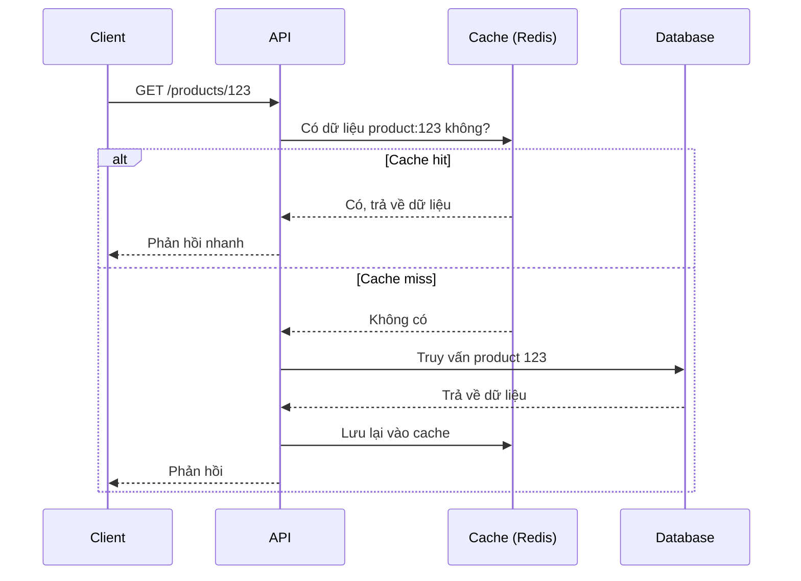
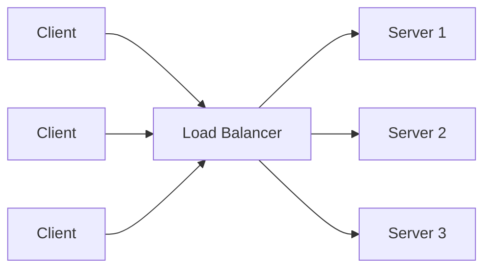

# Các cách tối ưu hiệu suất API

## Mục lục

1. [Vì sao cần tối ưu hiệu suất API?](https://claude.ai/chat/46012664-46ee-47a9-841b-67be707b29ed#vi-sao-can-toi-uu-hieu-suat-api)
2. [Thiết kế API hiệu quả ngay từ đầu](https://claude.ai/chat/46012664-46ee-47a9-841b-67be707b29ed#thiet-ke-api-hieu-qua-ngay-tu-dau)
3. [Dùng bộ nhớ đệm (Caching) để tăng tốc](https://claude.ai/chat/46012664-46ee-47a9-841b-67be707b29ed#dung-bo-nho-dem-caching-de-tang-toc)
4. [Connection Pooling — tái sử dụng kết nối](https://claude.ai/chat/46012664-46ee-47a9-841b-67be707b29ed#connection-pooling)
5. [Tránh vấn đề truy vấn N+1](https://claude.ai/chat/46012664-46ee-47a9-841b-67be707b29ed#tranh-van-de-truy-van-n1)
6. [Xử lý bất đồng bộ (Asynchronous Processing)](https://claude.ai/chat/46012664-46ee-47a9-841b-67be707b29ed#xu-ly-bat-dong-bo)
7. [Giảm kích thước Payload](https://claude.ai/chat/46012664-46ee-47a9-841b-67be707b29ed#giam-kich-thuoc-payload)
8. [Triển khai cân bằng tải (Load Balancing)](https://claude.ai/chat/46012664-46ee-47a9-841b-67be707b29ed#trien-khai-can-bang-tai)
9. [Tối ưu hóa hạ tầng](https://claude.ai/chat/46012664-46ee-47a9-841b-67be707b29ed#toi-uu-hoa-ha-tang)
10. [Ngăn chặn lạm dụng API](https://claude.ai/chat/46012664-46ee-47a9-841b-67be707b29ed#ngan-chan-lam-dung-api)
11. [Trích dẫn](https://claude.ai/chat/46012664-46ee-47a9-841b-67be707b29ed#trich-dan)
12. [Mở rộng](https://claude.ai/chat/46012664-46ee-47a9-841b-67be707b29ed#mo-rong)

---

## Vì sao cần tối ưu hiệu suất API?

Khi một ứng dụng chỉ có vài chục người dùng, một API "chạy được" là đủ. Nhưng khi số lượng người dùng tăng lên hàng nghìn, hàng triệu request mỗi ngày, những vấn đề nhỏ như "quên cache", "mở connection database tràn lan" hay "gọi thừa một câu query" sẽ cộng dồn lại và khiến hệ thống phản hồi chậm, thậm chí sập.

Tối ưu hiệu suất API nói chung xoay quanh 3 mục tiêu:

- **Giảm độ trễ (latency):** người dùng nhận được phản hồi càng nhanh càng tốt.
- **Tăng khả năng chịu tải (throughput):** hệ thống xử lý được nhiều request cùng lúc.
- **Sử dụng tài nguyên hợp lý:** không lãng phí CPU, RAM, băng thông, kết nối database một cách không cần thiết.

Các phần dưới đây sẽ trình bày từng kỹ thuật cụ thể, đi từ tầng cơ sở dữ liệu (database) → tầng ứng dụng (application) → tầng hạ tầng (infrastructure) → bảo mật/chống lạm dụng.

---

## Thiết kế API hiệu quả ngay từ đầu

Trước khi tối ưu bằng các kỹ thuật nâng cao, một API cần có nền tảng thiết kế tốt:

- **Kiến trúc RESTful:** REST (Representational State Transfer) là một tập quy ước thiết kế API dựa trên HTTP, trong đó mỗi _resource_ (tài nguyên, ví dụ: `user`, `post`) được truy cập qua một URL cố định và các thao tác được thể hiện qua HTTP method (`GET`, `POST`, `PUT`, `DELETE`...). Thiết kế REST rõ ràng giúp API dễ đọc, dễ cache và dễ mở rộng.
- **Định dạng dữ liệu phù hợp:** JSON là lựa chọn phổ biến vì dễ đọc, được hỗ trợ rộng rãi. Với các hệ thống cần hiệu năng cao hơn (ví dụ giao tiếp nội bộ giữa các service), có thể dùng **Protocol Buffers** (thường đi kèm gRPC) — một định dạng nhị phân (binary), kích thước nhỏ hơn JSON và tốc độ parse nhanh hơn, nhưng đánh đổi là không đọc được trực tiếp bằng mắt thường như JSON.
- **Giới hạn tốc độ (rate limiting)** và **caching** cũng nên được cân nhắc ngay từ khi thiết kế, thay vì chỉ thêm vào sau khi hệ thống đã gặp sự cố. Hai kỹ thuật này sẽ được trình bày chi tiết ở phần sau.

> 💡 Nguyên tắc chung: thiết kế đúng ngay từ đầu bao giờ cũng rẻ hơn tối ưu lại sau khi hệ thống đã lớn.

---

## Dùng bộ nhớ đệm (Caching) để tăng tốc

**Caching** là kỹ thuật lưu lại kết quả của một thao tác tốn chi phí (ví dụ: một câu truy vấn database phức tạp, hoặc kết quả tính toán nặng) vào một nơi truy xuất nhanh, để những lần sau không phải làm lại từ đầu.


Ý tưởng: thay vì mỗi request đều phải hỏi database, request đầu tiên sẽ lưu kết quả vào cache; các request tiếp theo với cùng nội dung sẽ được trả lời ngay từ cache mà không cần đụng đến database.



Một vài lựa chọn phổ biến:

- **Server-side cache:** **Redis** và **Memcached** là hai công cụ lưu trữ dữ liệu dạng key-value trong bộ nhớ (in-memory), tốc độ đọc/ghi rất nhanh — thường dùng để cache dữ liệu ở phía backend.
- **Client-side cache:** trình duyệt có thể tự lưu cache thông qua các header HTTP như `Cache-Control`, giúp giảm số lần gọi API cho những dữ liệu ít thay đổi.
- **Elasticsearch** thực chất là một _search engine_ (công cụ tìm kiếm và phân tích dữ liệu dạng văn bản), không phải là công cụ caching. Nó phù hợp cho các bài toán tìm kiếm full-text hoặc phân tích log/dữ liệu lớn, chứ không thay thế được vai trò của Redis/Memcached trong việc cache kết quả.

**Lưu ý khi dùng cache:** cần có chiến lược làm mới (invalidate) cache hợp lý — ví dụ đặt thời gian hết hạn (TTL) hoặc chủ động xóa cache khi dữ liệu gốc thay đổi. Nếu không, người dùng có thể nhận được dữ liệu cũ (stale data).

Ví dụ minh họa bằng Go, dùng thư viện `go-redis`:

```go
func GetProduct(ctx context.Context, rdb *redis.Client, db *sql.DB, id string) (*Product, error) {
    key := "product:" + id

    // 1. Thử lấy từ cache trước
    if val, err := rdb.Get(ctx, key).Result(); err == nil {
        var p Product
        json.Unmarshal([]byte(val), &p)
        return &p, nil
    }

    // 2. Cache miss -> truy vấn database
    p, err := queryProductFromDB(db, id)
    if err != nil {
        return nil, err
    }

    // 3. Lưu lại vào cache, hết hạn sau 5 phút
    data, _ := json.Marshal(p)
    rdb.Set(ctx, key, data, 5*time.Minute)

    return p, nil
}
```

---

## Connection Pooling

**Connection Pooling** là kỹ thuật duy trì sẵn một "bể" (pool) các kết nối (connection) tới database, để tái sử dụng thay vì phải mở kết nối mới cho mỗi request.


Việc mở một kết nối mới tới database (thiết lập TCP, xác thực, ...) tốn thời gian và tài nguyên. Nếu API của bạn nhận hàng trăm request mỗi giây và mỗi request đều mở một kết nối mới rồi đóng lại, phần lớn thời gian sẽ bị "lãng phí" vào việc mở/đóng kết nối thay vì xử lý dữ liệu thực sự.

Với connection pool:

- Một số lượng kết nối cố định được mở sẵn khi ứng dụng khởi động.
- Khi có request cần truy vấn database, ứng dụng "mượn" một kết nối rảnh từ pool.
- Sau khi dùng xong, kết nối được **trả lại pool** (chứ không đóng hẳn) để request khác dùng tiếp.

Trong Go, package chuẩn `database/sql` đã hỗ trợ sẵn connection pool. Việc của lập trình viên là cấu hình nó hợp lý:

```go
db, err := sql.Open("postgres", dsn)
if err != nil {
    log.Fatal(err)
}

db.SetMaxOpenConns(25)   // Số kết nối mở tối đa
db.SetMaxIdleConns(25)   // Số kết nối rảnh được giữ lại trong pool
db.SetConnMaxLifetime(5 * time.Minute) // Thời gian sống tối đa của 1 kết nối
```

> ⚠️ Cấu hình pool quá nhỏ sẽ khiến request phải chờ kết nối; cấu hình quá lớn có thể khiến database quá tải vì phải quản lý quá nhiều kết nối đồng thời. Con số phù hợp phụ thuộc vào giới hạn kết nối tối đa của database và tải thực tế của hệ thống.

---

## Tránh vấn đề truy vấn N+1

**Truy vấn N+1** là một lỗi hiệu năng rất phổ biến khi làm việc với database, đặc biệt khi dùng ORM (Object-Relational Mapping — công cụ ánh xạ giữa object trong code và bảng trong database, ví dụ GORM trong Go).

Vấn đề xảy ra khi:

1. Bạn thực hiện **1 truy vấn** để lấy danh sách N bản ghi (ví dụ N bài viết - post).
2. Với **mỗi** bản ghi đó, bạn lại thực hiện **1 truy vấn riêng** để lấy dữ liệu liên quan (ví dụ comment của từng post).

Kết quả: thay vì 1-2 truy vấn, bạn phải thực hiện tới **N + 1** truy vấn.


**Cách khắc phục:** gộp các truy vấn nhỏ lẻ lại, thường theo 1 trong 2 cách:

- Dùng `JOIN` để lấy toàn bộ dữ liệu post và comment trong **1 truy vấn duy nhất**.
- Hoặc tách thành **2 truy vấn**: một truy vấn lấy tất cả post, một truy vấn khác lấy tất cả comment thuộc các post đó (dựa vào danh sách `post_id`), rồi ghép lại ở tầng ứng dụng.


Ví dụ với GORM (một ORM phổ biến trong Go):

```go
// Cách gây ra N+1: lặp qua từng post rồi mới query comment
var posts []Post
db.Find(&posts)
for i := range posts {
    db.Where("post_id = ?", posts[i].ID).Find(&posts[i].Comments) // N truy vấn
}

// Cách tối ưu: dùng Preload để GORM tự gộp truy vấn
var posts []Post
db.Preload("Comments").Find(&posts) // Chỉ 2 truy vấn: 1 cho posts, 1 cho comments
```

Cách tiếp cận này giúp giảm số lần round-trip (số lượt đi-về) giữa ứng dụng và database, từ đó cải thiện đáng kể thời gian phản hồi, đặc biệt khi N lớn.

---

## Xử lý bất đồng bộ

Không phải tác vụ nào cũng cần trả kết quả ngay lập tức cho người dùng. **Xử lý bất đồng bộ (asynchronous processing)** là kỹ thuật đưa các tác vụ tốn thời gian (gửi email, xử lý file lớn, tạo báo cáo...) ra khỏi luồng xử lý chính của request, để API có thể phản hồi nhanh trong khi tác vụ nặng chạy ngầm ở phía sau.

Cách triển khai phổ biến là dùng **hàng đợi tin nhắn (message queue)** như RabbitMQ, Kafka, hoặc trong hệ sinh thái Go đơn giản hơn là dùng goroutine kết hợp channel cho các tác vụ nhẹ, nội bộ:

```go
func HandleUploadVideo(w http.ResponseWriter, r *http.Request) {
    videoID := saveVideoMetadata(r)

    // Đẩy việc xử lý nặng (encode video) sang goroutine, không chặn response
    go processVideoAsync(videoID)

    // Trả phản hồi ngay cho client
    respondJSON(w, 202, map[string]string{"status": "processing", "id": videoID})
}
```

> Lưu ý: dùng goroutine "trần" như trên chỉ phù hợp cho ứng dụng nhỏ hoặc tác vụ không quá quan trọng nếu mất do server restart. Với hệ thống production cần đảm bảo tác vụ không bị mất, nên dùng message queue thực sự (RabbitMQ, Kafka, hoặc các dịch vụ như AWS SQS) để tác vụ được lưu trữ bền vững và có thể retry khi lỗi.

---

## Giảm kích thước Payload

**Payload** là phần dữ liệu thực sự được gửi đi trong request/response (không tính header). Payload càng nhỏ, thời gian truyền tải càng nhanh và càng tiết kiệm băng thông — đặc biệt quan trọng với người dùng có kết nối mạng yếu.

Một số kỹ thuật cụ thể:

- **Chỉ trả về field cần thiết:** thay vì trả toàn bộ object, cho phép client chỉ định field muốn lấy (ví dụ qua query param `?fields=id,name`), hoặc dùng GraphQL nếu hệ thống cần sự linh hoạt cao trong việc chọn dữ liệu.
- **Phân trang (pagination):** với danh sách dữ liệu lớn, không nên trả về toàn bộ trong 1 lần mà nên chia theo trang (ví dụ `?page=2&limit=20`) hoặc dùng cursor-based pagination cho tập dữ liệu cực lớn.
- **Nén dữ liệu (compression):** dùng Gzip hoặc Brotli để nén response trước khi gửi đi. Hầu hết framework web hiện đại đều hỗ trợ bật nén qua middleware mà không cần code tay quá nhiều.

```go
// Ví dụ bật Gzip compression cho toàn bộ API bằng middleware (net/http)
handler := gziphandler.GzipHandler(mux)
http.ListenAndServe(":8080", handler)
```

---

## Triển khai cân bằng tải

**Cân bằng tải (load balancing)** là kỹ thuật phân phối các request đến trên nhiều máy chủ (server instance) thay vì dồn hết vào một máy chủ duy nhất.

Hãy tưởng tượng một nhà hàng đông khách chỉ có một nhân viên phục vụ — khách sẽ phải chờ rất lâu và trải nghiệm rất tệ. Tương tự, nếu chỉ có một server xử lý toàn bộ traffic, server đó sẽ dễ bị quá tải (CPU, RAM, số kết nối đều có giới hạn), dẫn đến phản hồi chậm hoặc thậm chí sập hệ thống.

Một **load balancer** (ví dụ Nginx, HAProxy, hoặc load balancer của các nhà cung cấp cloud) đứng trước các server và quyết định mỗi request sẽ được chuyển tới server nào. Một số thuật toán phân phối phổ biến:

- **Round Robin:** lần lượt chuyển request cho từng server theo vòng tròn.
- **Least Connections:** ưu tiên chuyển request tới server đang có ít kết nối đang xử lý nhất.
- **Weighted:** phân phối theo tỉ lệ dựa trên cấu hình/công suất của từng server (server mạnh hơn nhận nhiều request hơn).



Ngoài việc cải thiện hiệu suất, load balancing còn tăng **tính khả dụng (availability)**: nếu một server gặp sự cố, load balancer có thể tự động ngừng chuyển request tới server đó và chuyển toàn bộ traffic cho các server còn lại.

---

## Tối ưu hóa hạ tầng

Ngoài việc tối ưu ở tầng code/ứng dụng, hạ tầng (infrastructure) triển khai API cũng ảnh hưởng trực tiếp tới hiệu suất:

- **Giải pháp cloud:** cho phép mở rộng (scale) tài nguyên linh hoạt theo nhu cầu thực tế, thay vì đầu tư cứng phần cứng cố định.
- **CDN (Content Delivery Network):** mạng lưới máy chủ phân tán theo vị trí địa lý, giúp phục vụ nội dung tĩnh (hình ảnh, file JS/CSS, hoặc cả response API ít thay đổi) từ máy chủ gần người dùng nhất, giảm độ trễ do khoảng cách địa lý.
- **Triển khai đa vùng (multi-region):** đặt server ở nhiều khu vực địa lý khác nhau, vừa giảm độ trễ cho người dùng ở xa, vừa tạo dự phòng (redundancy) nếu một khu vực gặp sự cố.

---

## Ngăn chặn lạm dụng API

Một API hiệu suất tốt cũng cần được bảo vệ khỏi việc bị lạm dụng — dù là vô tình (bug ở phía client gọi API liên tục) hay cố ý (tấn công).

- **Rate limiting (giới hạn tốc độ):** giới hạn số lượng request mà một client được phép gửi trong một khoảng thời gian nhất định. Một thuật toán phổ biến là **Token Bucket**: hệ thống duy trì một "bucket" chứa token, token được nạp vào theo thời gian với tốc độ cố định; mỗi request tiêu tốn một token, nếu bucket hết token thì request bị từ chối hoặc phải chờ. Cách này vừa giới hạn được tốc độ trung bình, vừa cho phép xử lý các đợt tăng tải ngắn (burst) một cách hợp lý.
- **Xác thực khóa API (API key) / token:** chỉ cho phép client đã được cấp quyền truy cập vào API. Với hệ thống có người dùng thật (không chỉ máy-với-máy), thường kết hợp thêm cơ chế như OAuth2 hoặc JWT (JSON Web Token) để xác thực và phân quyền chi tiết hơn.

Hai cơ chế này không chỉ bảo vệ hệ thống khỏi bị quá tải, mà còn đảm bảo tài nguyên được phân bổ công bằng giữa các client.

---

## Trích dẫn

- MDN Web Docs — [HTTP Cache-Control header](https://developer.mozilla.org/en-US/docs/Web/HTTP/Headers/Cache-Control): tài liệu tham khảo chính thức về caching phía HTTP/client.
- Bài viết tổng hợp về thuật toán Token Bucket trong rate limiting: khái niệm bucket, refill rate và burst tolerance được tham khảo từ các bài viết kỹ thuật phổ biến về chủ đề rate limiting (ví dụ trên DEV Community, Medium).
- Khái niệm và cách khắc phục N+1 Query Problem: tổng hợp từ các tài liệu kỹ thuật phổ biến về ORM (ví dụ ShiftAsia, PingCAP) — các nguồn đều thống nhất về định nghĩa và giải pháp eager loading/JOIN.
- Phần còn lại của nội dung được biên soạn lại dựa trên tài liệu gốc do người dùng cung cấp (`Optimizing API performance.md`), có bổ sung thêm giải thích thuật ngữ, ví dụ code (Go) và sơ đồ minh họa.

_Ghi chú: các đường link hình ảnh gốc (`figure1.png`, `figure2.png`, `figure4.png`, `figure5.png`) được giữ nguyên từ tài liệu gốc._

---

## Mở rộng

Nếu muốn tìm hiểu sâu hơn về chủ đề tối ưu hiệu suất API, một số hướng nâng cao có thể tham khảo thêm:

- **Circuit Breaker Pattern:** kỹ thuật "ngắt mạch" tạm thời khi một service phụ thuộc liên tục lỗi, tránh làm sập dây chuyền (cascading failure).
- **Database Indexing:** đánh index hợp lý cho các cột thường xuyên dùng trong `WHERE`, `JOIN` để tăng tốc truy vấn — một trong những cách tối ưu database hiệu quả nhất nhưng không được đề cập trong tài liệu gốc.
- **gRPC và HTTP/2:** giao thức giao tiếp hiệu năng cao thường dùng giữa các microservice nội bộ.
- **Read Replica & Database Sharding:** tách database đọc/ghi (read replica) hoặc chia nhỏ dữ liệu theo shard để mở rộng theo chiều ngang (horizontal scaling).
- **Observability (Logging, Metrics, Tracing):** theo dõi hiệu suất API thực tế bằng công cụ như Prometheus, Grafana, OpenTelemetry để phát hiện điểm nghẽn (bottleneck) trước khi nó ảnh hưởng người dùng.
- **API Gateway:** lớp trung gian tập trung xử lý rate limiting, xác thực, logging cho nhiều service phía sau.