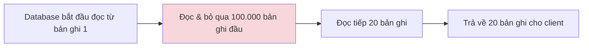

# Phân trang (Pagination): Từ Offset đến Cursor-based

## Mục lục

1. [Phân trang là gì, tại sao cần phân trang](https://claude.ai/chat/46012664-46ee-47a9-841b-67be707b29ed#phan-trang-la-gi)
2. [Phân trang truyền thống: LIMIT - OFFSET](https://claude.ai/chat/46012664-46ee-47a9-841b-67be707b29ed#offset-pagination)
3. [Phân trang theo con trỏ: Cursor-based (Keyset) Pagination](https://claude.ai/chat/46012664-46ee-47a9-841b-67be707b29ed#cursor-pagination)
4. [So sánh Offset vs Cursor — khi nào dùng cái nào](https://claude.ai/chat/46012664-46ee-47a9-841b-67be707b29ed#so-sanh)
5. [Trích dẫn](https://claude.ai/chat/46012664-46ee-47a9-841b-67be707b29ed#trich-dan)
6. [Mở rộng](https://claude.ai/chat/46012664-46ee-47a9-841b-67be707b29ed#mo-rong)

---

## Phân trang là gì, tại sao cần phân trang


Phân trang (pagination) là kỹ thuật chia một tập dữ liệu lớn thành nhiều phần nhỏ hơn, thay vì trả về toàn bộ dữ liệu trong một lần gọi API.

Hãy tưởng tượng bạn đang thiết kế backend cho một trang tin tức, và phía frontend cần một API để lấy danh sách bài viết từ database.


Nếu chỉ có 10–20 bài viết, bài toán rất đơn giản: lấy toàn bộ dữ liệu từ database, trả về một file JSON duy nhất cho frontend.

Nhưng khi tập dữ liệu lớn dần — ví dụ mỗi bài viết có nhiều trường (ảnh đại diện, chuyên mục, thời gian đăng...) và tổng số bài viết lên tới hàng nghìn, hàng chục nghìn — việc trả về toàn bộ dữ liệu trong một lần sẽ gây chậm ở hai điểm:

- **Phía database:** truy vấn và tải toàn bộ dữ liệu tốn nhiều thời gian và tài nguyên (CPU, RAM).
- **Phía người dùng:** tải một file JSON rất lớn trong một lần vừa chậm, vừa tốn băng thông (đặc biệt với người dùng mạng yếu hoặc thiết bị di động).

> Giải pháp là phân trang: mỗi lần chỉ gửi cho người dùng một phần nhỏ (ví dụ 10–15 bài viết). Khi người dùng chuyển trang, hệ thống mới gửi tiếp phần dữ liệu kế tiếp.

Ở các dự án mới, lượng dữ liệu còn nhỏ (vài nghìn bản ghi), nên `LIMIT` và `OFFSET` — hai từ khóa SQL quen thuộc — có vẻ là lựa chọn hoàn hảo. Nhưng khi bảng dữ liệu phình to lên tới hàng chục triệu dòng, cách làm này có thể trở thành nguyên nhân khiến cả hệ thống quá tải. Phần tiếp theo sẽ phân tích vì sao, và giới thiệu một kỹ thuật thay thế mạnh mẽ hơn: **Cursor-based Pagination**.

---

## Phân trang truyền thống: LIMIT - OFFSET


Đây là cách phân trang quen thuộc, thường thấy ở các trang web có dải số trang (1, 2, 3... Next) bên dưới danh sách. Về mặt kỹ thuật, nó dựa trên 2 tham số:

- **LIMIT (hay Page Size):** số lượng bản ghi tối đa muốn hiển thị trên một trang.
- **OFFSET:** số lượng bản ghi muốn bỏ qua, tính từ bản ghi đầu tiên.


```sql
-- Lấy 20 bản ghi, bắt đầu từ bản ghi thứ 100.001
SELECT * FROM products ORDER BY id LIMIT 20 OFFSET 100000;
```

### Vấn đề 1: Hiệu suất giảm dần khi vào trang sâu

Nhìn câu lệnh trên, ta dễ có cảm giác rằng database sẽ "nhảy thẳng" đến vị trí 100.000 rồi lấy đúng 20 bản ghi tiếp theo. Thực tế không phải vậy: hầu hết cơ sở dữ liệu quan hệ (MySQL, PostgreSQL...) không có khả năng nhảy cóc trực tiếp tới một vị trí trong bảng. Để trả về 20 bản ghi ở một trang sâu, database vẫn phải:

1. **Đọc tuần tự** qua toàn bộ 100.020 bản ghi đầu bảng (hoặc ít nhất là duyệt qua chừng ấy entry trên index, tùy loại truy vấn).
2. **Bỏ đi** 100.000 bản ghi đầu tiên.
3. **Trả về** đúng 20 bản ghi còn lại.



Khi bảng chỉ có vài nghìn dòng, sức mạnh phần cứng đủ để che giấu sự lãng phí này. Nhưng khi bảng có hàng triệu dòng, việc phải đọc rồi bỏ đi hàng trăm nghìn bản ghi mỗi lần sẽ tiêu tốn đáng kể băng thông ổ đĩa và CPU. Thời gian xử lý của OFFSET vì vậy **tăng dần theo độ sâu của trang** — càng vào trang sau càng chậm, dù số lượng bản ghi trả về (LIMIT) không đổi.

> **Lưu ý:** mức độ ảnh hưởng cụ thể còn phụ thuộc vào loại index và cách query planner của từng hệ quản trị database tối ưu câu lệnh; nhưng xu hướng chung — chi phí tăng theo độ sâu trang — là đặc điểm được nhiều tài liệu kỹ thuật ghi nhận với phân trang kiểu OFFSET<sup>[1][2]</sup>.

### Vấn đề 2: Dữ liệu bị trùng hoặc bị bỏ sót khi có thay đổi

Đây là vấn đề tinh vi hơn, dễ bị bỏ qua. Giả sử bạn đang xem **Trang 1** của một diễn đàn (10 bài viết mới nhất, từ bài số 1 đến bài số 10). Ngay lúc đó, có người khác vừa đăng thêm 1 bài viết mới.

Khi bạn bấm sang **Trang 2** (hệ thống dùng `OFFSET 10` để bỏ qua 10 bài đầu), điều gì xảy ra?

➡️ **Có bài bị lặp lại.** Vì có 1 bài mới chen vào đầu danh sách, toàn bộ các bài cũ bị đẩy lùi xuống 1 vị trí. Lệnh `OFFSET 10` lúc này sẽ bỏ qua bài mới cộng với 9 bài cũ — bài thứ 10 của Trang 1 cũ bị đẩy thành bài đầu tiên của Trang 2, khiến người dùng thấy nó xuất hiện **2 lần**.

Ngược lại, nếu một bài ở Trang 1 bị xóa trong lúc bạn đang đọc, danh sách bị kéo lên, và `OFFSET 10` sẽ vô tình nhảy cóc qua một bài, khiến bạn **bỏ sót** nó khi sang Trang 2.

Hai điểm yếu này — **hiệu suất giảm dần** và **sai lệch dữ liệu khi có thay đổi** — là lý do các nền tảng có dữ liệu thay đổi liên tục (news feed kiểu Facebook, Twitter/X) hầu như không dùng dải số trang kiểu OFFSET cho bảng tin của họ.

---

## Phân trang theo con trỏ: Cursor-based (Keyset) Pagination

Kỹ thuật này còn được gọi là **Keyset Pagination** hoặc **Seek Method**<sup>[1]</sup>.

Thay vì bảo database "đếm và bỏ qua X bản ghi đầu tiên" như OFFSET, ta dùng một **con trỏ (cursor)** làm mốc: "hãy lấy các bản ghi đứng ngay sau bản ghi có giá trị X".


Ví dụ, Trang 1 có 10 bài viết, sắp xếp từ mới nhất đến cũ nhất, bài cuối cùng (thứ 10) có `id = 96`. Thay vì gửi "trang = 2", client sẽ gửi: _"lấy 10 bài viết tiếp theo, sau bài có id = 96"_. Vì danh sách sắp xếp giảm dần theo id, các bài cũ hơn chắc chắn có id nhỏ hơn 96:

```sql
SELECT * FROM posts WHERE id < 96 ORDER BY id DESC LIMIT 10;
```

### Vì sao cách này giải quyết được cả 2 vấn đề của Offset?

- **Về hiệu suất:** nhờ có index trên cột `id`, database có thể định vị thẳng tới vị trí `id = 96` (bằng cách dò trên cây B-Tree của index) rồi lấy đúng 10 bản ghi tiếp theo, mà không cần đọc qua các bản ghi phía trước. Nhờ vậy, tốc độ gần như không đổi dù bạn đang ở trang đầu hay đã cuộn tới bản ghi thứ một triệu<sup>[1][2]</sup>.
- **Về tính chính xác:** vì `id = 96` là một mốc cố định, dù có bao nhiêu bài mới chèn vào đầu danh sách hay bị xóa, hệ thống vẫn chỉ lấy các bài có `id < 96`. Không còn tình trạng trùng lặp hay bỏ sót.

Đây chính là nguyên lý đứng sau tính năng **Infinite Scroll (cuộn vô hạn)** quen thuộc trên Facebook, TikTok hay Instagram.

### Giới hạn: cột làm con trỏ phải là duy nhất (unique)

`id` là lựa chọn an toàn vì mỗi bài viết có một `id` duy nhất. Nhưng nếu muốn sắp xếp theo một tiêu chí **dễ trùng giá trị** — ví dụ số lượt Like — vấn đề sẽ phát sinh.

|id|likes|Trạng thái|
|---|---|---|
|101|60|Trang 1|
|102|50|Trang 1 (trở thành cursor)|
|103|50|Đang chờ tải ở Trang 2|
|104|50|Đang chờ tải ở Trang 2|
|105|40|Đang chờ tải ở Trang 2|

Nếu Trang 2 được lấy bằng điều kiện "likes < 50" (nhỏ hơn bài có `likes = 50` vừa dùng làm cursor), database sẽ nhảy thẳng tới các bài có 49, 48, 40 lượt Like — **bỏ sót** hoàn toàn bài 103 và 104 (cùng có đúng 50 Like).

Nếu đổi sang điều kiện "likes <= 50" để cố lấy lại 2 bài đó, hệ thống sẽ lại lấy luôn cả bài 102 — gây **trùng lặp**.

### Giải pháp: Composite Cursor (Điểm neo kép)

Cách khắc phục là ghép thêm một cột **chắc chắn duy nhất** (thường là `id`) vào làm "trọng tài" phân định (tie-breaker) khi các bản ghi có cùng giá trị cột chính:

```sql
-- Trang 2: bài cuối Trang 1 có likes = 50 và id = 104
SELECT * FROM posts
WHERE likes < 50 OR (likes = 50 AND id < 104)
ORDER BY likes DESC, id DESC
LIMIT 10;
```

Nhờ `id` làm trọng tài, các bài có cùng 50 Like (id 103, 102) vẫn được tải chính xác ở Trang 2, không bỏ sót cũng không trùng lặp.

### ⚠️ Lưu ý khi dùng Cursor-based Pagination

**1. Luôn cần index đúng trên (các) cột làm cursor.** Nếu đổi cursor sang một cột khác (ví dụ `created_at`) mà quên đánh index, database sẽ phải quét tuần tự toàn bộ bảng (**Full Table Scan**) để thỏa điều kiện `WHERE created_at < :cursor`. Lúc này Cursor-based Pagination không những mất hết lợi thế, mà hiệu năng còn có thể tệ hơn cả Offset truyền thống<sup>[1][2]</sup>. Với composite cursor (nhiều cột), index cần bao phủ đúng thứ tự các cột trong `ORDER BY`.

**2. Không thể nhảy tới một trang bất kỳ.** Cursor chỉ biết "các bản ghi đứng sau mốc X" — nó không hỗ trợ việc nhảy thẳng tới "trang số 15" như dải số trang truyền thống. Với các bài toán cần hiển thị dải số trang (ví dụ trang quản trị đơn hàng, nơi người dùng cần thấy và bấm chọn "trang 1, 2, 3..."), Cursor-based Pagination không phù hợp — lúc này vẫn cần quay lại dùng `LIMIT`/`OFFSET`.

---

## So sánh Offset vs Cursor — khi nào dùng cái nào

| Tiêu chí                                     | Offset-based                                                  | Cursor-based (Keyset)                                              |
| -------------------------------------------- | ------------------------------------------------------------- | ------------------------------------------------------------------ |
| Tốc độ ở trang sâu                           | Chậm dần theo độ sâu trang                                    | Gần như không đổi (nhờ index seek)                                 |
| Dữ liệu thay đổi liên tục (feed mạng xã hội) | Dễ bị trùng/bỏ sót bản ghi                                    | Luôn chính xác nhờ mốc cố định                                     |
| Nhảy tới trang bất kỳ (ví dụ "trang 15")     | Hỗ trợ tốt                                                    | Không hỗ trợ trực tiếp                                             |
| Hiển thị dải số trang (1, 2, 3...)           | Phù hợp                                                       | Không phù hợp                                                      |
| Yêu cầu index                                | Có thì tốt hơn, nhưng không bắt buộc để hoạt động đúng        | Bắt buộc phải có index đúng cột/thứ tự, nếu không sẽ phản tác dụng |
| Trường hợp dùng điển hình                    | Trang quản trị (admin dashboard), danh sách cần đánh số trang | Infinite scroll, news feed, API công khai có lượng dữ liệu lớn     |

Một số hệ thống thực tế kết hợp cả hai: dùng Cursor-based cho luồng chính (cuộn tiếp/trang trước-sau), và chỉ dùng Offset khi người dùng thật sự cần nhảy tới một trang cụ thể.

---

## Trích dẫn

1. Markus Winand — [Use The Index, Luke: Pagination Done the PostgreSQL Way](https://use-the-index-luke.com/no-offset): phân tích kỹ thuật về hạn chế của OFFSET (dữ liệu bị trôi/drift khi có thay đổi, hiệu suất giảm theo độ sâu trang) và giới thiệu Keyset/Seek Method cùng yêu cầu index đi kèm.
2. Simon Willison — ghi chú về bài viết "Use The Index, Luke! Paging Through Results": [simonwillison.net](https://simonwillison.net/2018/Mar/29/use-index-luke-paging-through-results/) — tóm tắt nguyên lý keyset pagination so với OFFSET/LIMIT.
3. Phần còn lại của nội dung được biên soạn lại dựa trên tài liệu gốc do người dùng cung cấp (`1.system-pagination.md`), có tổ chức lại heading, bổ sung sơ đồ minh họa, bảng so sánh và chú thích thuật ngữ. Phần giới thiệu kỹ thuật **Deferred Join** ở cuối tài liệu gốc không nằm trong phạm vi bài viết này — xem phần Mở rộng bên dưới để tiếp tục.

---

## Mở rộng

- **Deferred Join (JOIN trì hoãn):** kỹ thuật giúp giữ lại lợi ích của phân trang kiểu Offset (hỗ trợ nhảy trang bất kỳ) trong khi giảm bớt chi phí hiệu năng ở trang sâu — nội dung này được tác giả tài liệu gốc hẹn trình bày ở phần tiếp theo: [đọc tiếp tại đây](https://github.com/GiaBao0510/ExperienceLearnedAndGathered/blob/main/InterviewQuestions/Pagination/2.system-pagination.md).
- **EXPLAIN / EXPLAIN ANALYZE:** công cụ để kiểm tra xem một câu truy vấn phân trang có thực sự dùng index (Index Scan) hay đang quét toàn bảng (Seq Scan/Full Table Scan).
- **GraphQL Cursor Connections:** chuẩn thiết kế phân trang theo cursor phổ biến trong hệ sinh thái GraphQL (dùng `edges`, `pageInfo`, `after`/`before`).
- **Composite Index (Index đa cột):** cách thiết kế index bao phủ đúng thứ tự các cột dùng trong `ORDER BY` của câu truy vấn cursor-based, quyết định việc truy vấn có thực sự nhanh hay không.
- **Phân trang trong hệ thống phân tán (distributed systems):** khi dữ liệu được chia nhỏ trên nhiều node (sharding), việc đảm bảo thứ tự và tính nhất quán khi phân trang sẽ phức tạp hơn nhiều so với một database đơn lẻ.