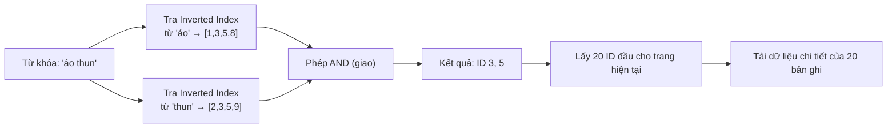

# Phân trang (Pagination): Deferred Join, Search Engine và Tổng kết

_Tài liệu dành cho sinh viên / lập trình viên mới bắt đầu tìm hiểu về Backend_ _Đây là phần tiếp theo của tài liệu ["Phân trang: Từ Offset đến Cursor-based"](https://claude.ai/chat/3.pagination-offset-vs-cursor.md) — nên đọc phần đó trước nếu chưa quen với Offset-based và Cursor-based Pagination._

## Mục lục

1. [Deferred Join — giảm chi phí cho Offset-based Pagination](https://claude.ai/chat/46012664-46ee-47a9-841b-67be707b29ed#deferred-join)
2. [Khi tìm kiếm cần vượt ra khỏi SQL: Search Engine](https://claude.ai/chat/46012664-46ee-47a9-841b-67be707b29ed#search-engine)
3. [Tổng kết: chọn kỹ thuật phân trang nào?](https://claude.ai/chat/46012664-46ee-47a9-841b-67be707b29ed#tong-ket)
4. [Trích dẫn](https://claude.ai/chat/46012664-46ee-47a9-841b-67be707b29ed#trich-dan)
5. [Mở rộng](https://claude.ai/chat/46012664-46ee-47a9-841b-67be707b29ed#mo-rong)

---

## Deferred Join — giảm chi phí cho Offset-based Pagination

Ở phần trước, ta đã thấy Offset-based Pagination có 2 vấn đề: chậm dần ở trang sâu, và dễ bị trùng/sót dữ liệu. Cursor-based Pagination giải quyết tốt cả hai, nhưng lại không hỗ trợ nhảy tới một trang bất kỳ (ví dụ "trang 15") — điều mà nhiều giao diện quản trị (admin dashboard) vẫn cần. **Deferred Join** là một kỹ thuật giúp **giảm bớt** (chứ không loại bỏ hoàn toàn) chi phí hiệu năng của Offset-based Pagination, trong khi vẫn giữ được khả năng nhảy trang tùy ý — mà không cần cài thêm hệ thống nào khác.

### Nguyên nhân cốt lõi: đọc dữ liệu thừa

Khi dùng `SELECT *` kết hợp `LIMIT ... OFFSET ...`, database phải tải **toàn bộ** dữ liệu của các bản ghi bị bỏ qua — bao gồm cả những cột nặng như mô tả chi tiết, đường dẫn hình ảnh, đánh giá... — từ ổ cứng lên RAM, rồi mới loại bỏ phần OFFSET. Chính việc tải những cột nặng không cần thiết này mới là phần tốn kém nhất, chứ không phải bản thân việc "đếm qua" các bản ghi.

### Ý tưởng: chỉ tìm "địa chỉ" trước, lấy dữ liệu đầy đủ sau

Thay vì bắt database tải toàn bộ dữ liệu nặng của hàng triệu bản ghi, Deferred Join chia truy vấn thành 2 bước:

1. Dùng một **truy vấn con** chỉ `SELECT id` (cùng các cột cần cho `ORDER BY`), để tìm ra đúng danh sách ID cần cho trang hiện tại. Vì chỉ cần cột trong index, database có thể trả lời bằng cách đọc thẳng trên cấu trúc **Index** (ví dụ cây B-Tree) — vốn nhỏ gọn, thường đã nằm sẵn trong RAM — mà **không cần đụng tới dữ liệu đầy đủ trên ổ cứng**.
2. Dùng `JOIN` (hoặc `WHERE id IN (...)`) để lấy dữ liệu đầy đủ, nhưng **chỉ cho đúng 20 bản ghi** của trang hiện tại — thay vì cho toàn bộ các bản ghi bị bỏ qua.

```sql
-- Cách cũ: tải toàn bộ dữ liệu chi tiết của cả 1.000.020 bản ghi rồi mới bỏ đi 1.000.000
SELECT * FROM products ORDER BY price DESC LIMIT 20 OFFSET 1000000;

-- Cách mới với Deferred Join: chỉ đọc ID từ Index ở bước lọc, dữ liệu đầy đủ chỉ tải cho đúng 20 bản ghi cần thiết
SELECT p.* FROM products p
INNER JOIN (
    SELECT id FROM products ORDER BY price DESC LIMIT 20 OFFSET 1000000
) AS deferred_ids ON p.id = deferred_ids.id;
```

### Lưu ý quan trọng: Deferred Join giảm chi phí, không loại bỏ hoàn toàn độ trễ theo độ sâu trang

Đây là điểm cần làm rõ so với tài liệu gốc: Deferred Join **không** biến OFFSET thành một phép tra cứu tức thời như Cursor-based Pagination. Database vẫn phải lướt qua (count qua) đúng 1.000.000 mục trong Index trước khi lấy được 20 ID cần dùng — phần việc này **vẫn tăng theo độ sâu trang**. Điều Deferred Join thực sự loại bỏ là việc phải **đọc toàn bộ dữ liệu chi tiết** (các cột nặng) của 1.000.000 bản ghi bị bỏ qua đó — vì bước lọc chỉ cần đọc trên Index, vốn rẻ hơn rất nhiều so với đọc cả dòng dữ liệu đầy đủ<sup>[1]</sup>.

Nói cách khác: Deferred Join giúp các trang sâu **nhanh hơn đáng kể** so với Offset truyền thống (có báo cáo thực tế cho thấy mức cải thiện từ vài giây xuống còn vài trăm mili-giây<sup>[1]</sup>), nhưng với bảng cực lớn và trang cực sâu, nó vẫn sẽ chậm dần — chỉ là chậm dần với tốc độ thấp hơn nhiều so với cách cũ. Nếu ứng dụng của bạn không cần nhảy tới trang bất kỳ, Cursor-based Pagination (phần trước) vẫn là lựa chọn nhanh hơn về bản chất thuật toán.

---
## Khi tìm kiếm cần vượt ra khỏi SQL: Search Engine

Deferred Join phát huy tác dụng tốt khi sắp xếp/lọc theo các cột đơn giản (ID, giá tiền...). Nhưng khi người dùng bỏ qua dải phân trang và gõ một cụm từ tìm kiếm tự do (ví dụ "áo thun nam màu đen cỡ L") vào ô tìm kiếm, cả Cursor lẫn Deferred Join đều không còn tác dụng: để tìm từ khóa trong văn bản, cơ sở dữ liệu quan hệ truyền thống (như MySQL) phải so khớp nội dung text của từng bản ghi — dù có đánh index thông thường, việc này vẫn rất tốn kém với bảng hàng chục triệu dòng.

### Chỉ mục đảo ngược (Inverted Index)

Để giải quyết bài toán tìm kiếm văn bản ở quy mô lớn, các hệ thống chuyên dụng — gọi chung là **Search Engine** (ví dụ Elasticsearch) — dùng một cấu trúc dữ liệu khác hẳn database quan hệ: **Inverted Index (chỉ mục đảo ngược)**.


Cách dễ hình dung:

- **Database truyền thống** lưu theo chiều "bản ghi → nội dung": sản phẩm ID 1 chứa các từ "áo", "thun", "nam"; sản phẩm ID 2 chứa "quần", "jean", "nam".
- **Inverted Index** lưu theo chiều ngược lại — "từ khóa → danh sách bản ghi chứa nó":
    - Từ "áo" → có ở ID `1, 5, 9`
    - Từ "nam" → có ở ID `1, 2, 9`
    - Từ "thun" → có ở ID `1, 7`

Nhờ cấu trúc này, tìm kiếm không cần quét qua nội dung của từng sản phẩm — chỉ cần tra thẳng vào danh sách ID đã có sẵn cho mỗi từ khóa.

### Ví dụ: tìm kiếm cụm từ "áo thun"

Giả sử hệ thống tra được:

- Từ "áo" có ở các ID: `[1, 3, 5, 8]`
- Từ "thun" có ở các ID: `[2, 3, 5, 9]`

Vì cần sản phẩm chứa **cả hai** từ "áo" **và** "thun", hệ thống sẽ thực hiện phép toán **AND (giao hai tập hợp)**, cho ra kết quả là ID `3` và `5`.

Với bảng dữ liệu thật, nếu phép giao trả về một tập hợp rất lớn (ví dụ 2 triệu ID khớp từ khóa), hệ thống chỉ cần "cắt" ra 20 ID đầu tiên tương ứng với số trang đang xem, rồi mới tải chi tiết đúng 20 bản ghi đó — nguyên lý tương tự như Deferred Join, nhưng áp dụng ở tầng tìm kiếm văn bản.



### Các lựa chọn Search Engine phổ biến

- **Elasticsearch:** lựa chọn phổ biến và trưởng thành nhất, dựa trên lõi Apache Lucene.
- **Meilisearch:** gọn nhẹ, dễ cài đặt, có sẵn tính năng tự sửa lỗi chính tả (typo-tolerance).
- **Typesense:** tốc độ phản hồi rất nhanh nhờ chạy hoàn toàn trên RAM (in-memory).
- **Algolia:** dịch vụ SaaS (phần mềm dạng dịch vụ) trên cloud, không cần tự quản lý hạ tầng, nhưng chi phí thường cao hơn các lựa chọn tự host.
- **Apache Solr:** cùng dựa trên lõi Lucene như Elasticsearch, độ ổn định cao, phổ biến trong các hệ thống doanh nghiệp lớn.
- **PostgreSQL Full-text Search (dùng GIN Index):** tận dụng ngay database SQL đang có sẵn để xử lý tìm kiếm văn bản cho quy mô vài triệu bản ghi, không cần dựng thêm hệ thống riêng — phù hợp khi nhu cầu tìm kiếm chưa đủ phức tạp để cần một search engine chuyên dụng.

> Lựa chọn công cụ nào phụ thuộc vào quy mô dữ liệu, ngân sách vận hành và mức độ phức tạp của tính năng tìm kiếm (có cần gợi ý, sửa lỗi chính tả, tìm theo ngữ nghĩa...). Với hệ thống nhỏ, PostgreSQL Full-text Search thường là điểm khởi đầu hợp lý trước khi đầu tư vào một search engine riêng.

---

## Tổng kết: chọn kỹ thuật phân trang nào?

Không có kỹ thuật phân trang nào là "tốt nhất" cho mọi trường hợp — lựa chọn phụ thuộc vào quy mô dữ liệu, kiểu giao diện (có cần dải số trang hay không) và yêu cầu nghiệp vụ. Một vài gợi ý thực tế:

- Nếu đang xây dựng một ứng dụng mới mà dữ liệu dự kiến sẽ tăng nhanh theo thời gian, nên cân nhắc dùng **Cursor-based (Keyset) Pagination** ngay từ đầu — chuyển đổi sau khi dữ liệu đã lớn thường tốn nhiều công sức hơn nhiều so với làm đúng từ đầu.
- Nếu bắt buộc phải hỗ trợ dải số trang (nhảy tới trang bất kỳ), **Offset kết hợp Deferred Join** là lựa chọn hợp lý để giảm bớt chi phí hiệu năng.
- `COUNT(*)` trên bảng lớn — thường dùng để tính tổng số trang — bản thân nó cũng là một nguồn gây chậm đáng kể, đôi khi còn ảnh hưởng tới hiệu năng nhiều hơn chính câu lệnh phân trang. Lý do: trong các hệ quản trị như PostgreSQL, `COUNT(*)` chính xác thường yêu cầu quét qua dữ liệu để kiểm tra tính khả kiến (visibility) của từng dòng theo cơ chế MVCC, nên không thể chỉ đọc một con số có sẵn như nhiều người lầm tưởng<sup>[2]</sup>. Nếu không cần số chính xác tuyệt đối, có thể cân nhắc dùng số đếm ước lượng (estimate) thay vì `COUNT(*)` chính xác trên bảng rất lớn.
- Phân trang chỉ là một phần của bài toán lớn hơn: **truy xuất dữ liệu hiệu quả**. Có index phù hợp và query plan đúng mới là yếu tố quyết định hiệu năng thực sự — chọn đúng kỹ thuật phân trang là điều kiện cần, nhưng chưa đủ.

---

## Trích dẫn

1. Aaron Francis — [Efficient MySQL pagination using deferred joins](https://aaronfrancis.com/2022/efficient-pagination-using-deferred-joins): giải thích cơ chế deferred join, số liệu cải thiện hiệu năng thực tế, và lưu ý rằng kỹ thuật này vẫn phải lướt qua số bản ghi bị OFFSET trên Index (không loại bỏ hoàn toàn độ trễ tăng theo độ sâu trang như Cursor-based).
2. PostgreSQL Wiki — [Slow Counting](https://wiki.postgresql.org/wiki/Slow_Counting) và Citus Data — [Faster PostgreSQL Counting](https://www.citusdata.com/blog/2016/10/12/count-performance/): giải thích vì sao `COUNT(*)` chính xác trên bảng lớn thường chậm do cơ chế MVCC, và các hướng khắc phục (đếm ước lượng, index riêng cho đếm...).
3. Phần còn lại của nội dung được biên soạn lại dựa trên tài liệu gốc do người dùng cung cấp (`2.system-pagination.md`), có bổ sung làm rõ về độ phức tạp thực sự của Deferred Join, chú thích thuật ngữ, sơ đồ minh họa cho Inverted Index, và sắp xếp lại một số đoạn cho súc tích hơn.

---

## Mở rộng

- **Covering Index:** một dạng index đặc biệt bao gồm đủ các cột mà truy vấn cần, giúp database trả lời hoàn toàn từ Index mà không cần đọc dữ liệu gốc (index-only scan) — có thể kết hợp với Deferred Join để tối ưu thêm.
- **Ước lượng COUNT (Approximate Count):** các kỹ thuật như dùng số liệu thống kê có sẵn trong hệ quản trị database (ví dụ `pg_class.reltuples` trong PostgreSQL) để ước lượng tổng số bản ghi thay vì chạy `COUNT(*)` chính xác trên bảng lớn.
- **Relevance Scoring (chấm điểm độ liên quan):** khi dùng search engine, ngoài việc lọc đúng/sai (AND/OR), hệ thống còn chấm điểm mức độ liên quan (ví dụ thuật toán BM25) để sắp xếp kết quả theo độ phù hợp thay vì chỉ theo thứ tự chèn.
- **Đồng bộ dữ liệu giữa Database chính và Search Engine:** khi tách tìm kiếm ra một hệ thống riêng (Elasticsearch...), cần có cơ chế đồng bộ (ví dụ Change Data Capture, message queue) để dữ liệu trong search engine luôn khớp với database gốc.
- **Phân trang trong GraphQL (Relay Cursor Connections):** một chuẩn thiết kế API phân trang theo cursor được dùng phổ biến trong hệ sinh thái GraphQL.