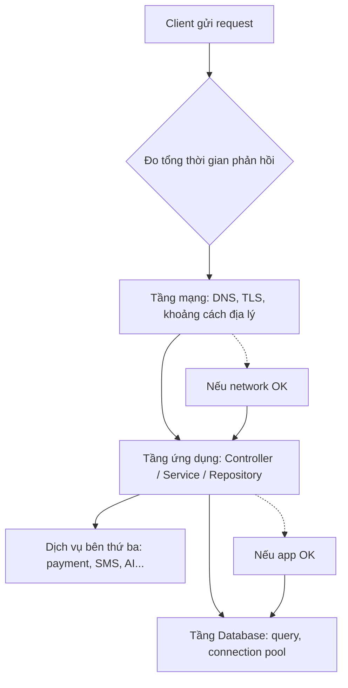
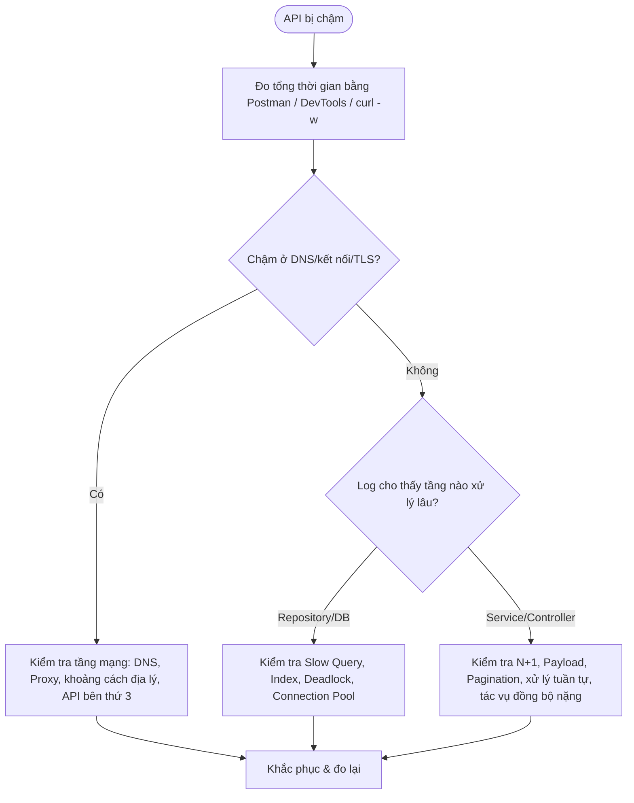

# Quy trình xác định nguyên nhân khiến API bị chậm

## Mục lục

1. [Nguyên tắc chung khi chẩn đoán hiệu suất API](https://claude.ai/chat/46012664-46ee-47a9-841b-67be707b29ed#nguyen-tac-chung)
2. [Bước 1 — Đo lường và xác nhận vấn đề](https://claude.ai/chat/46012664-46ee-47a9-841b-67be707b29ed#buoc-1)
3. [Bước 2 — Kiểm tra tầng mạng (Network)](https://claude.ai/chat/46012664-46ee-47a9-841b-67be707b29ed#buoc-2)
4. [Bước 3 — Phân tích log theo từng tầng xử lý](https://claude.ai/chat/46012664-46ee-47a9-841b-67be707b29ed#buoc-3)
5. [Bước 4 — Kiểm tra tầng Database](https://claude.ai/chat/46012664-46ee-47a9-841b-67be707b29ed#buoc-4)
6. [Bước 5 — Kiểm tra mã nguồn ứng dụng (Application code)](https://claude.ai/chat/46012664-46ee-47a9-841b-67be707b29ed#buoc-5)
7. [Sơ đồ tổng hợp quy trình chẩn đoán](https://claude.ai/chat/46012664-46ee-47a9-841b-67be707b29ed#so-do-tong-hop)
8. [Trích dẫn](https://claude.ai/chat/46012664-46ee-47a9-841b-67be707b29ed#trich-dan)
9. [Mở rộng](https://claude.ai/chat/46012664-46ee-47a9-841b-67be707b29ed#mo-rong)

---

## Nguyên tắc chung khi chẩn đoán hiệu suất API

Trước khi soi vào từng nguyên nhân cụ thể, cần nắm một nguyên tắc quan trọng: **một request đi qua rất nhiều tầng** trước khi có kết quả trả về — mạng, load balancer, application server, database, các service bên thứ ba... Chậm có thể xảy ra ở **bất kỳ tầng nào**, nên việc chẩn đoán hiệu quả nhất là đi theo hướng **"đo trước, đoán sau"**: dùng công cụ để xác định chính xác tầng nào đang chiếm nhiều thời gian nhất, thay vì đoán mò rồi sửa code ngẫu nhiên.

Cách tiếp cận phổ biến là đi từ ngoài vào trong, giống như "bóc từng lớp hành":



**Công cụ đo đạc nên có ngay từ đầu**, chứ không phải đợi hệ thống lớn rồi mới thêm vào — vì lúc đó việc chẩn đoán sẽ khó và tốn thời gian hơn rất nhiều:

- **APM (Application Performance Monitoring):** công cụ giám sát hiệu năng ứng dụng theo thời gian thực — ví dụ New Relic, Datadog, Elastic APM. APM giúp thấy ngay request nào chậm, chậm ở hàm/tầng nào, mà không cần thêm log thủ công.
- Nếu chưa có điều kiện dùng APM, cách đơn giản nhất là **chủ động thêm log đo thời gian** ở đầu và cuối mỗi tầng xử lý (controller, service, repository) để biết tầng nào tốn thời gian nhất.

---

## Bước 1 — Đo lường và xác nhận vấn đề

Trước khi kết luận "API bị chậm", cần đo bằng công cụ để có con số cụ thể, tránh chẩn đoán dựa trên cảm giác.

- **Postman / Browser DevTools:** xem thời gian phản hồi thực tế của từng request, tab Network trong DevTools còn cho biết thời gian được chia nhỏ theo từng giai đoạn (DNS, kết nối, chờ phản hồi, tải dữ liệu).
- **`curl` với flag `-w` (write-out):** một cách nhanh, không cần công cụ đồ họa, để bóc tách thời gian request thành từng giai đoạn ngay trên terminal:

```bash
curl -o /dev/null -s -w \
  "DNS: %{time_namelookup}s | Connect: %{time_connect}s | TLS: %{time_appconnect}s | TTFB: %{time_starttransfer}s | Total: %{time_total}s\n" \
  https://api.example.com/products
```

Kết quả trả về giúp biết ngay thời gian bị "ăn" vào giai đoạn nào: phân giải DNS, bắt tay TCP, bắt tay TLS, hay thời gian server xử lý trước khi trả byte đầu tiên (TTFB — Time To First Byte).

- **So sánh thời điểm chậm với chỉ số hạ tầng:** kiểm tra xem thời điểm API chậm có trùng với lúc CPU, RAM, hoặc I/O (đọc/ghi ổ đĩa) của server tăng cao không. Nếu trùng, nhiều khả năng nguyên nhân nằm ở tài nguyên phần cứng/hạ tầng chứ không phải logic code.

Sau bước này, bạn sẽ có một con số cụ thể (ví dụ: "API chậm trung bình 2.5s") và biết được phần lớn thời gian đó rơi vào giai đoạn nào — làm cơ sở để đi tiếp vào các bước sau.

---

## Bước 2 — Kiểm tra tầng mạng (Network)

Đây thường là bước kiểm tra đầu tiên vì nó nằm ở "vòng ngoài cùng" của request, dễ loại trừ trước khi đào sâu vào code.

- **Độ trễ do kết nối internet / khoảng cách địa lý:** nếu server đặt xa vị trí người dùng, thời gian truyền tín hiệu qua lại (round-trip time) sẽ tăng, dù server xử lý rất nhanh.
- **Cấu hình DNS/Proxy:** DNS phân giải chậm, hoặc proxy trung gian (ví dụ reverse proxy, VPN công ty) xử lý không tối ưu, cũng có thể cộng thêm độ trễ đáng kể vào mỗi request.
- **Đường truyền giữa các microservice:** trong hệ thống có nhiều service gọi lẫn nhau, độ trễ mạng **nội bộ** (giữa các service, thường qua REST hoặc gRPC) cũng cần được đo riêng, vì nó cộng dồn nếu một request phải đi qua nhiều service.
- **API bên thứ ba chậm:** khi ứng dụng phải chờ phản hồi từ dịch vụ ngoài (cổng thanh toán, gửi SMS, gọi AI model...), thời gian chờ đó tính vào tổng thời gian phản hồi của API, dù lỗi không nằm ở hệ thống của bạn. Cách xử lý phổ biến là đặt **timeout** hợp lý cho các lời gọi này và cân nhắc dùng **circuit breaker** (xem thêm ở mục Mở rộng) để tránh một dịch vụ ngoài bị chậm kéo sập cả hệ thống.

Nếu đo ở Bước 1 cho thấy phần lớn thời gian nằm ở giai đoạn DNS/kết nối/TLS (không phải TTFB), nhiều khả năng nguyên nhân nằm ở tầng mạng chứ chưa cần soi vào code hay database.

---

## Bước 3 — Phân tích log theo từng tầng xử lý

Nếu tầng mạng không phải nguyên nhân, bước tiếp theo là xác định **tầng nào trong ứng dụng** (controller, service, business logic, repository...) đang xử lý lâu.

Một công cụ phổ biến cho việc này là **Grafana Loki** — hệ thống tổng hợp log (log aggregation), cho phép gom log từ nhiều service về một nơi và tìm kiếm bằng ngôn ngữ truy vấn **LogQL**<sup>[1]</sup>. Điểm khác biệt của Loki so với các hệ thống log truyền thống là nó chỉ đánh index trên **label** (nhãn, ví dụ `service=order-api`, `level=error`) thay vì đánh index toàn bộ nội dung log, giúp chi phí vận hành thấp hơn.

Ví dụ một câu truy vấn LogQL đơn giản để tìm các request xử lý lâu hơn 1 giây ở service `order-api`:

```logql
{service="order-api"} | json | duration_ms > 1000
```

Điều kiện tiên quyết để làm được điều này là **ứng dụng phải ghi log có cấu trúc** (structured logging) tại từng tầng, kèm theo thời gian xử lý và một **correlation ID** (mã định danh duy nhất cho mỗi request) để có thể lần theo một request đi qua toàn bộ các tầng/service. Nếu hệ thống có nhiều microservice, kỹ thuật **distributed tracing** (dùng công cụ như OpenTelemetry, Jaeger) sẽ hiệu quả hơn việc chỉ đọc log rời rạc, vì nó hiển thị trực quan thời gian xử lý ở từng service trong cùng một request.

```go
// Ví dụ log có cấu trúc, đo thời gian từng tầng trong Go
func (s *OrderService) CreateOrder(ctx context.Context, req CreateOrderRequest) error {
    start := time.Now()
    defer func() {
        log.Info("CreateOrder finished",
            "correlation_id", ctx.Value("correlation_id"),
            "duration_ms", time.Since(start).Milliseconds(),
        )
    }()
    // ... xử lý logic
    return nil
}
```

---

## Bước 4 — Kiểm tra tầng Database

Nếu log cho thấy thời gian bị "ăn" nhiều nhất ở tầng repository (nơi gọi database), bước tiếp theo là soi vào các câu truy vấn SQL.

Các nguyên nhân phổ biến:

- **Slow Query (truy vấn chậm):** câu lệnh SQL chạy lâu do thiếu **index** (chỉ mục — cấu trúc giúp database tìm dữ liệu nhanh mà không cần quét toàn bộ bảng), do **Full Table Scan** (quét toàn bộ bảng thay vì dùng index), hoặc do `JOIN` nhiều bảng phức tạp.
- **Deadlock / khóa bảng (locking):** deadlock xảy ra khi hai hay nhiều transaction cùng chờ nhau giải phóng tài nguyên mà không bên nào chịu nhường, khiến cả hai bị kẹt; khóa bảng/dòng dữ liệu (locking) cũng khiến các request khác phải xếp hàng chờ.
- **Connection Pool cạn kiệt:** connection pool là một "bể" các kết nối database được mở sẵn để tái sử dụng; nếu số lượng kết nối trong pool không đủ so với lượng request đồng thời, các request mới phải chờ đến khi có kết nối rảnh, gây chậm dù bản thân câu query không có vấn đề gì.

**Cách kiểm tra cụ thể:**

- Bật tính năng **slow query log** có sẵn trong hầu hết hệ quản trị database (MySQL, PostgreSQL...) để tự động ghi lại các câu lệnh vượt quá một ngưỡng thời gian nhất định.
- Dùng lệnh `EXPLAIN` (hoặc `EXPLAIN ANALYZE` trong PostgreSQL) để xem database sẽ thực thi câu truy vấn như thế nào — ví dụ có dùng index hay đang quét toàn bảng:

```sql
EXPLAIN ANALYZE
SELECT * FROM orders WHERE customer_id = 123;
```

Nếu kết quả hiển thị `Seq Scan` (quét tuần tự toàn bảng) thay vì `Index Scan`, đó là dấu hiệu cột `customer_id` đang thiếu index.

- Theo dõi số lượng kết nối đang mở/đang chờ của connection pool qua APM hoặc log của thư viện database driver, để phát hiện tình trạng "cạn pool" trước khi nó gây timeout hàng loạt.

---

## Bước 5 — Kiểm tra mã nguồn ứng dụng (Application code)

Nếu cả tầng mạng lẫn database đều ổn nhưng API vẫn chậm, nguyên nhân thường nằm ở cách code xử lý logic:

- **Truy vấn N+1:** hiện tượng thực hiện 1 truy vấn để lấy danh sách, sau đó lặp qua từng phần tử để truy vấn thêm dữ liệu liên quan — dẫn đến N truy vấn phụ thay vì 1-2 truy vấn gộp. Đây là nguyên nhân rất phổ biến gây chậm ở tầng repository dù mỗi câu query riêng lẻ đều nhanh.
- **Payload quá lớn:** API trả về hoặc nhận dữ liệu JSON quá nặng, khiến thời gian **serialization** (chuyển đổi dữ liệu object sang định dạng truyền tải như JSON) và thời gian truyền qua mạng đều tăng.
- **Thiếu phân trang (pagination):** trả về hàng nghìn, hàng triệu bản ghi trong một lần gọi duy nhất thay vì chia nhỏ theo trang, vừa tốn thời gian truy vấn vừa tốn băng thông.
- **Xử lý tuần tự đáng lẽ có thể chạy song song:** ví dụ gọi lần lượt 3 API bên thứ ba không phụ thuộc nhau, thay vì gọi đồng thời (concurrent).
- **Tác vụ đồng bộ nặng chạy trong luồng chính:** thực hiện các việc tốn thời gian (gửi email, gọi bên thứ ba, xử lý file) trực tiếp trong lúc xử lý request, thay vì đẩy ra xử lý bất đồng bộ qua hàng đợi (queue) hoặc background job, khiến client phải chờ lâu hơn mức cần thiết.

Ví dụ minh họa việc chuyển từ gọi tuần tự sang gọi song song trong Go bằng `goroutine` và `sync.WaitGroup`:

```go
// Trước: gọi tuần tự — tổng thời gian = thời gian của cả 3 lời gọi cộng lại
userInfo := getUserInfo(userID)
orderHistory := getOrderHistory(userID)
recommendations := getRecommendations(userID)

// Sau: gọi song song — tổng thời gian ≈ thời gian của lời gọi chậm nhất
var wg sync.WaitGroup
var userInfo UserInfo
var orderHistory []Order
var recommendations []Product

wg.Add(3)
go func() { defer wg.Done(); userInfo = getUserInfo(userID) }()
go func() { defer wg.Done(); orderHistory = getOrderHistory(userID) }()
go func() { defer wg.Done(); recommendations = getRecommendations(userID) }()
wg.Wait()
```

> Lưu ý: chỉ nên chạy song song các tác vụ **độc lập** với nhau (không phụ thuộc kết quả của nhau). Nếu tác vụ B cần dữ liệu từ tác vụ A, bắt buộc phải chạy tuần tự.

---

## Sơ đồ tổng hợp quy trình chẩn đoán



---

## Trích dẫn

- Grafana Labs — [Grafana Loki documentation](https://grafana.com/docs/loki/latest/): định nghĩa Loki, cách Loki chỉ đánh index label thay vì full-text, và ngôn ngữ truy vấn LogQL.
- Tài liệu tham khảo về cách dùng `curl -w` để bóc tách thời gian request thành các giai đoạn (DNS lookup, TCP connect, TLS handshake, TTFB, total time) — tổng hợp từ các hướng dẫn kỹ thuật phổ biến về đo lường hiệu năng HTTP bằng curl.
- Phần còn lại của nội dung được biên soạn lại dựa trên tài liệu gốc do người dùng cung cấp (`Process for identifying the cause of API slowness.md`), có sắp xếp lại trình tự, bổ sung giải thích thuật ngữ, ví dụ code (Go/SQL) và sơ đồ minh họa.

---

## Mở rộng

- **Distributed Tracing:** dùng OpenTelemetry, Jaeger hoặc Zipkin để theo dõi một request đi qua nhiều microservice, xem chính xác thời gian xử lý ở từng service trong một biểu đồ trực quan (thay vì phải tự ghép log thủ công).
- **Circuit Breaker Pattern:** cơ chế tự động "ngắt" việc gọi tới một service phụ thuộc đang lỗi/chậm liên tục, tránh làm chậm dây chuyền (cascading failure) toàn hệ thống.
- **Database Indexing nâng cao:** hiểu sâu hơn về các loại index (B-Tree, Hash, Composite Index) và cách chọn index phù hợp với từng loại truy vấn.
- **Load Testing:** dùng công cụ như k6, JMeter, Locust để giả lập tải lớn, phát hiện điểm nghẽn (bottleneck) trước khi hệ thống gặp sự cố thật trong production.
- **Profiling ở cấp độ code:** với Go có thể dùng `pprof` để xem chi tiết CPU/memory profile của ứng dụng, xác định chính xác hàm nào tốn thời gian/tài nguyên nhất.
- **Caching và Connection Pooling:** hai kỹ thuật tối ưu hiệu suất liên quan trực tiếp tới nhiều nguyên nhân gây chậm ở tài liệu này — xem chi tiết trong tài liệu "Các cách tối ưu hiệu suất API".