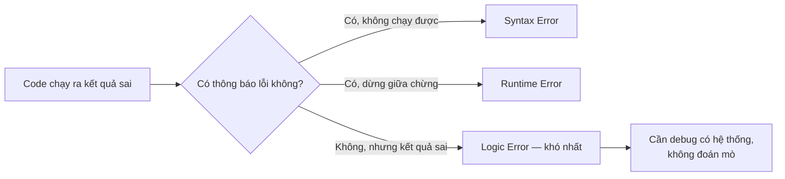
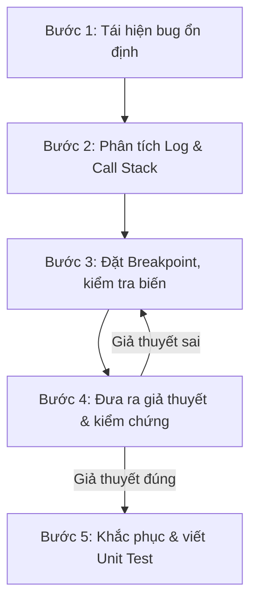

# Quy trình Debug lỗi Logic (Logic Error Debugging Workflow)

## Mục lục

1. [Bản chất của Bug và vì sao code không chạy đúng](#ban-chat-bug)
2. [Các kỹ thuật debug lỗi logic cơ bản](#ky-thuat-co-ban)
3. [Quy trình 5 bước debug lỗi logic một cách hệ thống](#quy-trinh-5-buoc)
4. [Các lỗi logic phổ biến cần kiểm tra trước tiên](#loi-logic-pho-bien)
5. [So sánh các phương pháp Debug phổ biến](#so-sanh-phuong-phap)
6. [Những sai lầm thường gặp khi Debug](#sai-lam-thuong-gap)
7. [Trích dẫn](#trich-dan)
8. [Mở rộng](#mo-rong)

---

## Bản chất của Bug và vì sao code không chạy đúng


Mọi hệ thống phần mềm, dù đơn giản hay phức tạp, đều có khả năng chứa lỗi (bug) trong quá trình phát triển. Lập trình viên thường gặp 3 nhóm lỗi chính:

- **Lỗi cú pháp (Syntax Error):** code viết sai quy tắc ngôn ngữ, khiến chương trình không biên dịch/chạy được. Đây là loại lỗi dễ phát hiện nhất, vì trình biên dịch (compiler) hoặc trình thông dịch (interpreter) thường báo lỗi ngay lập tức.
- **Lỗi khi thực thi (Runtime Error):** chương trình biên dịch thành công nhưng gặp sự cố trong lúc chạy — ví dụ chia cho 0, truy cập vào vị trí không tồn tại trong mảng, hoặc gọi vào một giá trị rỗng (null/nil).
- **Lỗi logic (Logic Error):** đây là dạng **khó phát hiện nhất**, vì chương trình vẫn biên dịch và chạy bình thường — không có thông báo lỗi nào cả — nhưng **kết quả đầu ra lại sai** so với yêu cầu bài toán. Ví dụ: hàm tính tổng tiền hóa đơn chạy không lỗi, nhưng áp dụng sai công thức khiến kết quả tính thiếu thuế VAT.

**Debugging** không đơn thuần là "sửa cho code chạy được", mà là một quá trình **điều tra có hệ thống**: phân tích dòng chảy dữ liệu (data flow — dữ liệu đi qua những bước xử lý nào, biến đổi ra sao) và trạng thái ứng dụng (application state — giá trị của các biến, đối tượng tại một thời điểm cụ thể) để tìm ra điểm sai lệch giữa những gì code *thực sự làm* và những gì nó *được kỳ vọng làm*.

Nếu thiếu tư duy phân tích hệ thống, việc tìm bug dễ biến thành "đoán mò" — sửa thử chỗ này, thử chỗ kia — vừa tốn thời gian, vừa không chắc giải quyết đúng gốc rễ vấn đề.



---

## Các kỹ thuật debug lỗi logic cơ bản

Trước khi đi vào quy trình đầy đủ, đây là các kỹ thuật cụ thể — có thể dùng độc lập hoặc kết hợp tùy tình huống:

### 1. Xác định kết quả kỳ vọng so với thực tế

- Viết rõ ra: đầu vào (input) là gì? Đầu ra (output) mong đợi là gì? Và chương trình đang thực tế trả về cái gì?
- Khoanh vùng điểm bắt đầu và điểm kết thúc của luồng xử lý đang nghi ngờ có lỗi.

Bước này nghe đơn giản nhưng rất quan trọng: nếu không viết rõ kỳ vọng ra trước, rất dễ debug nhầm hướng hoặc tự thuyết phục bản thân rằng kết quả sai... thực ra là đúng.

### 2. Dùng phương pháp in giá trị (Print / Console Debugging)

Đặt các lệnh như `print()`, `console.log()`, hoặc dùng một **Logger** (công cụ ghi log có cấu trúc, thường tốt hơn print thuần vì có thể bật/tắt theo mức độ — debug, info, error) tại các mốc quan trọng trong code, để kiểm tra giá trị biến ở:

- Đầu vào hàm (tham số nhận được).
- Các bước trung gian (sau mỗi phép tính, sau mỗi vòng lặp).
- Giá trị trả về (return).

```go
// Ví dụ debug bằng log trong Go
func CalculateTotal(items []Item) float64 {
    log.Printf("CalculateTotal: nhận %d items", len(items))

    var total float64
    for i, item := range items {
        total += item.Price * float64(item.Quantity)
        log.Printf("  sau item %d (%s): total = %.2f", i, item.Name, total)
    }

    log.Printf("CalculateTotal: kết quả trả về = %.2f", total)
    return total
}
```

Cách này đơn giản, không cần cấu hình gì thêm, nhưng nếu lạm dụng sẽ làm code "bẩn" (lẫn lộn logic nghiệp vụ với code debug) — nên nhớ dọn dẹp log debug sau khi xong, hoặc dùng mức log phù hợp (`debug`) để có thể tắt dễ dàng.

### 3. Dùng công cụ Debugger chuyên dụng (IDE Debugger)

Thay vì rải log khắp nơi, các IDE hiện đại (VS Code, PyCharm, IntelliJ, GoLand...) đều có **debugger tích hợp**, cho phép:

- Đặt **Breakpoint** (điểm dừng): chương trình sẽ tạm dừng khi chạy tới dòng này.
- Chạy ở **chế độ Debug** (thường là phím F5), rồi dùng:
  - **Step Over** (thường F10): chạy qua dòng hiện tại, không đi sâu vào bên trong hàm được gọi.
  - **Step Into** (thường F11): nhảy vào bên trong hàm đang được gọi, để xem chi tiết nó chạy ra sao.
- Quan sát giá trị thực tế của các biến **trong bộ nhớ, theo thời gian thực** — chính xác hơn nhiều so với đoán qua log.

### 4. Kỹ thuật "Rubber Duck Debugging" (Giải thích cho chú vịt cao su)

Kỹ thuật này được phổ biến từ cuốn sách *The Pragmatic Programmer* (Andy Hunt & Dave Thomas)<sup>[1]</sup>: đặt một vật vô tri (ví dụ một con vịt cao su) trước mặt, rồi giải thích cho nó (hoặc một đồng nghiệp) nghe, từng dòng một, code và thuật toán của bạn đang hoạt động như thế nào.

Điều thú vị là: việc **tự diễn đạt bằng lời** quá trình xử lý buộc não phải kiểm tra lại từng giả định — và rất thường xuyên, chính lúc nói ra bạn sẽ tự nhận ra chỗ giả định bị sai, trước cả khi người nghe (hay con vịt) kịp phản hồi.

### 5. Viết Unit Test

Viết các bài kiểm thử đơn vị (**Unit Test** — kiểm thử một hàm/module riêng lẻ, độc lập với phần còn lại của hệ thống) cho hàm hoặc module đang nghi có lỗi, thử với nhiều bộ dữ liệu khác nhau — đặc biệt là các **trường hợp biên (edge case)**: giá trị 0, danh sách rỗng, số âm, giá trị lớn nhất có thể...

```go
func TestCalculateTotal_EmptyList(t *testing.T) {
    result := CalculateTotal([]Item{})
    if result != 0 {
        t.Errorf("Mong đợi 0, nhưng nhận được %.2f", result)
    }
}
```

Viết test không chỉ giúp tìm ra lỗi hiện tại, mà còn là bước đệm cho Bước 5 của quy trình bên dưới — đảm bảo lỗi không quay lại trong tương lai.

---

## Quy trình 5 bước debug lỗi logic một cách hệ thống


Để xử lý triệt để sự cố phần mềm — từ đơn giản đến phức tạp — nên tuân theo một quy trình rà soát có hệ thống, thay vì sửa mã nguồn một cách ngẫu nhiên. Dưới đây là 5 bước tiêu chuẩn, kết hợp các kỹ thuật ở phần trên theo đúng trình tự:



### Bước 1: Tái hiện lại bug (Reproduce the bug) một cách ổn định

Một lỗi chỉ có thể sửa đúng khi bạn **tái hiện được nó một cách nhất quán** (mỗi lần làm đúng các bước đó, lỗi đều xuất hiện lại). Cần xác định rõ:

- Dữ liệu đầu vào (input) cụ thể gây lỗi.
- Môi trường thực thi: trình duyệt, hệ điều hành, phiên bản database...
- Các điều kiện biên dẫn tới sự cố.

Nếu lỗi xảy ra **chập chờn** (lúc có lúc không, cùng một input nhưng kết quả khác nhau giữa các lần chạy), đây là dấu hiệu đáng chú ý — nguyên nhân thường không nằm ở logic tuần tự thông thường, mà có thể do:

- **Race condition** (tranh chấp bất đồng bộ): nhiều luồng/tiến trình cùng truy cập, thay đổi một dữ liệu dùng chung mà không được đồng bộ hóa đúng cách, khiến kết quả phụ thuộc vào thứ tự thực thi ngẫu nhiên giữa các luồng.
- **Memory leak** (rò rỉ bộ nhớ): chương trình cấp phát bộ nhớ nhưng không giải phóng đúng lúc, khiến bộ nhớ sử dụng tăng dần theo thời gian — lỗi dạng này thường không xuất hiện ngay mà "lộ ra" sau một thời gian chạy dài.

### Bước 2: Phân tích Log hệ thống và Call Stack

Đừng vội sửa code khi chưa đọc kỹ thông báo lỗi. **Call Stack** (ngăn xếp lời gọi hàm) cho biết chính xác chuỗi hàm nào đã gọi hàm nào, theo thứ tự, trước khi ứng dụng gặp sự cố (crash) hoặc ném ra ngoại lệ (**exception** — tín hiệu báo lỗi được chương trình "ném ra" khi gặp tình huống bất thường).

Đọc hiểu **Stack Trace** (bản ghi lại Call Stack tại thời điểm lỗi xảy ra) giúp xác định ngay **tệp tin và dòng code cụ thể** nơi ngoại lệ xảy ra — tiết kiệm đáng kể thời gian so với việc dò từng dòng code một cách thủ công.

### Bước 3: Đặt Breakpoint và kiểm tra biến (Inspect Variables)

Thay vì rải quá nhiều lệnh in dữ liệu ra màn hình, hãy tận dụng debugger tích hợp sẵn trong IDE (Visual Studio Code, IntelliJ, Xcode, GoLand...). Đặt Breakpoint tại vùng nghi vấn, rồi dùng Step Over/Step Into để quan sát giá trị thực tế của các biến ngay trong bộ nhớ, tại thời điểm chạy thực (runtime).

### Bước 4: Khoanh vùng và đưa ra giả thuyết (Formulate Hypothesis)

Dựa trên dữ liệu quan sát được từ Breakpoint, khoanh vùng đoạn code gây ra sự bất thường và **đưa ra một giả thuyết cụ thể** về nguyên nhân. Ví dụ: *"Nếu dữ liệu đối tượng bị null tại dòng 45, nguyên nhân có thể là do API chưa trả về kịp."*

Sau đó, **kiểm chứng giả thuyết** — ví dụ thử thay đổi giá trị đầu vào, hoặc kiểm tra lại luồng xử lý điều kiện liên quan — để xác nhận giả thuyết đó đúng hay sai. Nếu sai, quay lại Bước 3 để thu thập thêm dữ liệu và đặt giả thuyết khác (đây là lý do sơ đồ trên có một vòng lặp giữa Bước 3 và Bước 4).

### Bước 5: Khắc phục lỗi và viết Unit Test phòng ngừa

Khi đã xác định chính xác nguyên nhân, tiến hành viết mã sửa lỗi gọn gàng, tuân theo kiến trúc hiện có của dự án — tránh sửa "vá víu" chỉ để qua được trường hợp lỗi cụ thể vừa gặp.

Đặc biệt, hãy bổ sung một **Unit Test** hoặc **Integration Test** (kiểm thử tích hợp — kiểm tra nhiều thành phần phối hợp với nhau) cho đúng trường hợp lỗi vừa sửa. Đây là kỹ thuật chống **Regression** (hồi quy — lỗi cũ quay trở lại sau khi code được thay đổi ở một đợt phát hành sau), đảm bảo bug đó không xuất hiện lại trong tương lai.

---

## Các lỗi logic phổ biến cần kiểm tra trước tiên

Trước khi đào sâu vào toàn bộ quy trình 5 bước, một số loại lỗi logic rất phổ biến đáng được kiểm tra đầu tiên, vì chúng chiếm tỷ lệ lớn trong các bug thực tế:

- **Lỗi lệch một đơn vị (Off-by-one error):** dùng sai dấu so sánh `<` thay vì `<=` (hoặc ngược lại), khiến vòng lặp chạy thiếu hoặc thừa một bước — ví dụ viết `for i := 0; i < n; i++` khi thực ra cần chạy tới `i <= n`.
- **Sai điều kiện rẽ nhánh (if-else):** biểu thức logic phủ định bị đặt sai, hoặc thứ tự các điều kiện kiểm tra bị chồng chéo, khiến một nhánh code không bao giờ được chạy vào (hoặc luôn chạy vào, trong khi lẽ ra có lúc không).
- **Thay đổi dữ liệu gốc ngoài ý muốn (Side effects):** một hàm vô tình làm thay đổi giá trị của biến toàn cục, hoặc của mảng/object được truyền vào làm tham số — trong khi người gọi hàm không ngờ tới điều đó. Ví dụ điển hình trong nhiều ngôn ngữ: truyền một slice/mảng vào hàm, hàm sửa trực tiếp lên phần tử của nó, khiến dữ liệu gốc bên ngoài hàm cũng bị thay đổi theo.
- **Thứ tự thực hiện phép toán (Operator precedence):** thiếu dấu ngoặc đơn `()`, khiến thứ tự ưu tiên của các toán tử bị tính sai — ví dụ `a + b * c` sẽ tính phép nhân trước, có thể không phải điều bạn muốn nếu thực ra cần `(a + b) * c`.

---

## So sánh các phương pháp Debug phổ biến


Mỗi phương pháp rà soát lỗi đều có ưu/nhược điểm riêng, tùy quy mô và ngữ cảnh của dự án:

| Phương pháp | Cơ chế hoạt động | Ưu điểm | Nhược điểm & Ngữ cảnh sử dụng |
|---|---|---|---|
| **Print / Log Debugging** | In giá trị biến ra Console hoặc tệp log hệ thống | Đơn giản, dễ thực hiện, không cần cấu hình công cụ phức tạp | Làm "bẩn" mã nguồn nếu không dọn dẹp; khó theo dõi các luồng xử lý bất đồng bộ phức tạp |
| **IDE Breakpoint Debugging** | Tạm dừng tiến trình ứng dụng, theo dõi bộ nhớ trực tiếp | Kiểm soát chính xác trạng thái (state), quan sát được Call Stack và luồng thực thi | Yêu cầu cấu hình môi trường debug đúng trên IDE; có thể bất tiện khi debug hệ thống phân tán nhiều service |
| **Rubber Duck Debugging** | Diễn giải logic code từng dòng cho người khác hoặc vật thể nghe | Tự phát hiện lỗ hổng tư duy logic nhanh chóng, không cần công cụ | Không hiệu quả với lỗi do cấu hình môi trường hoặc xung đột thư viện — những lỗi cần dữ liệu thực tế để xác minh, không chỉ suy luận bằng lời |
| **Profiling & APM Tools** | Ghi lại mức độ tiêu thụ CPU, RAM, Network I/O theo thời gian thực | Phát hiện điểm nghẽn hiệu năng (bottleneck) và rò rỉ bộ nhớ (memory leak) | Chi phí tích hợp/vận hành cao hơn; phù hợp hơn cho hệ thống production quy mô lớn, không cần thiết cho lỗi logic đơn giản |

> Lưu ý: 3 phương pháp đầu (Print/Log, Breakpoint, Rubber Duck) chủ yếu dùng để tìm **lỗi logic** (kết quả sai). Riêng **Profiling/APM** phù hợp hơn với việc chẩn đoán **vấn đề hiệu năng** (API chậm) — chủ đề này được trình bày chi tiết hơn ở tài liệu riêng về "Quy trình xác định nguyên nhân khiến API bị chậm".

---

## Những sai lầm thường gặp khi Debug

- **Sửa đổi nhiều nơi cùng lúc:** khi chưa chắc chắn nguyên nhân, việc thay đổi code ở nhiều tệp tin cùng lúc khiến bạn không biết thay đổi nào thực sự có tác dụng — đồng thời dễ vô tình tạo thêm bug mới chồng lên bug cũ.
- **Tin tưởng tuyệt đối vào giả định ban đầu:** luôn nghi ngờ dữ liệu đầu vào. Đừng mặc định một biến "chắc chắn có dữ liệu" hay một API bên ngoài "chắc chắn trả về đúng định dạng" — hãy kiểm tra trực tiếp giá trị thực tế tại runtime.
- **Bỏ qua hệ thống quản lý phiên bản (Git):** trước khi thử các phương án sửa lỗi phức tạp (có thể ảnh hưởng nhiều phần code), hãy tạo một nhánh (branch) mới trên Git. Việc này giúp dễ dàng khôi phục lại trạng thái code an toàn ban đầu nếu hướng sửa không đúng, thay vì phải nhớ thủ công những gì đã thay đổi.

---

## Trích dẫn

1. Andy Hunt & Dave Thomas — *The Pragmatic Programmer* (qua tóm tắt trên [Wikipedia — Rubber duck debugging](https://en.wikipedia.org/wiki/Rubber_duck_debugging)): nguồn gốc của kỹ thuật Rubber Duck Debugging — giải thích vấn đề từng bước cho một vật nghe thụ động (ban đầu là một con vịt cao su) để tự phát hiện ra giả định sai trong tư duy logic.
2. Phần còn lại của nội dung (quy trình 3 nhóm lỗi, quy trình 5 bước, các lỗi logic phổ biến, bảng so sánh phương pháp debug, các sai lầm thường gặp) được biên soạn lại dựa trên tài liệu gốc do người dùng cung cấp (`LogicErrorDebugging_wf.md`), có bổ sung định nghĩa thuật ngữ, ví dụ code minh họa (Go) và sơ đồ mermaid để trực quan hóa quy trình.

*Toàn bộ 3 hình ảnh minh họa trong tài liệu gốc đã được giữ nguyên đường dẫn và đặt đúng vị trí nội dung liên quan.*

---

## Mở rộng

- **Scientific Debugging (Debug theo phương pháp khoa học):** một cách tiếp cận hình thức hóa quy trình "quan sát → đặt giả thuyết → kiểm chứng" ở Bước 3-4 thành một vòng lặp lặp lại có hệ thống, tương tự phương pháp khoa học — hữu ích khi lỗi phức tạp, cần nhiều vòng thử.
- **Git Bisect:** công cụ của Git giúp tự động tìm ra chính xác commit nào đã gây ra lỗi, bằng cách chia đôi (binary search) lịch sử commit — rất hữu ích khi biết lỗi "mới xuất hiện gần đây" nhưng không rõ do thay đổi nào.
- **Distributed Tracing:** khi lỗi xảy ra trong hệ thống nhiều microservice, Stack Trace của một service đơn lẻ không đủ — cần công cụ theo dõi một request xuyên suốt nhiều service (OpenTelemetry, Jaeger).
- **Fuzz Testing:** kỹ thuật tự động sinh ra lượng lớn dữ liệu đầu vào ngẫu nhiên/bất thường để phát hiện các trường hợp biên mà lập trình viên có thể chưa nghĩ tới khi viết Unit Test thủ công.
- **Post-mortem / Root Cause Analysis:** quy trình phân tích sau sự cố (đặc biệt với lỗi production nghiêm trọng), không chỉ dừng ở việc sửa lỗi mà còn tìm hiểu vì sao lỗi lọt qua được các bước kiểm tra trước đó (code review, test...), để cải thiện quy trình cho tương lai.
