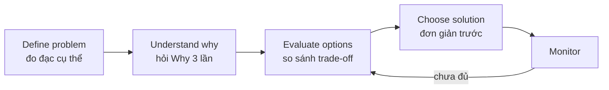
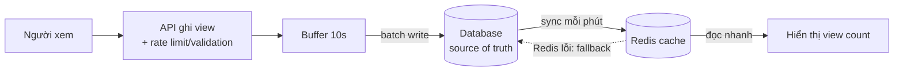

# Từ Code-First đến Problem-First: Tư duy của một Architect

> Tôi còn nhớ rõ lần đầu tiên bị senior architect hỏi: _"Tại sao em chọn Redis?"_
> 
> Câu trả lời của tôi lúc đó? _"Vì Redis nhanh ạ."_
> 
> Anh ấy mỉm cười: _"Nhanh hơn cái gì? Giải quyết vấn đề gì? Cost của nó là gì?"_
> 
> Tôi câm nín. Đó là lúc tôi nhận ra: mình đang nghĩ như một lập trình viên, không phải một architect.

## Mục lục

1. [Thuật ngữ nền tảng](#thuật-ngữ-nền-tảng)
2. [Tại sao phải thay đổi tư duy?](#tại-sao-phải-thay-đổi-tư-duy)
3. [Code-First: tư duy lập trình viên](#code-first-tư-duy-lập-trình-viên)
4. [Problem-First: tư duy architect](#problem-first-tư-duy-architect)
5. [Framework 5 câu hỏi vàng](#framework-5-câu-hỏi-vàng)
6. [Ví dụ so sánh: tính năng "View Count"](#ví-dụ-so-sánh-tính-năng-view-count)
7. [Bài tập thực hành](#bài-tập-thực-hành)
8. [Key Takeaways](#key-takeaways)
9. [Trích dẫn](#trích-dẫn)
10. [Mở rộng](#mở-rộng)

---

## Thuật ngữ nền tảng

Bài viết dùng nhiều thuật ngữ. Đọc nhanh bảng này trước để không bị vấp ở phần sau.

| Thuật ngữ | Giải thích ngắn |
|---|---|
| **Trade-off** | Được cái này thì mất cái kia. Mọi giải pháp kỹ thuật đều có trade-off. |
| **Cache** | Nơi lưu tạm kết quả đã tính/đã truy vấn để lần sau lấy nhanh hơn. Ví dụ: lưu danh sách sản phẩm hot trong bộ nhớ thay vì truy vấn database mỗi lần. |
| **Redis** | Hệ thống lưu dữ liệu trong bộ nhớ (in-memory), thường dùng làm cache hoặc bộ đếm. |
| **Index (chỉ mục)** | Cấu trúc phụ giúp database tìm dòng dữ liệu nhanh, giống mục lục cuối sách. |
| **Full table scan** | Database phải đọc toàn bộ bảng vì không có index phù hợp. |
| **Monolith** | Toàn bộ ứng dụng nằm trong một khối code, triển khai cùng nhau. |
| **Microservices** | Ứng dụng chia thành nhiều dịch vụ nhỏ, triển khai độc lập. Đổi lại, hệ thống phân tán phức tạp hơn. |
| **Sharding** | Chia dữ liệu ra nhiều máy, mỗi máy giữ một phần, để mở rộng ngang. |
| **ACID** | 4 tính chất của giao dịch: **A**tomicity (nguyên tử: làm hết hoặc không làm gì), **C**onsistency (nhất quán), **I**solation (cô lập), **D**urability (bền vững: đã commit thì không mất). |
| **Strong / Eventual Consistency** | Strong: ghi xong là mọi người đọc thấy ngay. Eventual: sau một khoảng ngắn mọi nơi mới thấy giá trị mới. |
| **Metric** | Con số đo được, dùng để đánh giá hệ thống (ví dụ: thời gian phản hồi, số request/giây). |
| **Alternative** | Phương án thay thế mà bạn đã cân nhắc trước khi chọn. |
| **Persistence** | Việc ghi dữ liệu xuống ổ đĩa để không mất khi hệ thống khởi động lại. |

---

## Tại sao phải thay đổi tư duy?

Khi bạn giỏi code, bạn có xu hướng nhảy thẳng vào giải pháp. Thấy cache? Nghĩ ngay đến Redis. Thấy queue? RabbitMQ. Microservices? Kubernetes.

Đó là **solution-first thinking**, kiểu tư duy nguy hiểm nhất trong system design. Bạn đang chọn công cụ trước khi hiểu vấn đề, giống như mua thuốc trước khi biết mình bệnh gì.

Một senior architect không bắt đầu bằng "Tôi sẽ dùng X". Họ bắt đầu bằng "Vấn đề tôi cần giải quyết là gì?"

---

## Code-First: tư duy lập trình viên

Đây là cách một developer thường nghĩ.

**Kịch bản:** Website bị chậm

```
Developer mindset:
"Website chậm → Cần cache → Dùng Redis → Done!"
```

Nghe có vẻ logic, nhưng thiếu năm câu hỏi quan trọng:

- Chậm ở đâu? Database queries? Network? API calls?
- Chậm khi nào? Giờ cao điểm hay mọi lúc?
- Chậm bao nhiêu? 100ms hay 5s?
- Cache thực sự giải quyết được không?
- Cost của cache là gì? Bộ nhớ, độ phức tạp, dữ liệu cũ (stale data)?

Code-first bỏ qua cả năm câu này. Đó là lý do nhiều giải pháp kỹ thuật thất bại.

### Ví dụ thực tế: Thảm họa Microservices

Một startup chưa có người dùng nào đã quyết định xây hệ thống bằng microservices ngay từ ngày đầu. Lý do: _"Netflix dùng microservices mà."_

Kết quả sau 6 tháng:

- 15 services cho các tính năng đơn giản
- Mỗi lần deploy mất 2 giờ
- Debug rất khó (bug nằm ở service nào?)
- Team kiệt sức vì độ phức tạp

Họ đã giải quyết được vấn đề gì? Không có, vì họ chưa có vấn đề về scale. Họ cần một monolith đơn giản để ship và lặp nhanh.

**Bài học:** Netflix dùng microservices để giải quyết vấn đề của Netflix (hàng triệu người dùng, hàng trăm team). Startup kia không có vấn đề đó.

---

## Problem-First: tư duy architect

Đây là cách một architect tiếp cận.

**Kịch bản:** Website bị chậm

```
Architect mindset:
1. Define problem:
   - Chậm ở đâu? → Measure: 80% thời gian ở database queries
   - Queries nào? → Top 3 slow queries chiếm 90% load
   
2. Understand why:
   - Tại sao slow? → Missing indexes
   - Tại sao lại missing? → Schema design không tối ưu cho query pattern
   
3. Evaluate options:
   - Option A: Add indexes → Simple, effective
   - Option B: Cache query results → Complex, có thể không cần
   - Option C: Rewrite queries → Time-consuming
   
4. Choose solution:
   → Start với indexes (simple, high impact)
   → Monitor
   → Cache nếu vẫn chưa đủ
```

Cùng một vấn đề, nhưng cách tiếp cận cho ra kết quả rất khác nhau. Architect không nhảy thẳng vào Redis. Họ **đo, phân tích, đánh giá, rồi mới quyết định**.



---

## Framework 5 câu hỏi vàng

Trước khi chọn bất kỳ giải pháp kỹ thuật nào, hãy tự hỏi:

**1. Vấn đề thực sự là gì?**
Không phải "website chậm", mà là "homepage load mất 3s, trong khi người dùng kỳ vọng dưới 1s". Vấn đề phải cụ thể, đo đạc được và có mục tiêu rõ ràng.

**2. Tại sao vấn đề này xảy ra?**
Hãy đào sâu, hỏi "Why?" ít nhất 3 lần.

```
Website chậm
→ Why? Database queries chậm
→ Why? Full table scan
→ Why? Không có index trên email column
→ Root cause: Missing index
```

**3. Giải pháp này giải quyết vấn đề gì?**

- "Redis làm website nhanh" là câu trả lời tồi.
- "Redis cache kết quả query để giảm tải database từ 1000 req/s xuống 100 req/s" là câu trả lời tốt.

**4. Cost của giải pháp là gì?**
Mọi giải pháp đều có cost:

- Redis: thêm hạ tầng, phải xử lý cache invalidation (khi nào xóa/làm mới cache), tốn bộ nhớ
- Microservices: thêm độ trễ mạng, hệ thống phân tán phức tạp, debug khó hơn
- Sharding: truy vấn xuyên nhiều shard (cross-shard) khó, chia lại shard (resharding) rất vất vả

Không có bữa trưa miễn phí. Trade-off luôn tồn tại.

**5. Có cách đơn giản hơn không?**
Đây là câu hỏi quan trọng nhất. Trước khi thêm Redis, bạn đã thử thêm index chưa? Trước khi chuyển sang microservices, bạn đã thử scale monolith chưa?

**"Simple solutions first. Complex solutions when necessary."**

---

## Ví dụ so sánh: tính năng "View Count"

Hãy xem hai cách tiếp cận cho cùng một tính năng: đếm lượt xem video.

### Approach 1: Code-First (Bad)

```
Feature: Đếm số lượt xem video

Developer thinking:
"Cần đếm views → Dùng Redis counter → Increment mỗi view → Done"

Implementation:
- Mỗi view → redis.incr('video:123:views')
- Display: redis.get('video:123:views')
```

Trông ổn đấy. Nhưng sau 1 tháng chạy production:

**Vấn đề phát sinh:**

- **Rủi ro mất dữ liệu:** Redis lưu dữ liệu chủ yếu trong bộ nhớ. Nếu không bật persistence, hoặc server sập giữa hai lần snapshot, bộ đếm có thể bị mất hoặc lùi về giá trị cũ [[1. Private vs Public vs Elastic IP]](#trích-dẫn).
- Không có dữ liệu lịch sử (views theo ngày/tháng)
- Không theo dõi được xu hướng (trending: views tăng nhanh)
- Bot spam làm tăng số view ảo

Developer lúc này phải refactor toàn bộ, migrate dữ liệu và xử lý downtime.

> Lưu ý: Redis **có** cơ chế persistence (RDB snapshot và AOF log) và có thể cấu hình để giảm mất dữ liệu [[1. Private vs Public vs Elastic IP]](#trích-dẫn). Vấn đề của Approach 1 không phải "Redis luôn mất dữ liệu", mà là **dùng một cache làm nguồn dữ liệu gốc duy nhất** mà không tính đến độ bền và nhu cầu phân tích.

### Approach 2: Problem-First (Good)

```
Feature: Đếm số lượt xem video

Architect thinking:
1. Requirements:
   - Độ chính xác: Có cần 100% accurate? (Probably not)
   - Scale: Bao nhiêu videos? Bao nhiêu views/s?
   - Analytics: Cần track theo thời gian không?
   - Fraud: Cần prevent bot spam không?

2. Design:
   - Write to database (persistent, source of truth)
   - Async batch write (10s buffer) để giảm DB load
   - Cache in Redis (fast read, có thể sai lệch 1-2%)
   - Background job sync Redis ← → DB mỗi phút
   
3. Trade-offs accepted:
   - View count có thể delay vài giây (acceptable)
   - Có thể sai lệch nhỏ (acceptable cho social metric)
   - Complex hơn solution 1 (necessary cho reliability)
```

Sơ đồ luồng của thiết kế trên:



Cách này xử lý được các vấn đề của Approach 1:

- Redis lỗi → fallback về DB
- Dữ liệu lịch sử → có sẵn trong DB
- Trending → truy vấn DB theo khoảng thời gian
- Bot spam → rate limit (giới hạn số request) và lớp validation

---

## Bài tập thực hành

### Exercise 1: Phân tích quyết định của bạn

Nhớ lại một quyết định kỹ thuật gần đây của bạn và trả lời 5 câu hỏi dưới đây. Phần trả lời mẫu là quyết định **chọn PostgreSQL thay vì MongoDB**.

#### 1. Bạn chọn giải pháp gì?

Dùng PostgreSQL thay vì MongoDB.

#### 2. Lý do bạn chọn?

- **Tính nhất quán cao:** PostgreSQL tuân thủ ACID theo mặc định, rất phù hợp với hệ thống tài chính, ngân hàng. MongoDB đảm bảo tính nguyên tử trên từng document, và hỗ trợ giao dịch nhiều document từ phiên bản 4.0 [[2]](#trích-dẫn). Tuy nhiên, giao dịch nhiều document không phải cách dùng chủ đạo của MongoDB và thường tốn tài nguyên hơn thao tác trên một document [[2]](#trích-dẫn).
- **Toàn vẹn dữ liệu:** Database tự kiểm soát tính đúng đắn của dữ liệu thông qua các ràng buộc (constraint) như khóa chính, khóa ngoại (Foreign Key), UNIQUE, CHECK.
- **Truy vấn phức tạp:** Các câu truy vấn nhiều bảng với JOIN, gom nhóm, báo cáo được hỗ trợ tốt.

#### 3. Bạn đã đo đạc vấn đề chưa? Có metrics cụ thể không?

**Metric là gì?** Là một con số đo được phản ánh sức khỏe hoặc hiệu năng của hệ thống. "Database nhanh" là cảm giác. "p95 latency của API đặt hàng là 80ms" là metric.

Các metric thường dùng khi so sánh database:

| Metric | Ý nghĩa |
|---|---|
| **Latency (p50, p95, p99)** | Thời gian phản hồi. p95 = 95% request nhanh hơn mức này. Nên xem p95/p99 thay vì chỉ trung bình, vì người dùng nhớ những lần chậm. |
| **Throughput (TPS/QPS)** | Số giao dịch/truy vấn xử lý được mỗi giây. |
| **Tỉ lệ lỗi** | Phần trăm request thất bại (ví dụ timeout, deadlock). |
| **Tài nguyên** | CPU, RAM, dung lượng ổ đĩa. |

**Cách đo cụ thể:**

1. **Xác định workload thật:** liệt kê 3-5 truy vấn/nghiệp vụ quan trọng nhất (ví dụ: tạo đơn hàng, xem lịch sử đơn).
2. **Phân tích từng truy vấn:** với PostgreSQL, dùng `EXPLAIN (ANALYZE, BUFFERS)` để xem kế hoạch thực thi và thời gian thực tế [[3]](#trích-dẫn). Lưu ý `ANALYZE` thực sự chạy câu lệnh, nên với `INSERT/UPDATE/DELETE` hãy bọc trong `BEGIN; ... ROLLBACK;` để không làm thay đổi dữ liệu [[3]](#trích-dẫn). Từ PostgreSQL 18, `BUFFERS` được bật mặc định khi dùng `ANALYZE` [[4]](#trích-dẫn). Với MongoDB, tương đương là `explain("executionStats")` [[6]](#trích-dẫn).
3. **Đo tải:** dùng `pgbench` (công cụ benchmark đi kèm PostgreSQL) [[5]](#trích-dẫn) hoặc script tải riêng với dữ liệu giống thật.

```bash
# Tạo dữ liệu mẫu (scale factor 10)
pgbench -i -s 10 mydb

# Chạy 60 giây với 10 client, 2 thread
pgbench -c 10 -j 2 -T 60 mydb
```

4. **Ghi lại kết quả** (latency, TPS) vào bảng để so sánh với phương án thay thế.


#### 4. Bạn có xem xét alternatives không? Có so sánh PostgreSQL với MongoDB không?

**Alternative** là các phương án thay thế bạn đã cân nhắc. Nếu chưa so sánh, bạn chưa thực sự "chọn", chỉ mới "quen tay dùng". Dưới đây là khung so sánh (Comparison Framework) PostgreSQL và MongoDB.

**The Comparison Framework**

- **Data Model (hình dạng dữ liệu):** PostgreSQL lưu theo dòng (row-based), yêu cầu cấu trúc rõ ràng. MongoDB lưu theo tài liệu (document-based), cho phép lồng dữ liệu (embedding). Ranh giới này đang mờ dần vì PostgreSQL hiện hỗ trợ kiểu `JSONB` rất mạnh.
- **Schema Flexibility:** PostgreSQL là "hợp đồng chặt chẽ" (rigid schema), bảo vệ bạn khỏi code xấu. MongoDB linh hoạt hơn (schemaless), đổi lại bạn cần kỷ luật engineering cao để dữ liệu không trở thành bãi rác.
- **Query Complexity (Joins vs. Embedding):** PostgreSQL mạnh ở các JOIN phức tạp. MongoDB ưu tiên nhúng dữ liệu. Cái giá của embedding là trùng lặp: khi một thông tin chung (như tên Product) thay đổi, bạn phải đồng bộ lại trên rất nhiều document.
- **Atomicity & Transactions (ACID):** PostgreSQL được xây dựng cho sự đúng đắn chặt chẽ. MongoDB đã hỗ trợ transaction đa document [[2]](#trích-dẫn), nhưng đi kèm chi phí hiệu năng và độ phức tạp thiết kế mà không phải team nào cũng xử lý tốt.
- **Performance (Read/Write Heavy):** Hiệu năng phụ thuộc rất nhiều vào workload và cách thiết kế, nên không có người thắng tuyệt đối. Bản gốc nhận định MongoDB thường nhanh hơn ở write-heavy còn PostgreSQL ổn định hơn ở read-heavy với truy vấn phức tạp nhờ nhiều loại index (B-tree, GIN, GiST).
- **Consistency Models:** PostgreSQL mặc định là Strong Consistency. MongoDB có thể cấu hình để chấp nhận Eventual Consistency (ví dụ đọc từ node phụ) nhằm tăng tốc. Hãy cẩn thận: đây không chỉ là lý thuyết phân tán. Đó là lúc khách hàng gọi điện phàn nàn vì số dư chưa cập nhật sau khi nạp tiền.
- **Scalability:** MongoDB thiết kế cho mở rộng ngang (horizontal scaling) bằng sharding. Tuy nhiên, chọn sai shard key có thể "nhốt" bạn vào một nhà tù hiệu năng, và re-sharding là cơn ác mộng vận hành. PostgreSQL scale dọc (nâng cấu hình máy) rất tốt; replication giúp mở rộng khả năng đọc, partitioning chia nhỏ bảng.
- **Operational Maturity (vận hành):** PostgreSQL có lịch sử phát triển lâu năm (khoảng 30 năm), công cụ backup/monitoring ổn định. MongoDB hiện đại, nhưng chi phí dịch vụ managed (như Atlas) hoặc thuê chuyên gia tối ưu có thể cao hơn.
- **Data Integrity:** Ở PostgreSQL, database gánh việc kiểm soát tính đúng đắn qua constraint. Ở MongoDB, phần lớn trách nhiệm này nằm ở code ứng dụng. Nếu có 10 microservices cùng ghi vào một collection, việc giữ toàn vẹn dữ liệu bằng code là gánh nặng chi phí ẩn rất lớn.
- **Team Expertise:** Đây là yếu tố con người. Tìm một người tối ưu SQL giỏi thường dễ hơn tìm một MongoDB Architect thực thụ. Đừng bắt một team thuần SQL chuyển sang MongoDB chỉ vì "nghe nói nó nhanh".

**Những trường hợp thất bại (Failure Cases)**

Hai kịch bản dưới đây mang tính minh họa.

- **Case 1: Dữ liệu mồ côi trong tài chính.** Một hệ thống ví điện tử dùng MongoDB nhưng không kiểm soát được quan hệ giữa User và Wallet. Khi một User bị xóa mà Wallet vẫn tồn tại (không có Foreign Key constraint ở tầng database), số dư rơi vào trạng thái sai lệch khó phục hồi. Hậu quả: thiệt hại tài chính trực tiếp và rủi ro tuân thủ (compliance).
- **Case 2: Migration Hell.** Một hệ thống thu thập log dùng PostgreSQL với cấu trúc bảng cứng nhắc. Khi dữ liệu chạm ngưỡng hàng tỷ dòng, một số lệnh thay đổi cấu trúc (`ALTER TABLE`) khóa bảng hàng giờ. Business bị tê liệt vì không ra được tính năng mới, và team DevOps phải thức trắng đêm tìm cách migration mà không làm sập service.

#### 5. Cost/trade-offs là gì? Bạn đã nghĩ đến chưa?

Khi chọn PostgreSQL thay vì MongoDB, bạn chấp nhận các trade-off sau:

- Khó scale ngang một cách tự nhiên cho hệ thống ghi (write-heavy) rất lớn, vượt quá khả năng một node, nếu không tốn công cấu hình thêm.
- Chi phí ghi (write overhead) cao hơn do phải duy trì WAL (Write-Ahead Logging, nhật ký ghi trước để đảm bảo độ bền) và kiểm tra ràng buộc ACID nghiêm ngặt.
- Cần thiết kế schema cố định từ đầu. Khi đổi cấu trúc bảng (thêm/bớt cột, đổi quan hệ), bạn phải viết script migration, tốn thời gian hơn.

---

### Exercise 2: Reverse Engineering

Chọn một app bạn hay dùng (Facebook, Instagram, Shopee...).

Nhiệm vụ: **đừng đoán họ dùng công nghệ gì**. Thay vào đó:

1. **Xác định các vấn đề họ phải giải quyết:**
   - Scale: Bao nhiêu người dùng?
   - Consistency: Số lượt like có cần chính xác tuyệt đối không?
   - Latency: Feed phải load nhanh cỡ nào?

2. **Suy luận:**
   - Với scale này, họ không thể dùng một database duy nhất.
   - Với yêu cầu latency, họ phải có lớp cache.
   - Với yêu cầu consistency, họ có thể chấp nhận eventual consistency.

3. **Dự đoán giải pháp:**
   - Có thể dùng CDN (mạng phân phối nội dung đặt gần người dùng) cho tài nguyên tĩnh như ảnh, video.
   - Có thể dùng cache cho feed.
   - Có thể dùng eventual consistency cho số lượt like.

**Ví dụ để thấy "yêu cầu quyết định giải pháp":** Số lượt like lệch vài đơn vị trong vài giây thì không ai bị thiệt hại, nên chấp nhận eventual consistency được. Nhưng số lượng tồn kho trong đợt flash sale mà lệch thì có thể bán quá số hàng đang có, nên phần này cần nhất quán chặt chẽ hơn. Cùng một app, hai yêu cầu khác nhau dẫn đến hai giải pháp khác nhau.

Thấy sự khác biệt chưa? Chúng ta đang suy luận từ **vấn đề → giải pháp**, không phải ngược lại.

---

## Key Takeaways

Problem-first thinking không phải là biết nhiều công nghệ. Nó là:

- Hiểu vấn đề sâu sắc
- Đo đạc và phân tích
- Cân nhắc trade-off
- Chọn giải pháp **phù hợp** (không phải "tốt nhất" mà là "vừa vặn", tức fit)

**Code-first thinking** mang tính phản xạ: thấy vấn đề thì nghĩ ngay đến giải pháp quen thuộc.

**Problem-first thinking** mang tính cân nhắc: hiểu vấn đề, phân tích, đánh giá các phương án, rồi quyết định.

Sự khác biệt này quyết định bạn là một developer giỏi hay một architect giỏi.

Câu hỏi quan trọng nhất mà một architect luôn tự hỏi:

"Tôi đang giải quyết vấn đề gì? Và đây có thực sự là cách tốt nhất không?"

---

## Trích dẫn

Nguồn gốc của bài viết:

- System Design Core, _Lesson 1: Code-First to Problem-First_ — https://www.systemdesigncore.site/phase/phase-0/lesson/lesson-1-code-first-to-problem-first

Nguồn bổ sung cho phần chỉnh sửa/bổ sung kiến thức:

1. Redis, _Redis persistence_ (RDB, AOF, tùy chọn tắt persistence) — https://redis.io/docs/latest/operate/oss_and_stack/management/persistence/
2. MongoDB, _Performance Best Practices: Transactions and Read / Write Concerns_ (đảm bảo tính nguyên tử trên một document; giao dịch đa document từ 4.0; khuyến nghị về transaction) — https://www.mongodb.com/resources/products/capabilities/performance-best-practices-transactions-and-read-write-concerns ; bổ sung phiên bản hỗ trợ (4.0 cho replica set, 4.2 cho sharded cluster): GeeksforGeeks, _Multi-Document Transaction in MongoDB_ — https://www.geeksforgeeks.org/multi-document-transaction-in-mongodb
3. PostgreSQL Documentation, _EXPLAIN_ — https://www.postgresql.org/docs/current/sql-explain.html
4. pgMustard, _EXPLAIN ANALYZE_ (BUFFERS bật mặc định từ PostgreSQL 18) — https://www.pgmustard.com/docs/explain/analyze
5. PostgreSQL Documentation, _pgbench_ — https://www.postgresql.org/docs/current/pgbench.html
6. MongoDB Documentation, _cursor.explain()_ — https://www.mongodb.com/docs/manual/reference/method/cursor.explain/
7. Bytebase, _The Evolution of PostgreSQL Schema Migrations_ (PG11 fast default, vẫn cần ACCESS EXCLUSIVE) — https://www.bytebase.com/blog/postgres-schema-migration-evolution.md
8. Brandur Leach, _A Missing Link in Postgres 11: Fast Column Creation with Defaults_ — https://brandur.org/postgres-default

---

### Mở rộng

- **CAP theorem và PACELC:** vì sao hệ thống phân tán phải đánh đổi giữa nhất quán, sẵn sàng và độ trễ.
- **Mức cô lập giao dịch (Isolation levels):** Read Committed, Repeatable Read, Serializable và các hiện tượng dirty read, phantom read.
- **Cache patterns:** cache-aside, write-through, write-behind và chiến lược cache invalidation.
- **Thiết kế index:** B-tree, GIN, GiST, composite index, covering index; cách đọc kế hoạch `EXPLAIN`.
- **Zero-downtime schema migration:** mẫu expand-contract, thêm ràng buộc `NOT VALID` rồi `VALIDATE CONSTRAINT`.
- **Sharding và chọn shard key**, cùng các giải pháp scale ghi cho PostgreSQL (ví dụ Citus).
- **Redis persistence nâng cao:** AOF fsync policy, hybrid RDB + AOF.
- **Đo lường và quan sát (Observability):** SLI/SLO, p95/p99 latency, distributed tracing.
- **Monolith vs Modular Monolith vs Microservices:** khi nào nên tách dịch vụ.
- **Back-of-the-envelope estimation:** ước lượng nhanh quy mô (QPS, dung lượng lưu trữ) trước khi chọn kiến trúc.
