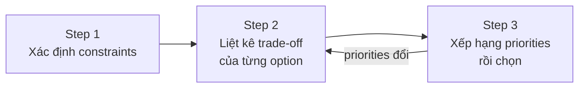
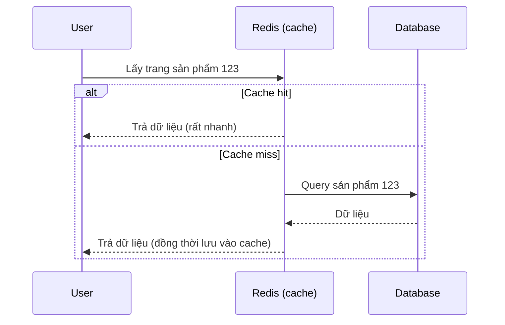
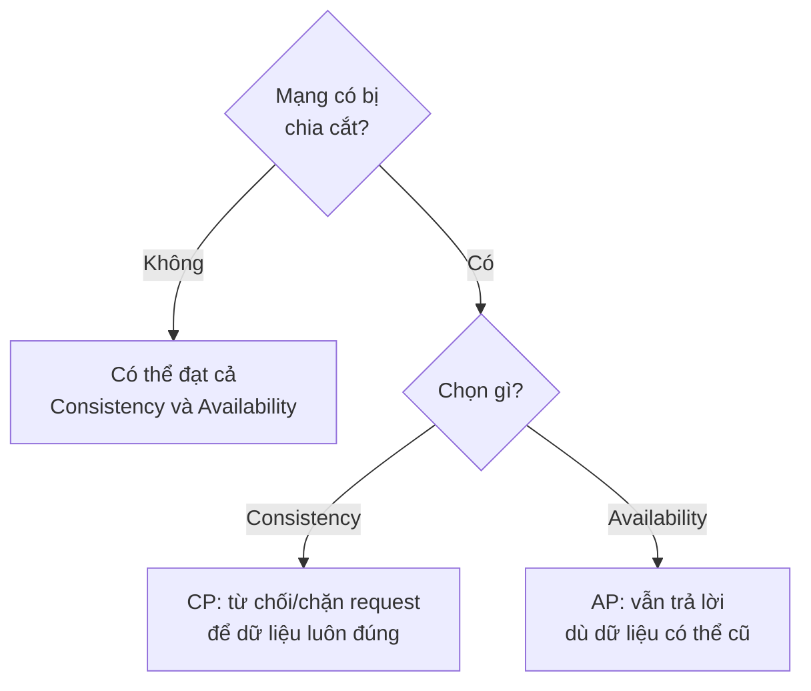
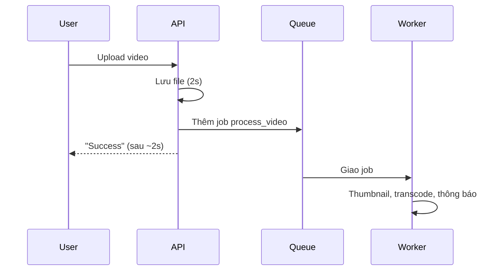
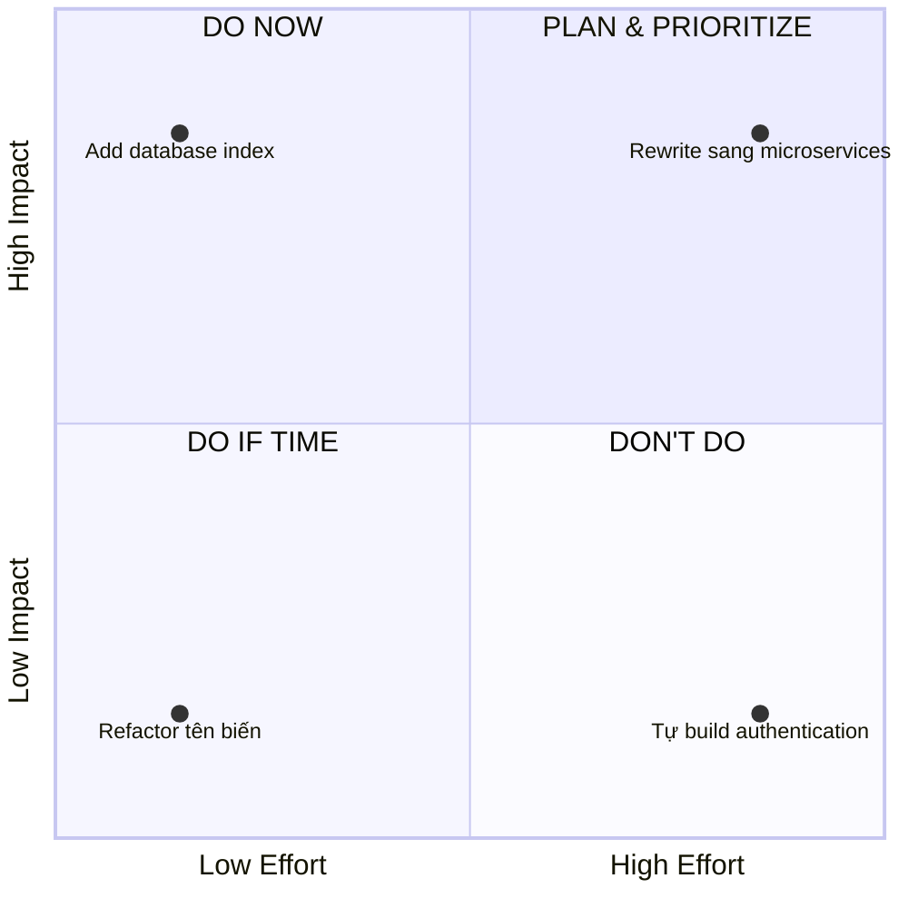

# Từ Perfect Solution đến Trade-off Thinking: Nghệ thuật của quyết định kiến trúc

Học cách đưa ra quyết định kiến trúc như một Senior Architect. Hiểu rằng không có giải pháp hoàn hảo, chỉ có giải pháp phù hợp. Làm chủ nghệ thuật cân bằng trade-off trong system design.

## Mục lục

1. [Thuật ngữ nền tảng](#thuật-ngữ-nền-tảng)
2. [Tại sao "Perfect Solution" không tồn tại?](#tại-sao-perfect-solution-không-tồn-tại)
3. [Huyền thoại "Best Practices"](#huyền-thoại-best-practices)
4. [Framework: Trade-off Matrix](#framework-trade-off-matrix)
5. [Case study: Cache hay không cache?](#case-study-cache-hay-không-cache)
6. [Các trade-off phổ biến mọi architect phải biết](#các-trade-off-phổ-biến-mọi-architect-phải-biết)
7. [Nghệ thuật "Good Enough"](#nghệ-thuật-good-enough)
8. [Mental models để ra quyết định](#mental-models-để-ra-quyết-định)
9. [Bài tập và lời giải](#bài-tập-và-lời-giải)
10. [Trích dẫn](#trích-dẫn)
11. [Mở rộng](#mở-rộng)

---

Có một câu hỏi mà mọi junior engineer đều từng hỏi tôi: _"Cách tốt nhất để thiết kế hệ thống này là gì?"_

Câu trả lời của tôi luôn làm họ thất vọng: _"Không có 'cách tốt nhất'. Chỉ có cách phù hợp nhất với constraints của bạn."_

Đó là bài học khó nhất mà mọi architect phải học: **không có giải pháp hoàn hảo**.

## Thuật ngữ nền tảng

Đọc nhanh bảng này trước để không bị vấp ở các phần sau.

| Thuật ngữ | Giải thích ngắn |
|---|---|
| **Trade-off** | Được cái này thì phải chấp nhận mất hoặc yếu đi ở cái khác. |
| **Constraint (ràng buộc)** | Giới hạn có sẵn của dự án: ngân sách, thời gian, kích thước team, quy mô người dùng, quy định pháp lý... |
| **Monolith** | Toàn bộ ứng dụng là một khối code, triển khai cùng nhau. |
| **Microservices** | Ứng dụng chia thành nhiều dịch vụ nhỏ, triển khai độc lập, giao tiếp qua mạng. |
| **ACID** | 4 tính chất của giao dịch: **A**tomicity (làm hết hoặc không làm gì), **C**onsistency (nhất quán), **I**solation (cô lập), **D**urability (đã commit thì không mất). |
| **Strong / Eventual Consistency** | Strong: ghi xong là mọi người đọc thấy ngay. Eventual: sau một khoảng ngắn mọi nơi mới thấy giá trị mới. |
| **Network partition** | Mạng giữa các node trong hệ thống phân tán bị đứt/chia cắt, các node không liên lạc được với nhau. |
| **Cache / Cache invalidation** | Cache: nơi lưu tạm kết quả để lần sau lấy nhanh. Invalidation: quyết định khi nào xóa/làm mới dữ liệu cache cho khỏi cũ. |
| **Stale data** | Dữ liệu cũ, đã lỗi thời so với dữ liệu thật trong database. |
| **Normalization (3NF) / Denormalization** | Chuẩn hóa: tách dữ liệu thành nhiều bảng để không trùng lặp (3NF là dạng chuẩn thứ 3). Phi chuẩn hóa: cố ý lặp dữ liệu để đọc nhanh hơn. |
| **JOIN** | Lệnh SQL ghép dữ liệu từ nhiều bảng. |
| **Sync / Async** | Đồng bộ: làm xong từng việc rồi mới trả kết quả. Bất đồng bộ: nhận việc, trả lời ngay, việc nặng xử lý nền sau. |
| **Queue (hàng đợi) / Worker** | Queue: nơi xếp các công việc chờ xử lý. Worker: tiến trình nền lấy việc từ queue ra làm. |
| **Stateless / Stateful** | Stateless: server không nhớ trạng thái người dùng giữa các request. Stateful: server lưu trạng thái (ví dụ session). |
| **JWT (JSON Web Token)** | Token gồm 3 phần (header, payload, chữ ký) dùng để xác thực; server kiểm tra chữ ký mà không cần tra database [[7]](#trích-dẫn). |
| **Session** | Phiên đăng nhập lưu ở server, client chỉ giữ một mã định danh (session ID), thường trong cookie. |
| **SSO (Single Sign-On)** | Đăng nhập một lần, dùng được cho nhiều ứng dụng. |
| **MVP / PMF** | MVP: sản phẩm khả thi tối thiểu. PMF (Product-Market Fit): sản phẩm đã khớp nhu cầu thị trường. |
| **ROI** | Lợi ích nhận được so với công sức/chi phí bỏ ra. |

---

## Tại sao "Perfect Solution" không tồn tại?

Khi mới bắt đầu, tôi tin rằng với đủ thời gian và kiến thức, tôi có thể tìm ra "the perfect architecture", một kiến trúc không có nhược điểm.

Sau 10 năm thiết kế hệ thống, tôi nhận ra một sự thật tàn khốc:

**Mọi quyết định kiến trúc đều là một sự đánh đổi.**

Không phải vì bạn không đủ giỏi. Mà vì trong thế giới thực, bạn luôn phải chọn giữa những thứ mâu thuẫn nhau:

- **Performance vs Consistency:** Nhanh hay chính xác?
- **Scalability vs Simplicity:** Dễ scale hay dễ maintain?
- **Flexibility vs Performance:** Linh hoạt hay tối ưu?
- **Cost vs Reliability:** Rẻ hay ổn định?

Bạn không thể có tất cả. Và đó không phải là vấn đề. Đó là thực tế.

## Huyền thoại "Best Practices"

Tôi thường thấy developer nói: _"Microservices là best practice"_ hoặc _"NoSQL tốt hơn SQL"_.

Cả hai câu đều sai vì thiếu ngữ cảnh.

Microservices là best practice cho Netflix, với hơn 300 triệu thuê bao trả phí [[2]](#trích-dẫn) và rất nhiều team kỹ sư. Nó là **worst practice** cho startup 5 người với 100 người dùng.

NoSQL phù hợp với hệ thống có khối lượng dữ liệu cực lớn và không cần quan hệ chặt chẽ giữa các bản ghi. Nó là **lựa chọn tồi** cho hệ thống ngân hàng cần giao dịch ACID.

**"Best practice" không tồn tại trong chân không. Context is everything.**

### Ví dụ thực tế: Monolith vs Microservices

Hãy phân tích trade-off của hai cách tiếp cận này.

**Monolith:**

```
Advantages:
- Simple deployment (1 app)
- Easy debugging (1 codebase)
- No network latency giữa components
- Transactions đơn giản (same database)
- Fast development initially

Disadvantages:
- Khó scale independently
- Deploy all-or-nothing
- Team conflicts trên same codebase
- Technology lock-in
- Restart toàn bộ app khi update
```

**Microservices:**

```
 Advantages:
- Scale independently
- Deploy independently
- Technology diversity
- Team autonomy
- Fault isolation

 Disadvantages:
- Network latency
- Distributed transactions nightmare
- Complex deployment
- Monitoring complexity
- Data consistency challenges
```

Giải thích nhanh hai điểm khó hiểu: _distributed transaction_ là giao dịch trải qua nhiều service/database khác nhau nên không thể dùng một transaction đơn giản của một database; còn _fault isolation_ là khi một service lỗi, các service còn lại vẫn chạy được.

Câu hỏi không phải là "cái nào tốt hơn?". Câu hỏi là:

**"Với context hiện tại của tôi, tôi cần advantages nào và có thể chấp nhận disadvantages nào?"**

## Framework: Trade-off Matrix

Đây là framework tôi dùng để đánh giá mọi quyết định kiến trúc. Gồm 3 bước.



### Step 1: Define Your Constraints

Trước khi so sánh giải pháp, hãy hiểu rõ constraints của bạn.

**Technical Constraints:**

- Current scale: 1K users hay 100M users?
- Growth rate: 2x/năm hay 10x/tháng?
- Team size: 2 dev hay 50 dev?
- Latency requirement: dưới 100ms hay dưới 1s là đủ?

**Business Constraints:**

- Budget: không giới hạn hay eo hẹp?
- Time to market: ship trong 1 tháng hay 6 tháng?
- Regulatory (quy định pháp lý): GDPR (bảo vệ dữ liệu cá nhân của EU), PCI (tiêu chuẩn bảo mật dữ liệu thẻ thanh toán)?

**Team Constraints:**

- Expertise: team biết gì?
- Learning curve: có thời gian học không?
- Operational capacity: ai vận hành, bảo trì?

### Step 2: List Trade-offs Explicitly

Với mỗi option, viết ra rõ ràng cái được (Gains) và cái mất (Costs):

```
Option A: PostgreSQL
 Gains:
- ACID guarantees
- Rich query capabilities (JOIN, aggregations)
- Mature ecosystem
- Team đã biết

 Costs:
- Vertical scaling limits
- Schema changes expensive
- Not optimal for unstructured data

Option B: MongoDB
 Gains:
- Horizontal scaling easier
- Flexible schema
- Good for rapid iteration

 Costs:
- No JOIN support (application-level)
- Eventual consistency complexity
- Team phải học mới
```

Một số mục trong khối trên cần đọc cùng ghi chú sau (khối code gốc được giữ nguyên):

> ⚠️ MongoDB có toán tử `$lookup` thực hiện left outer join sang collection khác trong cùng database; từ MongoDB 5.1 collection được join có thể được shard [[4]](#trích-dẫn). Vì vậy chính xác hơn là "JOIN hạn chế và kém tự nhiên hơn SQL".

> ⚠️ mức nhất quán của MongoDB phụ thuộc cấu hình read/write concern, không mặc định là eventual.

### Step 3: Align với Priorities

Xếp hạng priorities của dự án:

```
Priority 1: Ship fast (MVP trong 2 tháng)
Priority 2: Team productivity (ít learning curve)
Priority 3: Data integrity (financial data)

Given priorities → PostgreSQL wins
Why? Team biết, ACID critical, can scale later.
```

Nếu priorities thay đổi:

```
Priority 1: Scale to 100M users (đã có PMF)
Priority 2: Handle unstructured data (user-generated content)
Priority 3: Read performance

Given priorities → MongoDB might win
Why? Scale + flexibility outweigh JOIN limitations.
```

**Thấy chưa? Cùng 2 options, khác priorities → khác decision.**

**Minh họa bằng bảng chấm điểm (điểm là giả định để minh họa).** Chấm mỗi option từ 1 đến 5 theo từng priority, nhân với trọng số (Priority 1 = 3, Priority 2 = 2, Priority 3 = 1), rồi cộng lại, dùng bộ priorities thứ nhất:

| Priority (trọng số) | PostgreSQL | MongoDB |
|---|---|---|
| Ship fast (×3) | 4 → 12 | 4 → 12 |
| Team productivity (×2) | 5 → 10 | 2 → 4 |
| Data integrity (×1) | 5 → 5 | 3 → 3 |
| **Tổng** | **27** | **19** |

Đổi trọng số theo bộ priorities thứ hai thì kết quả có thể đảo ngược. Bảng này không thay cho tư duy, nhưng ép bạn nói rõ mình đang ưu tiên điều gì.

## Case study: Cache hay không cache?

Hãy xem một quyết định tưởng chừng đơn giản: "Có nên dùng cache không?"

Hầu hết developer nghĩ: _"Cache làm nhanh hơn → Always cache!"_

Sai rồi. Hãy phân tích trade-off.

### Scenario: E-commerce Product Page

**Without Cache:**

```
User request → Query DB → Return

 Advantages:
- Always fresh data (price, stock)
- Simple logic (no invalidation)
- No infrastructure overhead

 Disadvantages:
- DB load cao
- Slow response (DB query mỗi request)
- Hard to scale reads
```

**With Cache (Redis):**

```
User request → Check Redis → If miss: Query DB → Return

 Advantages:
- Fast response (< 10ms)
- Reduce DB load
- Easy to scale reads

 Disadvantages:
- Stale data risk (user thấy sold-out item as available)
- Cache invalidation complexity
- Infrastructure cost (Redis server)
- Memory limits
```

Luồng với cache (cache miss thì mới hỏi database):



### The Trade-off Decision

**Nếu bạn là Amazon:**

→ **Dùng cache** vì:

- Hàng triệu request/giây → DB không chịu nổi
- Chấp nhận được dữ liệu hơi cũ (số lượng tồn kho có thể sai 1-2 sản phẩm)
- Có ngân sách cho hạ tầng
- Team có chuyên môn

**Nếu bạn là startup nhỏ:**

→ **Bỏ qua cache** vì:

- 100 request/giây → DB xử lý được
- Dữ liệu mới quan trọng hơn (hàng tồn ít)
- Tiết kiệm chi phí hạ tầng
- Giữ mọi thứ đơn giản

> ⚠️ các con số "hàng triệu request/giây" và "100 request/giây" là giả định minh họa, không phải số liệu đo thực tế.

**Cùng một vấn đề, khác context, khác quyết định.**

## Các trade-off phổ biến mọi architect phải biết

### 1. Consistency vs Availability (CAP Theorem)

CAP theorem nói về ba thuộc tính của hệ thống phân tán: **C**onsistency (mọi nơi đọc thấy dữ liệu mới nhất), **A**vailability (mọi request đều nhận được phản hồi), **P**artition tolerance (chịu được mạng bị chia cắt).

Điểm cần nhớ: **khi có network partition, hệ thống buộc phải chọn giữa Consistency và Availability.** Khi mạng bình thường (không có partition), hệ thống hoàn toàn có thể đạt cả hai [[3]](#trích-dẫn).



**Chọn Consistency (CP):**

```
Banking, payments, inventory management
→ Đúng quan trọng hơn fast
→ OK với downtime nếu cần ensure correctness
```

**Chọn Availability (AP):**

```
Social media feeds, view counts, recommendations
→ Fast quan trọng hơn perfect accuracy
→ Eventual consistency acceptable
```

**Trade-off thinking** (hãy tự hỏi):

- Feature này CẦN strong consistency không? (Thường là KHÔNG)
- User có bị ảnh hưởng nếu dữ liệu sai vài giây không?
- Chi phí để đảm bảo consistency là gì?

### 2. Normalization vs Denormalization

**Normalized Database:**

```sql
-- 3 tables, proper 3NF
users: id, name
posts: id, user_id, content
likes: id, post_id, user_id

-- Query post with like count
SELECT p.*, COUNT(l.id) as likes
FROM posts p
LEFT JOIN likes l ON p.id = l.post_id
WHERE p.id = 123
GROUP BY p.id;
```

- **Được:** toàn vẹn dữ liệu, không trùng lặp.
- **Mất:** truy vấn chậm hơn (JOIN tốn tài nguyên hơn, nhất là khi bảng lớn).

**Denormalized:**

```sql
-- 1 table
posts: id, user_id, content, like_count

-- Query post with like count
SELECT * FROM posts WHERE id = 123;
```

- **Được:** đọc nhanh (không cần JOIN).
- **Mất:** nguy cơ dữ liệu lệch nhau, ghi tốn thêm việc cập nhật. Ví dụ: thêm một dòng vào `likes` nhưng quên tăng `like_count` thì số like hiển thị bị sai.

**Khi nào nên denormalize?**

- Đọc nhiều hơn ghi rất nhiều (99% đọc, 1% ghi)
- Hiệu năng là yếu tố sống còn
- Chấp nhận được lệch nhẹ

**Khi nào nên giữ normalized?**

- Ghi nhiều
- Toàn vẹn dữ liệu là bắt buộc
- Quan hệ giữa dữ liệu phức tạp

### 3. Async vs Sync Processing

**Synchronous:**

```python
def upload_video(video):
    save_to_s3(video)           # 2s
    generate_thumbnail(video)   # 3s
    transcode_720p(video)       # 30s
    send_notification()         # 1s
    return "Success"            # User waits 36s
```

- **Được:** đơn giản, người dùng nhận kết quả ngay khi xong.
- **Mất:** trải nghiệm kém (chờ 36 giây), có nguy cơ timeout.

**Asynchronous:**

```python
def upload_video(video):
    save_to_s3(video)           # 2s
    queue.add_job('process_video', video.id)
    return "Success"            # User waits 2s

# Background worker processes rest
```

- **Được:** trải nhiệm tốt hơn, chịu được lúc tải tăng đột biến.
- **Mất:** phức tạp hơn, kết quả xử lý đến muộn (eventual), xử lý lỗi khó hơn.

(`S3` ở đây là dịch vụ lưu trữ file của Amazon; có thể thay bằng bất kỳ nơi lưu file nào.)



**Trade-off decision** (hãy tự hỏi):

- User có cần kết quả ngay không?
- Tiến trình có thể lỗi rồi retry (thử lại) được không?
- Team có kinh nghiệm với mô hình async không?

## Nghệ thuật "Good Enough"

Một trong những kỹ năng quan trọng nhất của architect: **biết khi nào dừng tối ưu.**

Tôi từng thấy engineer dành 2 tuần để tối ưu một query từ 50ms xuống 20ms.

Tác động? Người dùng không thấy khác biệt. Giới hạn 0,1 giây (100ms) thường được dùng làm mốc để người dùng cảm thấy phản hồi là "tức thì" [[6]](#trích-dẫn).

Chi phí? 2 tuần dev time = các tính năng khác bị trễ.

**"Perfect is the enemy of good."**

### Quy tắc 80/20 trong kiến trúc

20% công sức thường giải quyết được 80% vấn đề. (Đây là quy tắc kinh nghiệm theo nguyên lý Pareto, không phải định luật.)

**Ví dụ: Tối ưu thời gian phản hồi của API**

```
Current: 800ms
Target: < 200ms

Option A: Add database indexes
- Effort: 2 hours
- Result: 800ms → 300ms (62% improvement)

Option B: Thêm + implement Redis caching
- Effort: 1 week
- Result: 300ms → 150ms (thêm 50% improvement)

Option C: Migrate sang Cassandra + rewrite queries
- Effort: 2 months
- Result: 150ms → 100ms (thêm 33% improvement)
```

> Các con số trong ví dụ trên mang tính minh họa. Kiểm tra phép tính: 800→300 giảm 62,5%, 300→150 giảm 50%, 150→100 giảm khoảng 33%.

**Quyết định thông minh:**

- Bắt đầu với Option A (ROI cao)
- Theo dõi (monitor)
- Làm Option B nếu 300ms vẫn chưa đủ
- Gần như không bao giờ làm Option C (lợi ích giảm dần, diminishing returns)

## Mental models để ra quyết định

### Model 1: Reversibility

**Câu hỏi:** Quyết định này có dễ thay đổi sau không?

**High reversibility** (dễ đổi):

- Chọn công cụ cache (Redis → Memcached)
- ORM library (thư viện ánh xạ code sang bảng database)
- Frontend framework

→ Đừng nghĩ quá nhiều. Chọn nhanh, lặp lại sau.

**Low reversibility** (đổi rất tốn kém):

- Chọn database (SQL → NoSQL)
- Monolith → Microservices
- Cloud provider

→ Cân nhắc kỹ. Cái giá của quyết định sai rất cao.

### Model 2: Impact vs Effort

```
High Impact, Low Effort → DO NOW
High Impact, High Effort → PLAN & PRIORITIZE
Low Impact, Low Effort → DO IF TIME
Low Impact, High Effort → DON'T DO

```



**Ví dụ:**

- Thêm database index: High impact, Low effort → DO NOW
- Viết lại sang microservices: High impact, High effort → PLAN cẩn thận
- Đổi tên biến cho gọn: Low impact, Low effort → DO if time
- Tự build hệ thống authentication: Low impact, High effort → DON'T (dùng Auth0, một dịch vụ quản lý đăng nhập có sẵn)

### Model 3: Regret Minimization

**Câu hỏi:** 6 tháng sau, quyết định nào tôi sẽ hối hận nhất?

**Scenario:** Chọn tech stack cho MVP của startup

**Decision A:** Dùng framework mới, đang "hot" (Deno, Bun...)

- Nguy cơ: ecosystem chưa trưởng thành, team phải học, rủi ro thất bại
- Khả năng hối hận: CAO (nếu fail, mất thời gian quý báu)

**Decision B:** Dùng stack "nhàm chán" nhưng đã được kiểm chứng (Node.js + Express + PostgreSQL)

- Nguy cơ: không "ngầu", có thể bỏ lỡ tính năng mới
- Khả năng hối hận: THẤP (dù chậm, vẫn chạy ổn định)

→ Với MVP của startup: **Giảm thiểu hối hận → Chọn B**

## Bài tập và lời giải

### Exercise 1: Design User Authentication

**Requirement:** Hệ thống đăng nhập cho người dùng.

Với mỗi option, hãy liệt kê **Gains** (được gì), **Costs** (mất gì) và **Best for** (phù hợp nhất với trường hợp nào). Viết ra reasoning của bạn. Không có đúng/sai, chỉ có phù hợp/không phù hợp.

#### Option A: JWT (Stateless)

**Gains:**

- **Stateless:** server không lưu trạng thái phiên đăng nhập của người dùng.
- **Tự chứa thông tin và hỗ trợ ủy quyền:** thông tin cần thiết (ID, vai trò/role...) nằm sẵn trong token và được ký số, nên server có thể tự xác thực người dùng và quyết định quyền truy cập.
- **Scalability:** vì server không lưu session, hệ thống dễ dàng mở rộng sang nhiều server mà không cần đồng bộ dữ liệu phiên đăng nhập (session replication).
- **Gọn nhẹ, dễ truyền:** token có kích thước nhỏ, có thể truyền qua URL, POST parameter hoặc HTTP Header một cách nhanh chóng.

**Costs:**

- **Lộ thông tin trong Payload:** dữ liệu trong phần Payload chỉ được mã hóa Base64 (không phải mã hóa bảo mật), nên bất kỳ ai có token cũng có thể giải mã và đọc được. Tuyệt đối không chứa dữ liệu nhạy cảm (như mật khẩu) ở đây [[1]](#trích-dẫn).
- **Giới hạn kích thước:** vì token mang cả thông tin bên trong nên thường lớn hơn một session ID, và được gửi kèm mọi request. Càng nhét nhiều claim vào, token càng nặng; nếu lưu trong cookie thì còn bị giới hạn dung lượng của cookie (trình duyệt cần hỗ trợ tối thiểu khoảng 4096 byte mỗi cookie theo RFC 6265 [[10]](#trích-dẫn)).
- **Khó thu hồi (revoke):** token đã phát hành thì hợp lệ cho đến khi hết hạn, server không thể "hủy" nó chỉ bằng cách xóa session. Muốn thu hồi sớm phải giữ danh sách đen (denylist), và khi đó hệ thống không còn hoàn toàn stateless [[1]](#trích-dẫn). Cách giảm thiểu thường dùng là đặt thời gian sống ngắn cho token [[1]](#trích-dẫn).

**Best for:**

- **Xây dựng API stateless và microservice:** máy chủ không cần lưu thông tin phiên làm việc (session state) của người dùng; mọi dữ liệu cần thiết (như ID, vai trò/role) đã nằm sẵn bên trong token và được ký số để tự xác thực. Bất kỳ server nào trong hệ thống phân tán (load balancing hoặc nhiều microservice) đều có thể tự kiểm tra token mà không cần tra cứu database hay session chung.
- **Trao đổi an toàn giữa các hệ thống (Server-to-Server):** nhờ phần chữ ký số (signature), các bên có thể tin tưởng rằng dữ liệu JSON không bị giả mạo hay chỉnh sửa trên đường truyền.
- **Single Sign-On (SSO):** giúp người dùng đăng nhập một lần ở một tên miền (domain) chính và có thể truy cập qua nhiều tên miền hoặc ứng dụng con khác nhau một cách dễ dàng.
- **Đăng nhập bên thứ ba (Third-party / Federated Login):** các giao thức chuẩn như OpenID Connect sử dụng JWT làm ID Token (ví dụ: tính năng "Đăng nhập bằng Google", Facebook).

#### Option B: Session (Stateful)

**Gains:**

- **Bảo mật cao hơn ở phía client:** toàn bộ dữ liệu nhạy cảm (như thông tin tài khoản, quyền hạn) được lưu trên server, phía client chỉ giữ một session ID nên không thể đọc hay sửa trực tiếp dữ liệu phiên.
- **Dung lượng lớn:** khác với Cookie (tối đa khoảng 4KB mỗi cookie), Session có thể lưu lượng dữ liệu lớn và phức tạp, chỉ bị giới hạn bởi bộ nhớ hoặc database của máy chủ.
- **Dễ quản lý và kiểm soát:** máy chủ có thể chủ động hủy, vô hiệu hóa hoặc cấu hình thời gian sống của session bất cứ lúc nào (ví dụ: tự động đăng xuất sau 30 phút không hoạt động).
- **Duy trì trạng thái tốt:** giúp website "nhớ" trạng thái của người dùng qua các trang khác nhau như trạng thái đăng nhập, giỏ hàng, hoặc các bước đặt hàng.

**Costs:**

- **Tốn tài nguyên máy chủ:** vì toàn bộ dữ liệu phiên được lưu ở phía server, khi có hàng nghìn hoặc hàng triệu người dùng truy cập cùng lúc, máy chủ sẽ tốn nhiều bộ nhớ (RAM) hoặc quá tải database.
- **Khó mở rộng (scale):** khi ứng dụng chạy trên nhiều server (Load Balancing / Cluster), nếu không dùng một hệ thống lưu trữ session tập trung (như Redis, Memcached), server A sẽ không đọc được session do server B tạo ra.
- **Phụ thuộc vào Cookie hoặc URL:** trình duyệt phía người dùng phải hỗ trợ và chấp nhận lưu session ID (thường thông qua cookie). Nếu người dùng tắt cookie hoặc trình duyệt chặn, session có thể không hoạt động bình thường.
- **Dễ mất dữ liệu khi đóng trình duyệt hoặc hết hạn:** mặc định session thường kết thúc khi người dùng đóng trình duyệt hoặc hết thời gian timeout, không phù hợp để lưu thông tin cần ghi nhớ lâu dài (như "Nhớ tài khoản của tôi trong 30 ngày").

**Best for:**

- **Xác thực và quản lý đăng nhập (Authentication):** lưu trạng thái đăng nhập của người dùng (như tài khoản, quyền hạn) sau khi họ nhập đúng mật khẩu, giúp họ không phải đăng nhập lại mỗi khi chuyển trang.
- **Quản lý giỏ hàng (Shopping Cart):** lưu danh sách sản phẩm khách đã chọn trong quá trình mua sắm trước khi bấm thanh toán.
- **Lưu trữ dữ liệu nhạy cảm hoặc cần bảo mật:** các thông tin quan trọng (như mã token, thông tin cá nhân, cấu hình tài khoản) không muốn lưu ở trình duyệt (client) vì dễ bị xem trộm hoặc chỉnh sửa.
- **Lưu tạm thông tin qua nhiều bước (Multi-step forms):** ví dụ khi điền form đăng ký nhiều bước hoặc thanh toán gồm nhiều giai đoạn, session giúp giữ lại dữ liệu ở các bước trước đó.

**Tóm tắt so sánh:**

| Tiêu chí | JWT (Stateless) | Session (Stateful) |
|---|---|---|
| Server lưu trạng thái? | Không | Có |
| Mở rộng nhiều server | Dễ | Cần kho session dùng chung (Redis...) |
| Thu hồi quyền đăng nhập | Khó (chờ hết hạn hoặc dùng denylist) | Dễ (xóa session) |
| Kích thước mỗi request | Lớn hơn (token mang thông tin) | Nhỏ (chỉ session ID) |
| Hợp với | API, microservice, SSO | Web truyền thống, giỏ hàng, form nhiều bước |

### Exercise 2: Real-World Scenario

**Context:**

- Startup, 5 engineers
- Hiện tại: 10K users
- Dự kiến: 100K users trong 6 tháng
- Feature: Real-time chat

**Options:**

1. Tự xây WebSocket server (WebSocket: kết nối hai chiều liên tục giữa trình duyệt và server, dùng cho chat thời gian thực)
2. Dùng Firebase Realtime Database
3. Dùng dịch vụ bên thứ ba như Twilio/Stream Chat

**Nhiệm vụ của bạn:**

1. Liệt kê trade-off của mỗi option
2. Xếp hạng priorities (time, cost, scalability, control)
3. Đưa ra quyết định kèm reasoning

Bạn có thể dùng khung trống sau để trả lời:

| Tiêu chí | Tự xây WebSocket | Firebase Realtime DB | Twilio / Stream Chat |
|---|---|---|---|
| Time to market | ? | ? | ? |
| Cost | ? | ? | ? |
| Scalability | ? | ? | ? |
| Control | ? | ? | ? |
| Team expertise | ? | ? | ? |

Không có "đáp án đúng". Hãy luyện tư duy trade-off.

---

## Trích dẫn

Nguồn gốc của bài viết:

- System Design Core, _Lesson 2: Perfect Solution to Trade-off Thinking_ — https://www.systemdesigncore.site/phase/phase-0/lesson/lesson-2-perfect-solution-to-trade-off-thinking

Nguồn bổ sung cho phần chỉnh sửa/bổ sung kiến thức:

1. OWASP, _JSON Web Token Cheat Sheet_ (payload chỉ base64url, không mã hóa; thu hồi token; thời gian sống ngắn) — https://cheatsheetseries.owasp.org/cheatsheets/JSON_Web_Token_Cheat_Sheet.html
2. Axios, _Netflix says it now has 325 million paid subscribers_ (20/01/2026) — https://www.axios.com/2026/01/20/netflix-stock-nflx-subscribers-warner-bros
3. Martin Kleppmann, _A Critique of the CAP Theorem_ (khi có partition phải chọn giữa C và A; hạn chế của cách nói "chọn 2 trong 3") — https://ar5iv.arxiv.org/html/1509.05393
4. MongoDB Documentation, _$lookup (aggregation)_ — https://www.mongodb.com/docs/current/reference/operator/aggregation/lookup/
5. Bronson et al., _TAO: Facebook's Distributed Data Store for the Social Graph_, USENIX ATC 2013 (TAO dùng MySQL để lưu trữ bền vững) — https://usenix.org/system/files/conference/atc13/atc13-bronson.pdf
6. Nielsen Norman Group, _The 3 Response Time Limits in Interaction Design_ (các mốc 0,1s; 1s; 10s) — https://www.nngroup.com/videos/3-response-time-limits-interaction-design/
7. IETF, _RFC 7519: JSON Web Token (JWT)_ — https://www.rfc-editor.org/rfc/rfc7519
8. Bytebase, _The Evolution of PostgreSQL Schema Migrations_ (PostgreSQL 11: fast default) — https://www.bytebase.com/blog/postgres-schema-migration-evolution.md
9. Brandur Leach, _A Missing Link in Postgres 11: Fast Column Creation with Defaults_ — https://brandur.org/postgres-default
10. IETF, _RFC 6265: HTTP State Management Mechanism_ (mục 6.1: giới hạn tối thiểu của cookie) — https://www.rfc-editor.org/rfc/rfc6265

---

### Mở rộng

- **CAP theorem nâng cao và PACELC:** vì sao ngay cả khi không có partition vẫn phải đánh đổi giữa độ trễ và nhất quán.
- **Mô hình nhất quán (consistency models):** linearizability, causal consistency, read-your-writes.
- **Saga pattern và distributed transaction:** cách xử lý giao dịch xuyên nhiều microservice.
- **Cache patterns:** cache-aside, write-through, write-behind; chiến lược cache invalidation và cache stampede.
- **Thiết kế index và đọc kế hoạch truy vấn (`EXPLAIN`)** để tối ưu query trước khi nghĩ đến cache.
- **JWT nâng cao:** access token/refresh token, JWE (mã hóa token), xoay vòng khóa ký, OAuth 2.0 và OpenID Connect.
- **Quản lý session an toàn:** cookie `HttpOnly`/`Secure`/`SameSite`, chống session hijacking và CSRF (xem OWASP Session Management Cheat Sheet).
- **Message queue và event-driven architecture:** RabbitMQ, Kafka, SQS; đảm bảo giao hàng và idempotency khi xử lý bất đồng bộ.
- **Quyết định "one-way door" và "two-way door":** phân loại quyết định theo khả năng đảo ngược.
- **Architecture Decision Records (ADR):** cách ghi lại quyết định kiến trúc cùng trade-off để team sau này hiểu vì sao.
- **Monolith, Modular Monolith và Microservices:** khi nào nên tách dịch vụ.
- **Build vs Buy:** cân nhắc tự xây hay dùng dịch vụ có sẵn (Auth0, Firebase, Stream Chat...).
